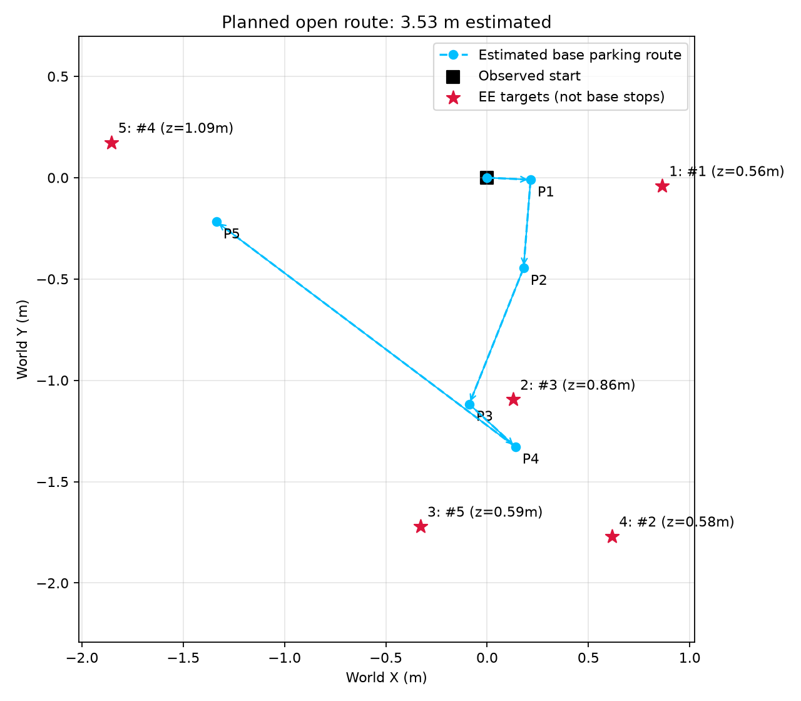

# Robotnik 多目标巡检

**COMP0245 Machine Learning for Robotics · 2026-11-05 · 分支 `feature/multi-target-patrol-120`**

在恢复120版机械臂模型和原导航模型上，增加连续多目标访问、随机目标参数、相对停车点计算、访问顺序优化及预定路线显示。一次任务中机器人保持真实状态，从一个目标继续到下一个，不重置底盘或关节。

本版沿用已训练模型，没有新增训练。任务是**末端到达并保持**；没有实现实体抓取或避障，随机目标仍可能失败。

## 先看这里

- **[完整使用说明](patrol/README.md)**：环境、运行命令、所有参数、模型、任务切换和显示方式。
- **[已有巡检运行与失败案例](patrol/results/README.md)**：成功、超时和未执行点分别记录。
- **[当前模型包](artifacts/patrol120/README.md)**：120机械臂、导航权重、原归一化及带噪配置，按字节校验。
- **[此前全部研究尝试](RESEARCH_ARCHIVE.md)**：GRU、辅助监督、恢复数据、残差、RL及Transformer等正负结果。
- **[原baseline使用说明](docs/BASELINE_RELEASE_20261103.md)**：保留原发布版流程，不被本应用覆盖。

## 已有环境直接运行

在仓库根目录，使用自己已有的RoboEnv环境：

```powershell
pixi run --manifest-path "F:\UCL\COMP0245 Labs\RoboEnv\pixi.toml" -e ml python patrol/test_patrol_120.py --roboenv-root "F:\UCL\COMP0245 Labs\RoboEnv" --num-targets 5 --radius-range 0.8 2 --height-range 0.5 1.3
```

换成自己的环境路径。新电脑的安装步骤见[完整说明](patrol/README.md#新电脑准备)。巡检直接使用仓库里的独立模型和配置快照，不要求重建全部训练数据或历史父模型目录。

| 常用参数 | 默认 | 用途 |
|---|---|---|
| `--num-targets` | `3` | 随机目标数量 |
| `--radius-range` | `0.8 2` | 初始水平距离范围，米 |
| `--height-range` | `0.5 1.3` | 高度范围，米 |
| `--target-seed` | 每次随机 | 固定同一组随机目标 |
| `--target X Y Z` | 无 | 重复指定明确目标 |
| `--route-order` | `shortest` | `given`按输入顺序访问 |
| `--no-show-planned-route` | 默认显示 | 隐藏窗口内路线 |



青色箭头表示预计底盘停车路线，目标旁标注访问顺序；橙色表示当前阶段重新计算的停车段。上图是排序器示意，不是新仿真成绩。模型没有被强制沿折线运动。

## 这一版解决了什么

原单目标停车方向默认参考世界原点，直接用于连续任务时不合适。本版在每段开始时根据“当前底盘→新目标”的相对方向计算停车点，并在该段固定。修正后已有固定三点及随机多点连续完成记录。

应用先比较预计底盘停车路程，再执行所选顺序。8个及以内目标精确搜索；更多目标近似排序。这里优化的是**预计水平距离**，不保证实际最短路线，也没有考虑避障、转向时间或机械臂时间。

默认以**观测误差小于5cm并连续保持1秒**切换目标，真实末端位置独立评分。每点20秒，超时默认结束；有些点进入5cm后又离开，会记作未保持成功。两个模型每步都生成动作；不加入专家机械臂、IK或额外机械臂PD。

底盘网络使用相对导航特征；机械臂26维输入仍保留世界底盘位置和绝对朝向，因此不能把整个系统称为完全坐标不变。

## 效果与边界

已记录随机五点完整完成的例子，也保留了另一次计划5点、尝试3点、保持通过2点的失败：第三点导航完成并进入5cm，但末端随后下沉，未连续保持1秒。

这些是开发演示记录，没有预先定义的独立多目标测试集，**不汇总成总体成功率**。原单目标1cm基准与本巡检5cm保持标准不同，不能相互替代。

发布前33项算法/参数/显示接口检查通过；模型与统计原字节校验通过；可移植加载入口与原模型类的前向输出逐元素一致。本次发布没有代替用户启动仿真、采集或训练。

```powershell
python -m unittest discover -s patrol -p "check_patrol_*.py"
python patrol/verify_bundle.py --model-check
```

来源、文献与历史实验仍保留在[研究归档](RESEARCH_ARCHIVE.md)、[方法来源](research/docs/文献与方法来源.md)和[第三方说明](docs/THIRD_PARTY.md)。没有为上游代码或组员发布包擅自新增许可证。
