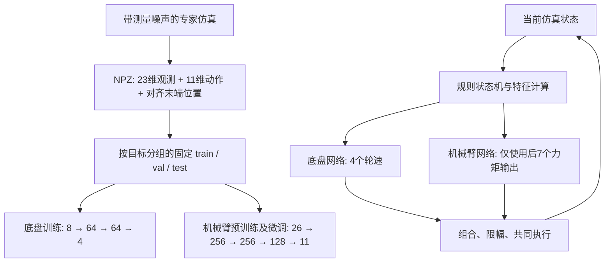

# Robotnik：分离式底盘导航与机械臂行为克隆

**COMP0245 Machine Learning for Robotics · 当前实验版本：2026-11-03**

Mobile manipulator behaviour cloning with separate navigation and arm MLPs, noisy expert demonstrations, frozen data splits, portable checkpoints and closed-loop evaluation.

使用传统专家控制器采集带测量噪声的移动机械臂轨迹，再离线训练两个 MLP：底盘网络预测四轮角速度，机械臂网络预测七个关节力矩。运行时两个网络每一步都计算，规则状态机提供导航阶段信息，最终组合成 11 维动作。

本仓库整理当前展示版的**采集 → 划分 → 训练 → 单点测试 → 批量验证 → 随机目标演示**流程，附四个有关联的模型快照、固定划分清单、训练曲线原始数据和验证结果。

> 当前任务是**末端位置到达**，目标球只是视觉标记，夹爪保持固定姿态，没有实现实体物体抓取。模型不能保证所有位置成功；连续高度插值、低高度和训练范围外目标仍可能失败。

## 当前方法



- 阶段为 `align → drive → orient → done`；规则负责阶段和停车几何，实际轮速与关节力矩来自网络。
- 两个模型**不是先后启停**；导航期间机械臂也持续输出力矩。
- 输入没有历史窗口，没有 Transformer、RNN 或在线强化学习。
- 训练是离线动作监督学习；闭环到达成功率需要单独仿真评估。

## 已记录的验证结果

统一条件：单目标最长 **20 秒**，测量噪声关闭，任意时刻末端欧氏误差 **< 0.01 m** 即成功；没有 8 秒最短时间或测试保持 1 秒要求。

| 组合 | 验证目标 | 成功 | 成功率 |
|---|---:|---:|---:|
| 新底盘 + 原机械臂 | 原验证子集 116 | 94 | 81.03% |
| 新底盘 + 第一次机械臂微调，`previous` | 相同 116 | 98 | 84.48% |
| 新底盘 + 补采后机械臂，`supplement`，演示默认 | 合并验证集 144 | 111 | 77.08% |
| 同一个 `supplement` 模型 | 其中原 116 | 97 | 83.62% |
| 同一个 `supplement` 模型 | 新增连续低高度 28 | 14 | 50.00% |

**116 与 144 的成绩不能直接当作同一集合的前后变化。**这些是开发中使用的验证集成绩，不是当前组合在独立 156 点测试集上的成绩。之前模型在固定高层的高成功率，也不能解释成随机连续高度成功率。

结果证据在 [`results/`](../results/)，详细解释见 [RESULTS.md](RESULTS.md)。

## 仓库内容

```text
robotnik-split-bc/
├── README.md
├── docs/                         # 数据结构、完整流程、文件索引、结果和来源
├── LAB_SESSION_COMP_0245_2026_PUBLIC/
│   └── final/robotnik_arm_task/   # 原实验脚本的精选副本，保留原目录层级
├── artifacts/
│   ├── provenance.json           # 源代码哈希、依赖版本、样本来源
│   └── RoboEnv/                  # 可迁移模型快照、固定清单和采集计划
├── environment/                  # 本次环境的 pixi.toml + pixi.lock
├── examples/expert_sample.npz    # 仅一个训练轨迹样本，不来自验证/测试集
├── results/                      # 三次正式验证的 summary.json / results.csv
└── tools/                        # 准备工作目录、校验、数据导出、划分重建
```

运行时会新建 Git 忽略的 `RoboEnv/` 工作目录。保留较长目录层级是为了不改变原脚本的路径计算方式；模型与特征计算代码保持原样，原实验文件没有被覆盖。

### Git 中包含什么？

- **包含**：当前模型、父模型、归一化统计、配置、完整目标分组清单、训练 history、正式验证结果、一个训练样本。
- **不包含**：全部原始 NPZ（约 2.75 GB，完整来源为 931 + 200 条）、`.pixi` 环境、仿真依赖的 Git 工作区、机器人网格资产、私人 Word 实验记录。
- 演示与模型加载**不需要完整数据集**；重新训练或重跑专家动作离线误差需要另行取得数据，或重新采集。仓库没有声称提供尚未上传的下载链接。

## 安装与准备

建议使用 Pixi。以下命令在**本仓库根目录**执行；本机已有环境时可直接使用现有的 `pixi run -e ml python`。

### 新电脑

```powershell
git clone https://github.com/Waller-Shaun/robotnik-split-bc.git
cd robotnik-split-bc

git clone --recurse-submodules https://github.com/VModugno/RoboEnv.git RoboEnv
git -C RoboEnv checkout 7bb49439677c2ac111347b40e997025ce87bff50
git -C RoboEnv submodule update --init --recursive

# 使用本次实验记录的环境定义；只在这个新建的 RoboEnv 副本中操作
Copy-Item environment/pixi.toml RoboEnv/pixi.toml
Copy-Item environment/pixi.lock RoboEnv/pixi.lock
pixi install --manifest-path RoboEnv/pixi.toml -e ml
pixi run --manifest-path RoboEnv/pixi.toml -e ml python tools/prepare_workspace.py
pixi run --manifest-path RoboEnv/pixi.toml -e ml python tools/verify_release.py --runtime
```

### 已有可用 RoboEnv 环境（本项目作者的使用方式）

在现有环境的 Pixi shell 中进入本仓库根目录，执行：

```powershell
python tools/prepare_workspace.py --source-roboenv "F:\UCL\COMP0245 Labs\RoboEnv"
python tools/verify_release.py --runtime
```

这只复用已有环境中的机器人资产，在**本仓库内部**生成运行副本，不修改原来的 RoboEnv 或实验结果。准备过程会按依赖顺序迁移路径、更新文件指纹；网络张量和归一化数值不变。已经准备过的目录会拒绝覆盖。

下文用 `python` 表示已激活正确环境；也可以替换为：

```powershell
pixi run --manifest-path RoboEnv/pixi.toml -e ml python ...
```

测试过的环境为 Windows、Python 3.14、PyTorch CUDA 12.8 构建。是否使用 GPU 取决于实际安装和驱动；CPU 可用于推理。`environment/` 是本次本机快照，不意味着我们已经在所有平台重新验证过。

## 直接演示

```powershell
# 推荐的展示条件：整圈随机 XY，水平半径 0.8～2 m，随机选已有高层
python LAB_SESSION_COMP_0245_2026_PUBLIC/final/robotnik_arm_task/demo_robotnik_bc.py --height-mode trained

# 明确指定一个世界坐标目标；手动坐标优先于随机范围
python LAB_SESSION_COMP_0245_2026_PUBLIC/final/robotnik_arm_task/demo_robotnik_bc.py --target -1.5827733453143615 -0.04169457644129078 0.75 --seed 3543482326

# 随机生成训练半径外的目标：默认水平半径 2.05～3 m
python LAB_SESSION_COMP_0245_2026_PUBLIC/final/robotnik_arm_task/demo_robotnik_bc.py --distance outside --height-mode trained

# 连续高度；这也是脚本原始默认行为，层间插值可能失败
python LAB_SESSION_COMP_0245_2026_PUBLIC/final/robotnik_arm_task/demo_robotnik_bc.py --height-mode continuous

# 查看计划，不启动仿真
python LAB_SESSION_COMP_0245_2026_PUBLIC/final/robotnik_arm_task/demo_robotnik_bc.py --height-mode trained --dry-run
```

`trained` 的高度为 **0.5、0.75、1.0、1.15、1.3 m**；它只限定采样高度，不会筛选成功点，也不保证成功。`--seed` 可以复现目标；省略时每次生成新随机目标。`--model previous` 可切回第一次微调版本，默认是 `supplement`。

GUI 结束后暂停推进仿真并保留画面，终端按 Enter 关闭和保存；这不代表模型已经学会长时间保持。结果保存在 `RoboEnv/demo_runs/`。`--plot` 显示误差图，`--headless` 无窗口运行。

## 单点测试与完整批量测试

```powershell
python LAB_SESSION_COMP_0245_2026_PUBLIC/final/robotnik_arm_task/test_bc_split_nav_arm_lowz_supplement.py --target -1.5827733453143615 -0.04169457644129078 0.75 --duration 20 --sensor-noise off

# 完整合并验证集 144 点
python LAB_SESSION_COMP_0245_2026_PUBLIC/final/robotnik_arm_task/batch_test_bc_split_nav_arm_lowz_supplement.py --split val

# 同一模型只查看旧 116 点，便于对照
python LAB_SESSION_COMP_0245_2026_PUBLIC/final/robotnik_arm_task/batch_test_bc_split_nav_arm_lowz_supplement.py --split val --subset base

# 独立测试集 156 点；不要把它当作反复调参的验证集
python LAB_SESSION_COMP_0245_2026_PUBLIC/final/robotnik_arm_task/batch_test_bc_split_nav_arm_lowz_supplement.py --split test
```

批量程序从清单读取**目标坐标**，重新闭环运行模型，不回放专家动作，也不需要读取完整 NPZ 轨迹。`summary.json`、`results.csv` 和逐回合结果在模型运行目录的 `batch_tests/` 中。进程错误也计入计划目标分母；`--limit` 仅是子集检查，不能报告成完整集合成绩。

## 数据、划分和训练

完整步骤和可执行命令见 **[PIPELINE.md](PIPELINE.md)**；字段顺序见 **[DATASET.md](DATASET.md)**；脚本职责见 **[FILES.md](FILES.md)**。

目前固定清单：

| 用途 | 总轨迹 | train | val | test |
|---|---:|---:|---:|---:|
| 原完整环状预训练 | 931 | 651 | 140 | 140 |
| 半径 ≥ 0.8 m 的底盘/首次机械臂微调 | 798 | 558 | 116 | 124 |
| 原 798 + 连续低高度补采 200，当前机械臂 | 998 | 698 | 144 | 156 |

原 931 中较近的 133 条没有删除，只从当前 798/998 任务清单排除；机械臂预训练历史仍用过其中属于训练集的近距离目标。新增 200 条按 50 个 XY 组分配，同组四个高度全部属于同一个集合。原 798 的划分按原目标归属保留，没有追溯改成 XY 分组。

如要给组员发送现有原始数据，在**作者原机器**运行：

```powershell
python tools/export_dataset.py --source-roboenv "F:\UCL\COMP0245 Labs\RoboEnv" --output-dir "dataset_exports/current998"

# 从最初机械臂预训练开始复现时，还需要那 133 条近距离轨迹
python tools/export_dataset.py --source-roboenv "F:\UCL\COMP0245 Labs\RoboEnv" --output-dir "dataset_exports/full1131" --include-pretraining-near
```

每个 ZIP 约不超过 400 MiB，附 SHA-256 索引。接收方先准备运行目录，再把 ZIP 全部解压到仓库根目录，保留 `RoboEnv/expert_data_.../文件名.npz` 路径。不要只按文件名排序重新划分，也不要把整条轨迹打散到不同集合。

## 来源和使用范围

基于 [COMP0245 课程实验仓库](https://github.com/VModugno/LAB_SESSION_COMP_0245_2026_PUBLIC)、[RoboEnv](https://github.com/VModugno/RoboEnv) 和 [simulation_and_control](https://github.com/VModugno/simulation_and_control)。专家控制器、机器人模型和仿真框架的来源与本组修改范围见 [THIRD_PARTY.md](THIRD_PARTY.md)。本仓库没有替第三方材料授予新的开源许可。

当前结果反映固定初始位姿、无障碍仿真中的目标分布，不构成任意初始朝向、任意距离或实体机器人的可靠性保证。
