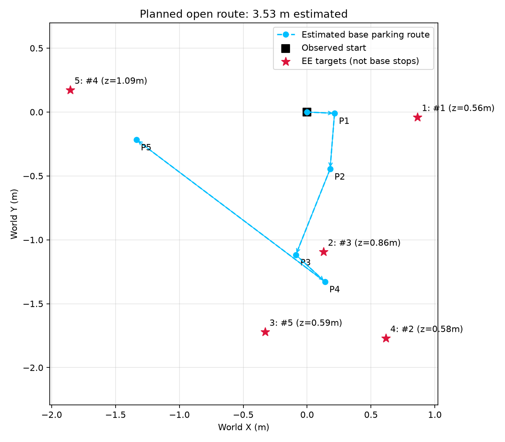

# 多目标巡检：冻结120模型＋相对停车＋路线排序

这一版让同一台机器人连续访问多个目标。完成一个后，从真实结束状态继续执行下一个，不把车或机械臂重置回初始位置。

默认随机3点，目标覆盖初始位置周围全方向，水平半径0.8～2m，高度连续采样0.5～1.3m。可调整数量、范围、间距，也可明确给出目标。应用先选择访问顺序，再由原来的两个学习模型生成4个轮速和7个机械臂力矩。

任务是**末端位置到达并保持**，不是实体抓取。当前模型仍会失败，不保证随机目标全部成功。

## 使用当前已有环境

先切换到仓库根目录，并使用已有的RoboEnv Pixi环境。以下命令中的环境路径换成自己的：

```powershell
pixi run --manifest-path "F:\UCL\COMP0245 Labs\RoboEnv\pixi.toml" -e ml python patrol/test_patrol_120.py --roboenv-root "F:\UCL\COMP0245 Labs\RoboEnv" --num-targets 5
```

如果已经激活了对应Pixi shell：

```powershell
python patrol/test_patrol_120.py --roboenv-root "F:\UCL\COMP0245 Labs\RoboEnv" --num-targets 5
```

`--roboenv-root`只指定机器人URDF/网格等资源和结果保存根目录。默认仿真配置是仓库内`artifacts/patrol120/configs/robotnik_arm.json`，是本次带0.001观测噪声配置的原字节快照；不覆盖已有RoboEnv配置。需要使用自己的配置时，明确传入`--robot-config PATH`。

## 新电脑准备

先获取此功能分支：

```powershell
git clone --branch feature/multi-target-patrol-120 https://github.com/Waller-Shaun/robotnik-split-bc.git
cd robotnik-split-bc
```

然后在本仓库根目录执行：

```powershell
git clone --recurse-submodules https://github.com/VModugno/RoboEnv.git RoboEnv
git -C RoboEnv checkout 7bb49439677c2ac111347b40e997025ce87bff50
git -C RoboEnv submodule update --init --recursive
Copy-Item environment/pixi.toml RoboEnv/pixi.toml
Copy-Item environment/pixi.lock RoboEnv/pixi.lock
pixi install --manifest-path RoboEnv/pixi.toml -e ml
pixi run --manifest-path RoboEnv/pixi.toml -e ml python patrol/test_patrol_120.py --num-targets 5
```

巡检入口直接加载独立的原字节模型包，不需要执行旧baseline的`tools/prepare_workspace.py`，不需要完整训练数据或历史父模型目录。当前发布只检查了模型兼容、语法和算法，没有在新电脑上重新仿真或重新验证所有平台。

## 参数与例子

| 参数 | 默认 | 用途 |
|---|---|---|
| `--num-targets N` | `3` | 随机目标数量，至少1个 |
| `--radius-range MIN MAX` | `0.8 2` | 初始水平半径，单位m；可扩大探索 |
| `--height-range MIN MAX` | `0.5 1.3` | 高度，限制在0.5～1.3m；上下界相同可固定高度 |
| `--min-target-spacing M` | `0.4` | 最小水平间距，单位m |
| `--target-seed N` | 每次新生成 | 固定目标采样种子；终端和结果记录实际种子 |
| `--target X Y Z` | 无 | 可重复传入；明确坐标优先于随机生成参数 |
| `--route-order shortest/given` | `shortest` | 自动排序，或按输入顺序 |
| `--no-show-planned-route` | 默认显示 | 隐藏GUI中的路线覆盖层 |
| `--headless` | 关闭 | 不打开仿真窗口，仍保存路线图 |
| `--duration-per-target S` | `20` | 每个目标最大仿真时间 |
| `--reach-tolerance M` | `0.05` | 应用到达及保持误差阈值 |
| `--hold-seconds S` | `1` | 连续保持时间 |
| `--continue-after-timeout` | 关闭 | 超时后仍尝试下一点，保留真实状态，仅作补充诊断 |
| `--sensor-noise config/off` | `config` | 沿用配置噪声，或仅在内存关闭 |
| `--seed N` | `42` | 仿真噪声种子，独立于目标采样 |
| `--roboenv-root PATH` | 仓库内`RoboEnv` | 资源及输出根目录 |
| `--robot-config PATH` | 仓库内带噪配置 | 不覆盖环境原配置 |

固定高度和随机五点：

```powershell
python patrol/test_patrol_120.py --num-targets 5 --height-range 0.75 0.75 --target-seed 73
```

指定目标并自动排序：

```powershell
python patrol/test_patrol_120.py --target 0.8 1.2 1 --target 0 1.2 1 --target 0.4 1.2 1
```

给这些命令加自己的`--roboenv-root`即可复用外部环境。半径超出0.8～2m时会记录对应编号，不能据此保证泛化；3点及以上会拒绝过近或整体近似共线的点集。目标种子相同但数量/范围变化时，坐标也会变化。

## 预定路线显示



上图是排序器生成的五点示意，不是新的仿真成绩。

- 青色箭头：预计底盘停车路线，`P1/P2/...`是预计停车点。
- 目标上方标签：访问次序与原输入编号。
- 橙色当前段：该阶段根据实际观测重新算出的停车段，可能与初始预测不同。

绘图只使用PyBullet调试线和文字，不创建碰撞物体或控制指令。模型不是被强制沿折线运动；折线也不是机械臂末端轨迹。

## 停车点与路线排序

原单目标逻辑以世界原点计算停车方向，直接用于连续目标会选错几何关系。本版在每段首帧计算：

```text
direction = normalize(target_xy - observed_current_base_xy)
parking_xy = target_xy - standoff(target_height) * direction
final_heading = atan2(direction_y, direction_x)
```

停车点在该段内固定，下段开始时重新计算。整体水平平移或旋转会使停车点相应变换；不会一直以世界原点为停车参考。

排序从当前观测位置出发，递推预计停车点，最小化预计水平行驶距离，不返回起点。8点及以内分支限界穷举；更多点用贪心和开放路线2-opt近似。因为停车点依赖访问顺序，每个候选都重新计算完整停车几何，不能只用固定目标间距离。

**这是估计成本下的排序，不保证闭环实际路线最短。** 未考虑转向时间、机械臂运动时间或障碍物。执行下一段时使用实际观测起点；不会为了吻合路线而瞬移机器人。

## 模型与评分边界

| 部分 | 当前版本 |
|---|---|
| 底盘 | 冻结8→64→64→4 MLP；相对停车点XY、两个角误差、4阶段one-hot |
| 机械臂 | 冻结恢复120版，最佳138轮；26→256→256→128→11，仅使用后7个力矩输出 |
| 机械臂输入 | 仍保留底盘世界XYZ和绝对朝向；目标与末端误差为yaw对齐相对量，不能说全系统已完全坐标不变 |
| 阶段规则 | 提供align/drive/orient/done，不直接替换学习轮速 |
| 执行 | 每步两个网络都计算；无专家机械臂、IK或新增机械臂PD；手指沿用原固定姿态 |
| 应用标准 | 观测误差<5cm且连续1秒才切换；真实末端位置独立评分，不用于控制或切换 |

首次进入5cm但未保持1秒，可以出现`first reached`增加而`true held`不增加。默认某点超时就结束，因此`true held=2/5`可能表示只尝试3点，后2点未执行。查看`attempted_targets`和`unattempted_targets`，不要把未执行算成已验证失败。

模型原单目标1cm基准保留在研究归档中；巡检5cm保持结果不能拿来替代原成绩。这里也没有新增训练、避障或实体抓取。

## 已记录的应用运行

结果来自作者已有运行，发布过程没有替作者启动新的仿真。详见[记录说明](results/README.md)及[完整索引](results/index.json)。

| 运行 | 计划/尝试 | 真实保持通过 | 说明 |
|---|---:|---:|---|
| `115645_136423` | 3/3 | 3 | 修正相对停车后，固定三点连续完成 |
| `122839_050084` | 5/5 | 5 | 随机五点；目标种子1266108476 |
| `123130_010104` | 5/3 | 2 | 第3点进入5cm后未保持；后2点未执行，种子3440080612 |
| `123548_502306` | 4/4 | 4 | 随机四点；目标种子327383641 |
| `125621_640484` | 4/4 | 4 | 半径上限2.5m的单次探索；不能据此声称训练范围外普遍成功 |

这些是开发演示记录，目标集合、协议版本和条件不同，没有预先定义的独立多目标测试集；不把它们拼成总体成功率。失败案例保留在[第三点诊断图](assets/visit3_failure_diagnosis.png)：导航完成后末端进入5cm，但Z误差随后增加。

## 输出与检查

输出到`--roboenv-root`下的`patrol_validation_120/patrol_时间戳/`：

- `route_plan.json/png`：输入目标、访问顺序、预计停车点、成本与路线图。
- `config.json`、`summary.json`：实际模型/配置/代码哈希、采样参数、切换与真实评分结果。
- `target_01.npz/json`等：访问次序对应的状态、模型动作、误差与边界快照。
- `inspection_results.csv`、`patrol.png`：逐点结果及结束后的实际/预定路线对比。

实际底盘行程按1kHz位置累计，含物理微动；不直接用它与理想直线距离相减宣称真实节省。

仅检查代码和模型，不开仿真：

```powershell
python -m unittest discover -s patrol -p "check_patrol_*.py"
python patrol/verify_bundle.py
python patrol/verify_bundle.py --model-check
```

发布前33项单元检查、模型包哈希、语法检查通过；加载原字节检查点后，发布类与原类的前向输出逐元素一致。此检查不是一次新的闭环成功测试。
