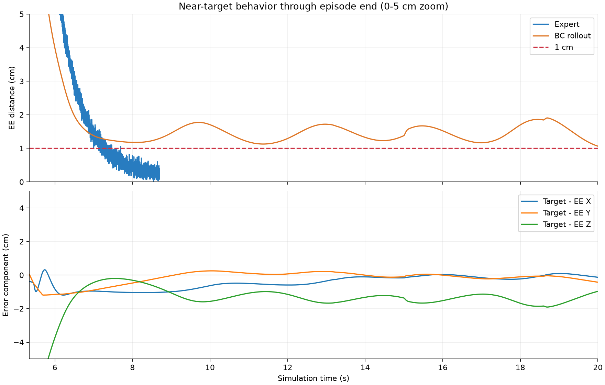
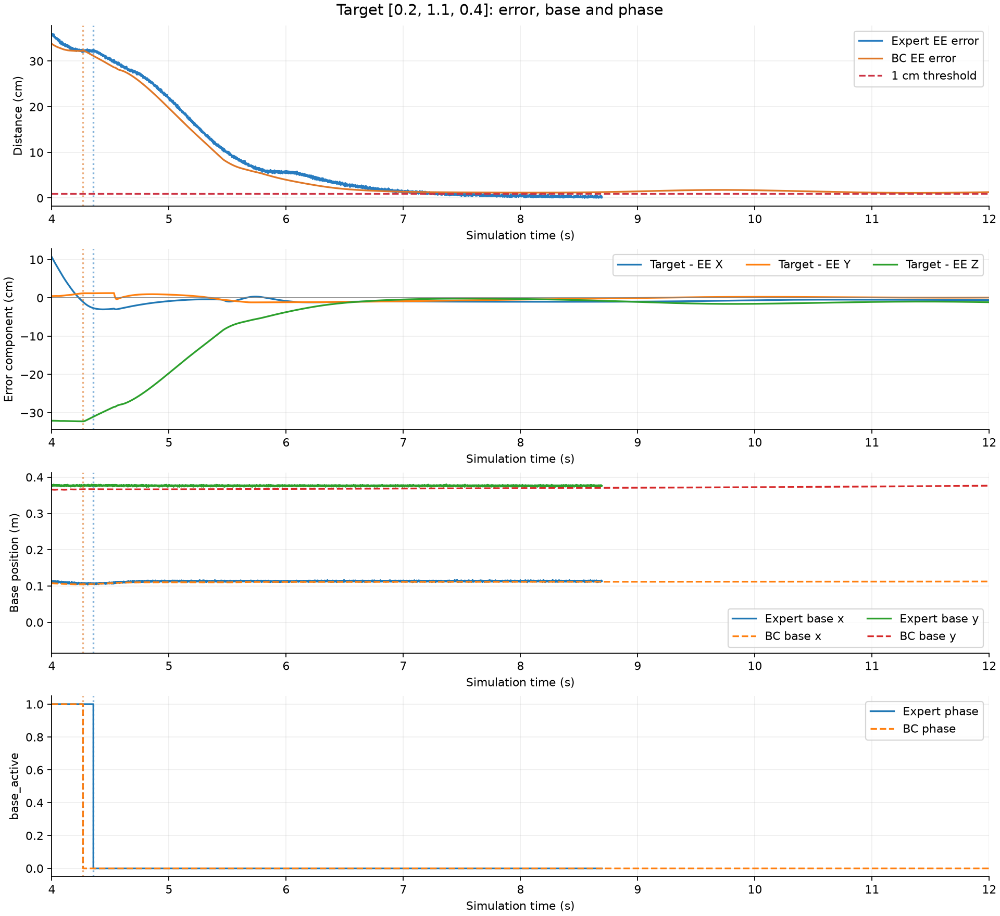
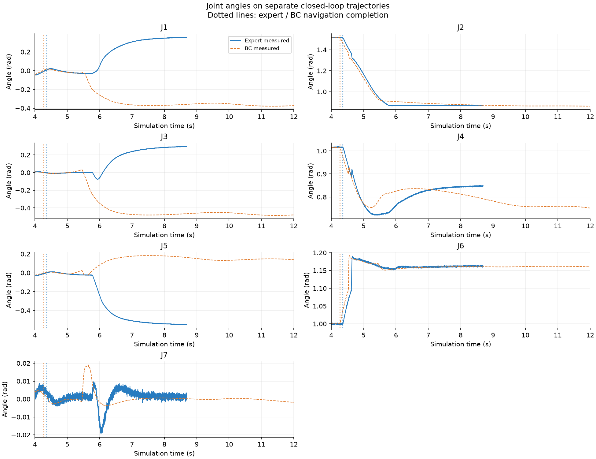
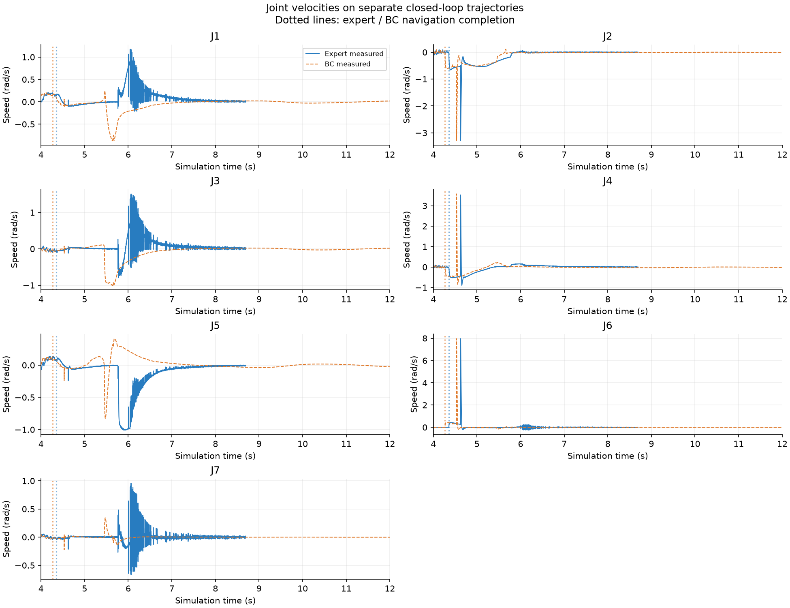
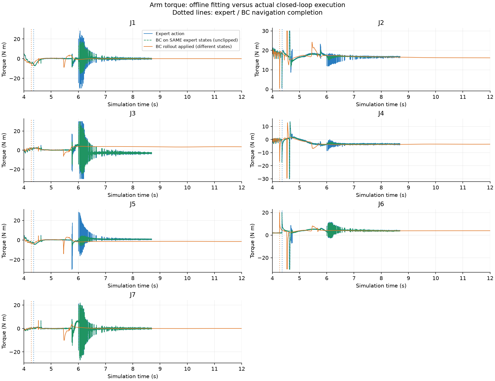
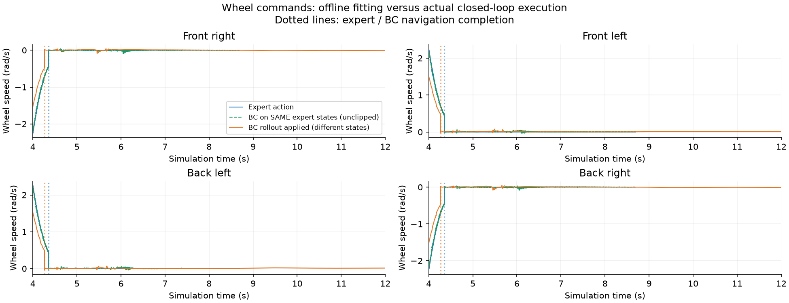

# 单目标失败诊断

目标：`[0.2, 1.1, 0.4]`；模型轮次：138；专家轨迹所属集合：val。

模型最低误差：1.0639cm，时刻20.000s；最终误差：1.0639cm。

## 看图方法

1. `01_error_base_phase.png`：观察误差从哪个方向增加，以及底盘、阶段是否同时变化。
2. `02_joint_angles.png`与`03_joint_velocities.png`：定位最先变化的关节。
3. `04_arm_torques.png`：蓝线与绿线是同一专家输入下的标签和预测，能直接判断离线拟合；橙线是模型执行时的动作，状态已经不同。
4. `05_wheel_commands.png`：查看模型在机械臂阶段是否仍输出非零轮速。

5. `06_near_target_zoom.png`：放大0～5cm并显示到轨迹结束，直接观察1cm附近是在漂移、震荡还是缓慢收敛。

`offline_action_errors.csv`给出全程、导航、机械臂、专家进入5cm和1cm范围时的逐动作RMSE及有符号偏差。误差单位为真实物理单位，不能直接把轮速和力矩大小横向比较。

如果蓝绿在专家末段就存在持续偏差，说明已有专家状态上的拟合仍有不足；若拟合较好而实际闭环偏离明显，则应进一步调查偏离状态下的控制。两者可同时存在，不能仅凭叠加曲线宣称已找到唯一原因。

专家采集含测量噪声，闭环测试可能关闭噪声；这些差异也会影响轨迹。该脚本不在模型状态上重新调用专家，不将最近专家样本冒充真实纠正标签。

