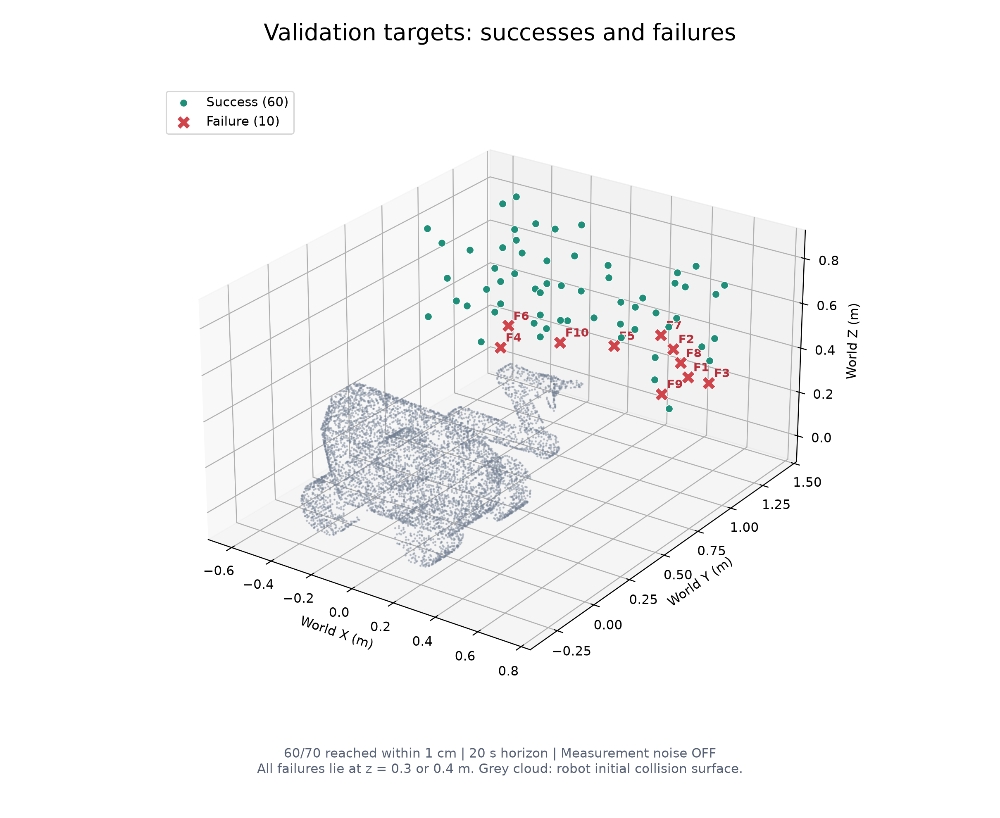
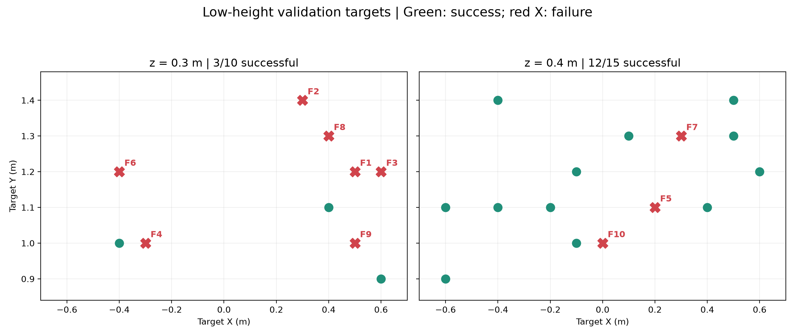

# 验证目标失败位置分析

当前批次：`F:\UCL\COMP0245 Labs\RoboEnv\bc_training_23d_noise_wide_finetune\run_20261031_025012_026265\batch_tests\val_20261031_031404_387244`。
微调前参照：`F:\UCL\COMP0245 Labs\RoboEnv\bc_training_23d_noise_wide\run_20261030_112637_239667\batch_tests\val_20261031_022415_233671`。

70个验证目标中60个成功、10个失败，成功率85.71%。失败点全部在0.3m和0.4m高度；所有目标都完成了导航切换。

[打开交互式三维图](failure_map.html)

绿色为成功，红色叉号为失败；灰色是机器人初始碰撞表面，不是失败时的实际姿态。

| 编号 | 目标 [x,y,z] m | 最低误差 cm | 对应时间 s | 最终误差 cm | 微调变化 |
|---|---|---:|---:|---:|---|
| F1 | [0.5, 1.2, 0.3] | 1.075 | 7.112 | 50.91 | 仍然失败 |
| F2 | [0.3, 1.4, 0.3] | 2.400 | 7.631 | 51.07 | 仍然失败 |
| F3 | [0.6, 1.2, 0.3] | 1.937 | 6.936 | 53.86 | 由成功变失败 |
| F4 | [-0.3, 1.0, 0.3] | 1.849 | 9.315 | 40.18 | 仍然失败 |
| F5 | [0.2, 1.1, 0.4] | 1.057 | 6.193 | 20.27 | 由成功变失败 |
| F6 | [-0.4, 1.2, 0.3] | 1.780 | 8.172 | 63.83 | 由成功变失败 |
| F7 | [0.3, 1.3, 0.4] | 1.393 | 6.917 | 21.01 | 由成功变失败 |
| F8 | [0.4, 1.3, 0.3] | 1.922 | 7.364 | 51.71 | 仍然失败 |
| F9 | [0.5, 1.0, 0.3] | 1.575 | 6.745 | 27.64 | 仍然失败 |
| F10 | [0.0, 1.0, 0.4] | 1.072 | 6.041 | 48.75 | 由成功变失败 |

## 观察与解释

1. z=0.3m：3/10成功，7个失败；z=0.4m：12/15成功，3个失败；z≥0.5m：45/45成功。
2. 失败点同时出现在负x、零x和正x，不能归结为某一侧x坐标。高度与失败的关联更突出，但目标数较少，不能仅凭图判断因果。
3. 所有失败案例都曾接近至约1.06～2.40cm，最终误差约20～64cm。共同现象是接近后未能进入容差并出现后续偏离。
4. 导航切换全部完成，不代表底盘后续保持静止；空间分布本身不能区分关节力矩、底盘漂移或训练覆盖不足等原因。
5. F5对应此前观察的[0.2,1.1,0.4]，最低误差约1.057cm。可在HTML中点击F5或对应表格行查看末端三维路径。

评估条件：20秒上限，测量噪声关闭，任意时刻欧氏距离误差小于1cm即成功，无保持要求。这里只展示验证目标，不能将没有验证点的空间区域解释为成功或失败。
