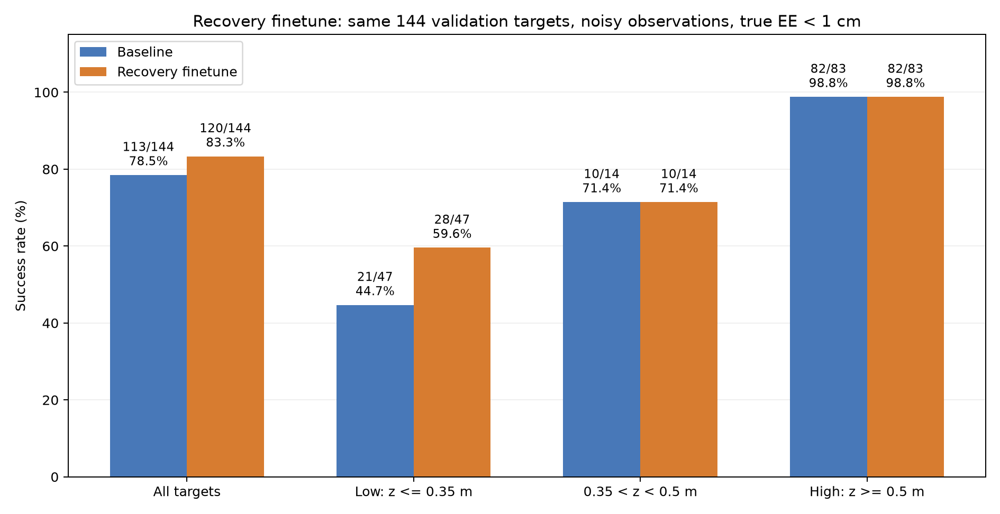

# 从GRU到恢复示范微调：阶段实验记录

作者：张书畅  
更新日期：2026年11月4日  
范围：GRU历史输入、辅助监督、梯度门控、恢复示范采集与微调。不重复更早的数据集构建过程。

## 1 本阶段的问题与基本设置

此前已经实现了分开的导航和机械臂策略，但低高度目标经常出现“接近了，却没有进入1cm”的情况。我们希望在保留纯模型控制的前提下改善这些失败。

导航由冻结的8维输入、4维轮速输出MLP控制。机械臂使用26维底盘yaw坐标系特征，网络为26→256→256→128→11，实际只取后7维关节力矩；旧轮速输出不参与导航。26维输入包含底盘状态、机械臂关节角及角速度、相对目标、阶段标志和末端位置误差，仍保留底盘绝对位置和朝向，因此不是完全旋转／平移不变的表示。

当前冻结划分为训练698目标、验证144目标、最终测试156目标。后面提到的144点成绩全部是开发验证，不能称为156点最终测试成绩。

本阶段先尝试让网络利用历史、增加辅助学习目标，随后转向补充模型偏离后的恢复动作。最终测试时始终由学习模型输出轮速和力矩，不临时切换专家。

## 2 B1：加入GRU，利用短期历史

### 想解决什么

原MLP只观察当前一帧。我们认为，短时间内的变化可能有助于判断机器人是在接近、停滞还是偏离目标，因此加入历史分支。

### 实际实现

保留原MLP，并加入GRU历史分支预测机械臂力矩修正。历史窗口为16帧，每隔10个仿真步取一帧，在1ms仿真步长下覆盖约150ms。历史不跨越轨迹边界，不读取未来状态，起始不足窗口时重复首帧。导航模型保持冻结。

训练经过多次续训，先后出现最佳第30、55、96和269轮；最终最佳平衡验证力矩MSE约0.01268819。

### 结果与判断

同144目标的无噪声评估，原MLP为111/144，最终GRU为113/144。整体小幅提高，但低高度特别是固定0.2m没有稳定收益。

这组GRU成绩采用无噪声FK评分，后面的带噪实验采用PyBullet真实位置评分，不能直接横向排列后宣称谁更好。我们保留了GRU结果，但没有继续将其作为主要优化路线；这不证明所有历史模型都无效。

## 3 B2：增加专家参考偏差辅助监督

### 想解决什么

只模仿力矩可能没有充分利用专家的控制意图。我们增加一个训练用辅助头，让模型除了预测动作，还预测：

```text
专家期望关节角 − 当前实测关节角
```

希望学习“专家希望关节向哪里调整”能改善共享特征。

### 实际实现

MLP共享隐藏层，保留原11维动作输出，新增7维辅助输出。损失由机械臂力矩MSE与加权辅助MSE组成。输入仍为26维，专家参考只作为训练答案，不作为模型输入；部署不使用辅助输出。

分别尝试辅助权重0.1和0.01，并设置权重0的继续训练对照。

| 设置 | 训练观察 | 已核验的闭环结果 |
|---|---|---|
| 辅助权重0.1 | 最佳第2轮，第17轮早停；辅助任务改善，但主力矩验证未显示收益 | 未完成完整闭环核验 |
| 辅助权重0.01 | 最佳第2轮，第22轮早停；降低权重缓解退步，仍未显示主任务收益 | 未完成完整闭环核验 |
| 辅助权重0 | 继续优化原MLP，对照运行最佳第185轮、第205轮早停 | **带噪真实评分113/144** |

原MLP带噪真实评分为106/144，关闭辅助损失后继续训练提高到113/144，成为后续基线。这个提升不能记成辅助监督成功，因为获得该成绩的对照没有使用辅助损失。

## 4 B3：梯度方向门控

### 想解决什么

辅助任务可能有时帮助力矩学习，有时干扰。我们进一步让辅助任务对共享网络的影响取决于两项梯度的方向关系。

### 实际实现

分别计算主力矩任务与辅助任务对共享参数的梯度，计算余弦相似度：正向一致时按相似度允许辅助更新，反向时关闭辅助对共享层的贡献。主任务继续更新，辅助头自身仍训练。

这是梯度方向上的局部训练信号，不是让模型直接判断物理动作会不会使末端距离下降，也没有每步损失或闭环稳定性的保证。

### 结果与判断

最佳第31轮，平衡验证力矩MSE约0.01273692，第51轮早停。梯度余弦整体接近0，门控后辅助共享梯度贡献很小。

同口径带噪闭环为113/144，与基线同分；逐目标有7个改善、7个退步，低高度没有改善。说明当前门控设置没有提供明确的总体成功率收益。

## 5 B4：将辅助标签换成专家期望关节速度

### 为什么换标签

专家的期望关节角通过逐步积分更新，包含上一时刻的控制器内部参考状态。模型当前26维输入没有这个内部参考，因此可能难以仅凭当前观测还原参考偏差。

这只是合理的可观测性疑问，不是已经证明的失败主因。

### 实际实现与结果

保留B3设置，将辅助标签换为同一时刻的专家期望关节速度`qd_des_arm`。它不同于输入中已有的实测关节速度，也不是下一帧标签。已有数据包含该字段，无需重采。

最佳第31轮，平衡验证力矩MSE约0.01273718，第51轮早停。辅助预测确实改善，但完整带噪闭环为109/144，低于基线113/144；低高度成功数由21/47降为17/47。

因此暂时结束这条辅助标签路线。固定辅助权重组没有完整闭环核验，B3同分、B4退步，各自结论分别保留，不笼统写成“所有辅助学习都无效”。

## 6 转向数据：从模型偏离的状态采集恢复示范

### 新的思路

原数据主要来自专家正常执行的轨迹。模型产生偏差后，可能进入原数据覆盖不足的状态；继续增加网络结构并不一定补上这些状态的正确动作。

我们改为先让模型控制，等接近目标却停滞时，让专家从模型当时的实际状态重新计算恢复动作。

### 成对诊断

```text
模型控制 → 接近后停滞 → 保存同一状态
                         ├─ 模型机械臂继续运行
                         └─ 恢复保存状态，专家机械臂接管
```

两条分支从相同物理状态、观测与噪声随机数状态开始，依次各运行最多10s。导航始终由原学习策略控制，两条分支不强制使用相同轮速；之后动作不同，轨迹自然分叉。

专家参考角初始化为当前带噪实测关节角，再正常积分。不能把原专家轨迹里的一段动作直接剪过来接到模型的新状态上。

默认触发要求导航完成、仿真时间至少8s、最近约2s的观测距离在1～5cm附近且改善不足2mm。诊断比较“进入真实1cm并连续保持1s”；真实位置只评分，不用于控制或触发。

首轮20个低高度训练目标中，7个模型接管前已到达，8个只有专家恢复并保持，5个未满足接管条件。8个成对案例中模型续跑10s均未进入1cm，专家全部恢复成功。这支持继续收集恢复示范，但不等于当前模型成功率。

## 7 正式采集：102条恢复片段

扫描冻结训练清单中300个z<0.5m目标，配置噪声开启，不使用验证／测试目标的专家标签。全部完成，0进程错误。

| 结果 | 数量 |
|---|---:|
| 模型在接管前已进入1cm | 142 |
| 模型与专家续跑都恢复并保持 | 14 |
| 只有专家恢复并保持 | **102** |
| 未触发符合条件的近距离停滞 | 42 |

只将102个专家分支导出为训练数据，共233,150帧。其中98个模型续跑未到达，另外4个模型曾进入1cm但未保持1s。这批数据同时补充了纠偏和稳定保持示范。

| 字段 | 内容 |
|---|---|
| `observations` | N×26，动作前观测，已做底盘yaw坐标变换，未标准化 |
| `arm_torques` | N×7，同一步实际执行的专家机械臂力矩 |
| `timestamps` | N个动作前时间 |
| `target` | 世界坐标目标 |

模型失败前的动作不作为正确标签，导航模型输出也不作为新增训练标签。原诊断N+1状态、N动作的长度差在导出时明确处理，取前N个动作前状态。目标归属、文件哈希、时间对齐及真实1cm保持均核验通过。

数据位置：

```text
RoboEnv/expert_recovery_data/collection_20261104_112547_770894/
├─ diagnostics/summary.json
└─ episodes/recovery_manifest.json
```

## 8 混合微调、早停调整与续训

保持原结构和导航不变，只训练机械臂力矩。每轮有放回抽样500,000帧，按80%原始示范、20%恢复示范混合。原数据内部低高度与其他高度各半，原输入和力矩归一化完全继承。

优化采用Adam、学习率1e-5、batch4096、GPU常驻数据。验证仍为原144目标的全部自然帧，不加入恢复数据。

### 第一次15轮早停

最初规则将第0轮原基线MSE作为历史最好值。加入恢复数据后，验证误差先上升再下降，但一直未超过原基线，于是连续未改善计数达到15而早停。

| 指标 | 微调前 | 第15轮last |
|---|---:|---:|
| 恢复片段训练MSE | 0.187176 | **0.024177** |
| 原验证集平衡MSE | **0.012753** | 0.013400 |

这次确实学了恢复数据，但原轨迹拟合略有退步。保存的best仍是第0轮原权重；第15轮权重在last里，没有完成单独闭环评估。

### 修正与续训

将原基线单独保存为`baseline_model.pt`，`best_model.pt`只比较微调后的各轮；默认至少50轮、耐心15轮、最多100轮。日志显示微调最佳、连续未刷新次数及与原基线的差距。训练误差不参与早停。

随后从原基线重跑到100轮，再恢复第100轮last的权重、Adam、抽样状态及早停计数，续训累计上限设为300轮。原目录和原始基线保留。

| 运行 | 最佳／结束轮次 | 最佳平衡验证MSE |
|---|---:|---:|
| 旧早停运行 `run_20261104_120308_587271` | 0／15 | 0.0127534703，原基线 |
| 修正后重跑 `run_20261104_130656_584873` | 100／100 | 0.0130789137 |
| 续训 `run_20261104_152933_829681` | **138／153** | **0.0130293772** |

第139～153轮连续15轮未刷新第138轮纪录，因此这次早停正常。最佳验证MSE仍比原基线高约2.16%，不能称为原轨迹拟合精度提升；是否改善控制，需要闭环仿真判断。

## 9 闭环结果：低高度取得明确进步

用第138轮最佳模型，在与113/144基线相同的144个目标、每目标噪声种子、配置噪声、20s时限和真实1cm标准下验证。全部动作来自学习模型，不调用专家。

| 分组 | 原基线 | 恢复微调后 |
|---|---:|---:|
| 整体 | 113/144＝78.47% | **120/144＝83.33%** |
| 高度≤0.35m | 21/47＝44.68% | **28/47＝59.57%** |
| 0.35<高度<0.5m | 10/14 | 10/14 |
| 高度≥0.5m | 82/83 | 82/83 |
| 原固定0.2m | 6/16 | **11/16** |
| 原固定0.35m | 6/17 | **8/17** |



逐目标有12个失败变成功、5个成功变失败，净增加7个。整体提升4.86个百分点，低高度提升14.89个百分点。0进程错误，4进程现实耗时448.4s。

这说明原轨迹上的动作MSE与闭环1cm成功率并不完全一致。本次“恢复示范＋额外微调”的组合，在保持网络结构不变的情况下改善了困难高度的到达能力。

仍缺少相同训练预算、恢复比例为0的闭环对照，因此尚不能把全部提升单独归因于恢复数据。原基线保留，第138轮模型作为当前带噪验证成功率更高的候选。

## 10 暴露出的新问题：底盘导航阶段未切换

成功率提高的同时，平均最终误差从22.51mm增至29.97mm，受一个严重失败影响：

```text
target = [-0.893461, 0.542858, 0.462578]
seed = 10049
```

该点恢复版最终末端误差2.3439m，原基线也失败但最终误差为0.1099m。它不是新增5个“成功变失败”的点，而是原失败程度进一步扩大。

| 导航状态 | 原基线 | 恢复版 |
|---|---|---|
| 完成初始转向、进入drive | 2.740s | 2.740s |
| 进入orient | 5.140s | 未发生 |
| 导航done | 5.841s | 未发生 |
| 观测到停车点的最近距离 | 6.216cm | **8.042cm** |

底盘阶段距离门槛为小于8cm，恢复版最近观测值只差约0.42mm。该数值来自带噪底盘观测，不是精确真实物理差值，也不同于末端1cm成功阈值。drive还可在近距离越过目标方向时退出，本次也未触发；25s导航超时长于本次20s测试。

恢复版持续停留在drive并收到非零轮速，随后偏离。不能只凭画面把它解释为停止后的惯性滑行。导航权重没变，也不代表整机轨迹不变；机械臂控制、噪声及整机动力学的具体因果贡献尚未隔离。

现有恢复示范要求导航先完成，不能覆盖这种导航阶段失败。我们没有为了使此点成功而放宽阈值、强制停车或改变成功标准。

## 11 本阶段结论与未完成事项

| 路线 | 本次证据支持的判断 |
|---|---|
| GRU历史 | 无噪声整体小幅提高，低高度收益不稳定 |
| 固定辅助监督 | 未显示主力矩验证收益，两组完整闭环未核验 |
| 关闭辅助后继续训练 | 带噪106/144提高到113/144，形成比较基线 |
| 梯度门控 | 113/144，同分且成功坐标有变化 |
| 期望速度辅助 | 109/144，当前设置下退步 |
| 恢复示范混合微调 | **120/144，净增加7个，收益集中在低高度** |

本阶段最明确的新进展，是补充模型实际偏离状态的专家恢复动作并混合微调后，低高度验证成功率提高。网络和输入维度没有扩大，部署也没有增加专家接管。

仍有5个旧成功点退步、个别严重导航失稳。当前只验证每目标一组噪声种子，没有完成156点独立最终测试、多种子统计或匹配预算的零恢复对照，不宣称普遍稳定、统计显著或任意陌生目标均能成功。

## 12 记录与证据位置

- [完整实验记录](研究过程与结果分析.md)：第36～55节。
- [当前进展摘要](当前进展摘要_20261104.md)。
- [结果核验索引](结果核验索引.md)：包含各运行目录及原始日志链接。
- [GRU与B2阶段核验](阶段核验快照_20261104.json)。
- [B3与B4阶段核验](阶段核验快照_20261104_B3_B4.json)。
- [恢复示范核验](阶段核验快照_20261104_恢复示范.json)：包含源文件哈希、完整144点比较和导航异常统计。

本文单独整理既有实验进展，没有启动新训练、采集或仿真，也没有修改原Word、模型、配置或数据。图表引用同目录下的`assets`文件夹。
