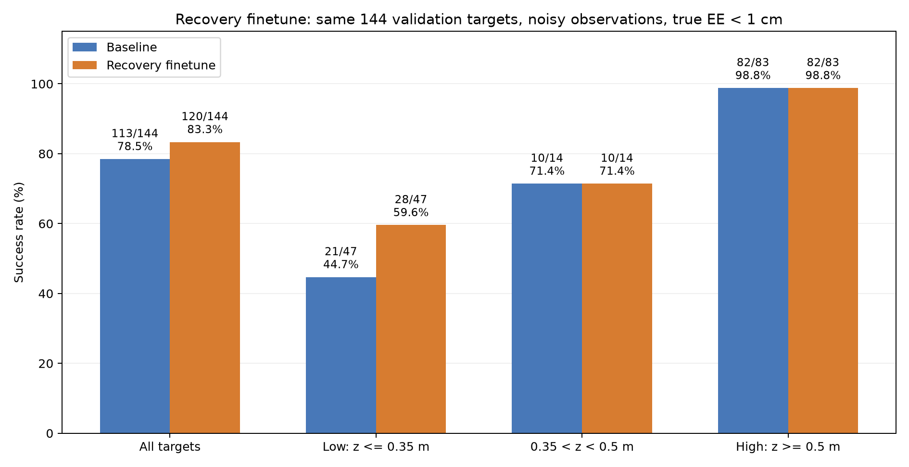

# 当前实验进展摘要（2026年11月4日，更新至RL残差负结果）

最新补记：两版TD3残差均未超过所用恢复版基线。V1有明显退化；V2在固定8点验证中为7/8→6/8→3/8→4/8，15,370步早停，best回到第0步零修正。固定8点结果不是完整144点成功率。当前暂停直接增加RL训练量，保留失败记录和原有效模型。

本轮冻结父模型的带噪完整验证为120/144，后续独立测试为132/156＝84.62%。RL没有获得这两项成绩的归因资格。其他监督残差候选不在本次补记中重新排名。

详见[两版RL失败记录](RL残差强化学习_失败分析_20261104.md)、[完整记录第56节](研究过程与结果分析.md)、[原始核验快照](RL残差核验快照_20261104.json)。

---

以下保留前次“恢复示范微调”阶段摘要；其中“尚未完成156点测试”等为当时状态，以本次补记为后续更新。

# 当前实验进展摘要（2026年11月4日，更新至恢复示范微调）

作者：张书畅。详细过程见[完整实验记录](研究过程与结果分析.md)：第36—48节保留GRU和辅助标签实验，第49—55节记录恢复诊断、采集、早停调整、续训和闭环结果。原始证据见[结果核验索引](结果核验索引.md)，完整逐目标比较见[恢复示范核验快照](阶段核验快照_20261104_恢复示范.json)。

## 当前结果

**恢复示范混合微调后，同144个带噪验证目标达到120/144＝83.33%，原基线为113/144＝78.47%。** 净增加7个，提升集中在低高度；这是当前验证成功率更高的候选，原113/144模型保留作对照。

```text
RoboEnv/bc_training_arm_ring_r08_recovery/run_20261104_152933_829681
└─ best_model.pt：累计第138轮，最终第153轮早停
```

## 这次做了什么

此前B3梯度门控113/144、B4期望角速度辅助109/144没有超过原基线。我们暂停辅助标签路线，改用训练目标上模型实际偏离后的专家恢复动作。

模型先控制，导航完成且目标附近停滞后保存状态：一条分支让模型继续，另一条从同一起点让专家接管机械臂。底盘始终使用原学习导航。专家初始化参考角为当前带噪实测关节角，随后正常计算动作；不从其他轨迹剪动作来拼接。

首轮20点诊断中8个案例只有专家恢复并保持。正式扫描300个z<0.5m训练目标：142个模型接管前到达、14个两分支都保持成功、102个只有专家保持成功、42个未触发，0进程错误。

导出102条、233,150帧专家恢复示范。其中98个模型续跑未到达，4个模型曾到达但未保持1s。只收专家分支，不将模型失败动作当标签，不混入验证／测试目标。

| 项目 | 设置 |
|---|---|
| 网络 | 冻结导航8→64→64→4；机械臂26→256→256→128→11，只训练后7维力矩 |
| 输入／归一化 | 原底盘yaw坐标26维输入及归一化不变，真实末端不作输入 |
| 训练数据 | 原7,306,407帧＋新233,150帧恢复数据 |
| 抽样 | 每轮500,000帧；80%原数据、20%恢复数据；原数据内部低／其他高度各半 |
| 优化 | GPU单帧数据常驻；Adam，lr1e-5，batch4096，无辅助损失，辅助头冻结 |
| 验证 | 原144目标的1,481,313自然帧，不加恢复数据 |
| 正式仿真 | 噪声开启、各项0.001，20s内任意时刻真实末端距离<1cm；无保持要求 |

恢复采集中的1s保持是筛选示范的稳定性要求，不改变正式纯模型成功标准。最终仿真全部动作来自学习模型，没有专家接管或强制轮速归零。

## 训练经过及早停问题

| 运行 | 结果 |
|---|---|
| `run_20261104_120308_587271` | 旧逻辑以第0轮原基线MSE作门槛，15轮早停，best仍为0；恢复训练误差却从0.187176降到0.024177 |
| `run_20261104_130656_584873` | 原基线另存，按微调后纪录早停，至少50轮、耐心15轮；重跑至100轮上限，最佳MSE0.013078914 |
| `run_20261104_152933_829681` | 恢复第100轮last的模型、Adam、抽样RNG及早停计数，累计上限300；最佳138轮MSE0.013029377，153轮早停 |

最佳微调MSE仍比原基线0.012753470高约2.16%，但闭环成功率提高。微调最佳与原基线分别保存，不把更高的MSE写成离线拟合进步。原100轮与15轮实验没有被覆盖。

## 同口径闭环比较

| 分组 | 原113/144基线 | 恢复微调138轮 |
|---|---:|---:|
| 全部目标 | 113/144＝78.47% | **120/144＝83.33%** |
| 原116点 | 94/116 | **101/116** |
| 连续高度28点 | 19/28 | 19/28 |
| z≤0.35m | 21/47＝44.68% | **28/47＝59.57%** |
| 0.35<z<0.5m | 10/14 | 10/14 |
| z≥0.5m | 82/83 | 82/83 |
| 原固定z=0.2m | 6/16 | **11/16** |
| 原固定z=0.35m | 6/17 | **8/17** |



目标、每目标种子、噪声、时限、真实评分及导航绑定一致。逐点12个失败变成功、5个成功变失败，净增加7个；不能说所有旧成功都保住了。完整验证4进程448.4s，0进程错误。

## 仍存在的失败与结论边界

平均最终误差22.51mm→29.97mm，受一个严重失败影响：`[-0.893461,0.542858,0.462578]`、seed10049，最终2.3439m。该点旧基线也失败（0.1099m），不属于新增5个退步坐标。

恢复版2.740s完成初次转向后一直留在drive，未完成导航；观测到停车点最近距离8.042cm，略高于8cm阶段门槛。原基线5.140s切换orient、5.841s进入done。8.042cm是带噪底盘观测，不是末端真实1cm判据；drive还有越过停车点的退出条件，本次也未触发。轮速持续非零，不能只归为惯性滑行；具体噪声、整机动力学及摩擦的因果贡献尚未隔离。

现有恢复采集只覆盖导航完成后的近距离停滞，不能修复所有导航阶段失败。网络不变、最终仍由学习模型控制的情况下，本次组合方案取得明确验证集改善；但还没有匹配训练预算的恢复比例0闭环对照，不能把全部提升单独归因于恢复数据。

现阶段保留恢复版为更高成功率候选，保留113/144原基线和全部负结果。尚未增加156点最终测试、多噪声种子或统计显著性结论。原Word、配置、数据和模型均保留；本次记录更新没有启动新训练或仿真。
