# COMP0245 移动机械臂：研究过程与结果分析

> **2026-11-05发布说明：** 本文由原Word整理稿及运行证据扩充，发布名改为“研究过程与结果分析”。前面各节保留对应日期的认知状态，“尚未完成测试”等文字不代表截至发布时的最新状态。最新结果：恢复120版带噪test132/156；冻结120版的监督残差验证122/144；两版TD3未获有效提升；CNN＋Transformer38/144后中止；组员TCN为固定PD混合控制。完整模型与结果见[根README](../../README.md)、[模型索引](../MODEL_INDEX.md)。


> 11月4日晚补记：新增第56节，记录在线TD3残差V1与保守V2的失败及回退。前文“尚未完成156点测试”等表述为对应历史阶段状态；恢复版后续带噪独立测试已完成132/156，来源见本节。

作者：张书畅  
记录时间：2026年10月23日至11月4日  
任务：学习专家控制器的行为，控制移动底盘和机械臂，使末端到达指定三维目标位置。

原始来源：作者的Word工作文档（不在本分支提交原Word），以及对应运行日志。本文保留原实验顺序，结合对应运行日志补全设置和结果；本次更新后的29张原图单独归档。

截至2026年11月4日，本阶段在保留原113/144带噪MLP基线的基础上，完成了模型偏离状态下的专家恢复示范采集与机械臂混合微调。第138轮模型在同144个带噪验证目标上达到120/144＝83.33%，较原基线净增7个；z≤0.35m由21/47提高到28/47。B3/B4的负结果保留，原始模型、Word、数据和配置不变。新增第49—55节详细记录恢复诊断、102条示范、早停修正与续训、同口径逐点比较，以及一个严重导航失稳案例。当前是更高验证成功率候选，尚未给出156点最终测试或多种子泛化结论。

本文按实验顺序保留已完成的尝试，以Word更新内容为主线，用冻结运行配置、训练历史和闭环结果补齐缺失进度。每阶段分别记录做了什么、观察到什么，以及哪些解释尚未验证；旧70／71目标与新152／153目标、验证与测试、首次到达与持续保持分别列明。

| 阶段 | 主要工作 |
|---|---|
| 10月23日起 | 专家轨迹采集、468目标划分、22维行为克隆基线 |
| 10月27日至28日 | 增加阶段标志为23维，调整动作损失 |
| 10月29日 | 噪声与保持数据首次成功、统一评估口径、低高度重采样 |
| 10月30日至31日 | 小网络微调、三隐藏层网络及微调、失败案例分析 |
| 10月31日 | 专家高度探索、补采546条、扩展划分及23维重训 |
| 11月1日 | 显式末端误差26维重训、完整152目标验证达到90.79%，反向目标测试暴露导航泛化不足 |
| 11月2日 | 完成931目标环状采集、651/140/140划分及26维训练；环状验证15.71%，训练目标抽测19.05%；核对配置并讨论底盘坐标系输入 |
| 11月2日至3日 | 底盘坐标系模型同140点验证46.43%；混合诊断、r≥0.8m筛选，独立导航＋原机械臂同116点验证81.03%；启动低高度机械臂微调 |
| 11月3日后续 | 首次机械臂微调同116点达到84.48%；0.4m与40s诊断；连续低高度补采200条全部保持成功；合并998条清单并启动补采版继续微调 |
| 11月3日至4日 | E15完成；GRU历史与续训、带噪真实位置评估、辅助参考监督及无辅助对照；新带噪基线113/144 |
| 11月4日后续 | B3参考偏差梯度门控113/144；B4期望速度辅助109/144；未修复最低高度，保留原带噪基线 |
| 11月4日恢复示范 | 20点专家接管诊断；300个低高度训练目标采集，导出102条233,150帧；修正早停并续训至最佳138轮，同144点带噪验证120/144，低高度净增7个；记录导航阶段失稳 |

快速查看：[11月4日当前进展摘要](当前进展摘要_20261104.md)；[11月3日摘要](当前进展摘要_20261103.md)作为历史快照保留。最新证据见文末第49—55节及核验索引；第36—48节为此前GRU和辅助标签实验。

## 1 实验目标与流程

我们希望用监督学习近似已有专家控制器：输入当前机器人状态和目标位置，输出四个车轮的目标角速度和七个机械臂关节的力矩。模型在仿真中反复执行“观测、预测动作、执行、再次观测”，形成闭环控制。

本任务判断末端位置是否到达目标，不等同于完成物体抓取。手指维持固定姿态，不属于学习模型的11维输出。

实验流程为：

1. 运行专家控制器，确认任务能够完成。
2. 在不同目标位置采集完整专家轨迹。
3. 按目标坐标划分训练集、验证集和测试集。
4. 训练行为克隆模型，使用验证损失选择检查点。
5. 用模型独立控制仿真机器人，统计到达成功率并分析失败案例。
6. 分别探索阶段输入、损失加权、噪声与保持数据、重采样、微调、网络结构、高度覆盖和显式末端误差特征。

## 2 专家行为与数据定义

### 2.1 专家控制器的阶段

专家的底盘导航包含以下子阶段：

```text
align 对准底盘停车位置
  → drive 驶向停车位置
  → orient 调整最终朝向
  → done 导航结束
```

在导航期间，机械臂主要维持初始姿态；导航结束后，底盘的专家轮速指令变为零，机械臂执行到达任务。导航结束状态会被锁存，不会因为后续小幅偏移而重新启动导航；超时也可以触发导航结束。

这里“轮速指令为零”描述的是控制器输出，不表示仿真中底盘的实际速度必然严格为零。机械臂维持姿态时仍需要控制力矩，也不是电机完全停止工作。

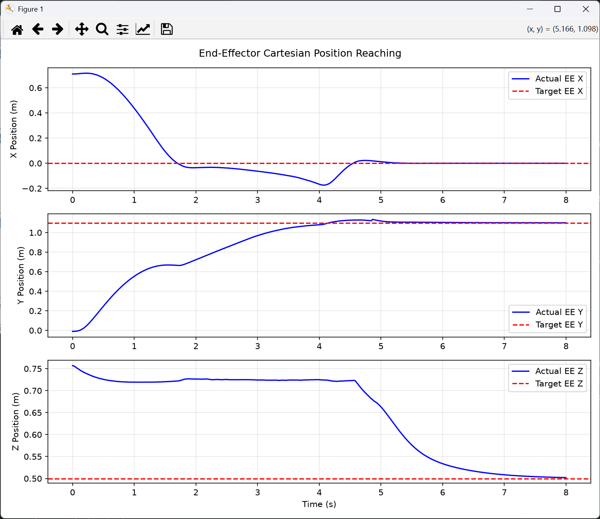

图1　专家到达原始目标的三个坐标分量。蓝线为实际末端位置，红色虚线为目标。

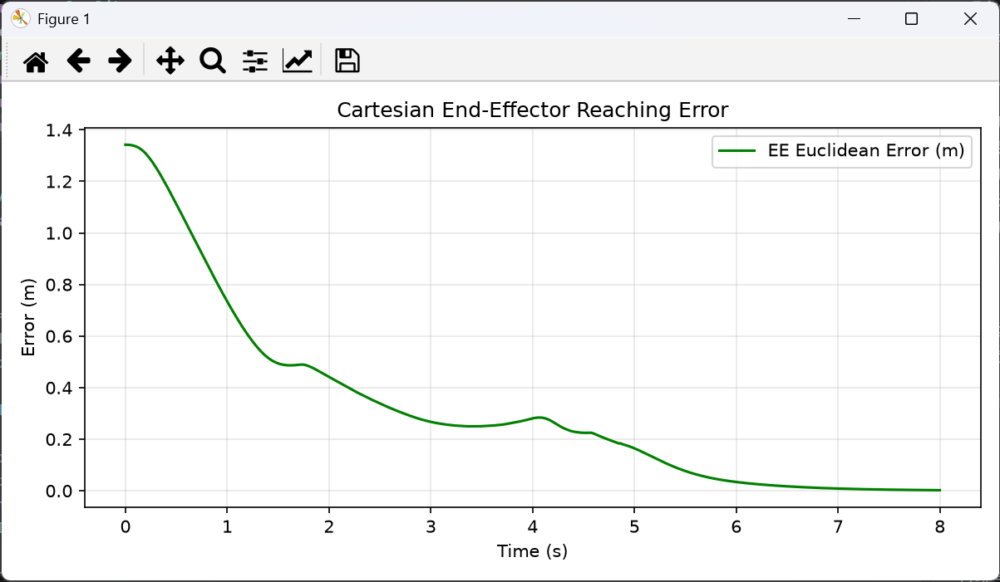

图2　专家末端误差随时间收敛。七个关节的实际角度与期望角度见[原始图3](原始图索引.md#图3)。

### 2.2 原始22维输入

| 输入量 | 代码或含义 | 维度 | 单位 |
|---|---|---:|---|
| 底盘位置 | `base_pos`，世界坐标系的x、y、z | 3 | m |
| 底盘朝向 | `sin(yaw)`、`cos(yaw)` | 2 | 无量纲 |
| 机械臂关节角 | `q_mes[4:11]` | 7 | rad |
| 机械臂关节角速度 | `qd_mes[4:11]` | 7 | rad/s |
| 末端目标位置 | `TARGET_EE_POS`，世界坐标系坐标 | 3 | m |
| **输入合计** | 当前时刻的状态与目标 | **22** | 混合单位 |

使用朝向的正弦和余弦，是为了避免角度在正负π附近的数值跳变。输入不包含历史窗口。

### 2.3 11维动作输出

```python
action = np.concatenate([
    wheel_cmds,  # 四个车轮的目标角速度
    torque_arm,  # 七个机械臂关节的控制力矩
])
```

| 输出量 | 动作下标 | 维度 | 单位 |
|---|---|---:|---|
| 车轮目标角速度 | `action[0:4]` | 4 | rad/s |
| 机械臂关节力矩 | `action[4:11]` | 7 | N·m |
| **输出合计** | 同一观测对应的专家动作 | **11** | 混合单位 |

训练标签为专家计算的动作。采集时先读取当前观测并计算、记录动作，再推进仿真，以保持输入和标签在时间上的对应关系。

## 3 初始数据采集与划分

### 3.1 从手动验证到批量采集

最初先验证目标 `[0.0, 1.1, 0.5]`，随后手动修改目标为 `[0.6, 1.1, 0.5]` 等位置，确认专家能够完成任务，再扩展为规则网格。

这两组三元数表示的是**末端目标位置**，不是机器人初始朝向。对应的末端位置、误差和关节曲线保留在[原始图4至图6](原始图索引.md#图4)。

| 坐标轴 | 最小值 | 最大值 | 步长 | 取值个数 |
|---|---:|---:|---:|---:|
| x | −0.6m | 0.6m | 0.1m | 13 |
| y | 0.9m | 1.4m | 0.1m | 6 |
| z | 0.3m | 0.8m | 0.1m | 6 |
| **目标组合总数** | | | | **13 × 6 × 6 = 468** |

每个目标单独运行，轨迹保存为带时间戳的 `.npz` 文件，例如：

```text
RoboEnv/expert_data/expert_episode_20261023_103025_123456.npz
```

仿真步长为0.001s。训练时把不同轨迹的时间步合并，每个时间步构成一个输入和动作标签对。因此，468条完整轨迹可以产生数百万个样本，但相邻时间步高度相关，不能将其理解为数百万种独立场景。

初始数据检查发现465条轨迹最终误差小于1cm，另外3条略高于1cm；本次实验选择保留全部468条，没有因为这3条略超阈值而剔除它们。

### 3.2 按目标坐标划分数据

| 数据集 | 目标数 | 完整轨迹数 | 用途 |
|---|---:|---:|---|
| 训练集 train | 327 | 327 | 计算梯度并更新模型参数 |
| 验证集 val | 70 | 70 | 计算验证损失、选择模型和判断早停；后续进行开发阶段闭环评估 |
| 测试集 test | 71 | 71 | 在固定条件下报告留出目标的闭环表现 |
| **合计** | **468** | **468** | 全部纳入划分 |

划分比例约为70∶15∶15，随机种子为42。同一个目标的完整轨迹属于同一个集合，不随机拆分轨迹中的相邻时间步，以降低训练和评估之间的数据泄漏风险。

后续重新采集的文件名虽然发生变化，但仍根据**目标坐标**映射回原来的集合。因此，22维、23维和噪声数据可以沿用相同的目标分组。

初始22维数据中，训练时间步为2,657,767个，验证时间步为565,143个。轨迹长度并不完全相同，因此样本数应以实际文件统计为准。

## 4 实验一 22维行为克隆基线

### 4.1 网络与训练设置

```text
22维输入 → Linear 128 → ReLU → Linear 128 → ReLU → Linear 11
```

| 超参数 | 设置 |
|---|---:|
| 随机种子 | 42 |
| 批次大小 | 4096 |
| 最大训练轮数 | 100 |
| 优化器 | Adam |
| 学习率 | 0.001 |
| 早停耐心 | 15轮 |
| 损失 | 标准化动作空间中的普通MSE |

输入和输出的均值、标准差仅使用训练集计算，再应用于验证集及推理。最小验证MSE出现在第98轮，为0.016699。

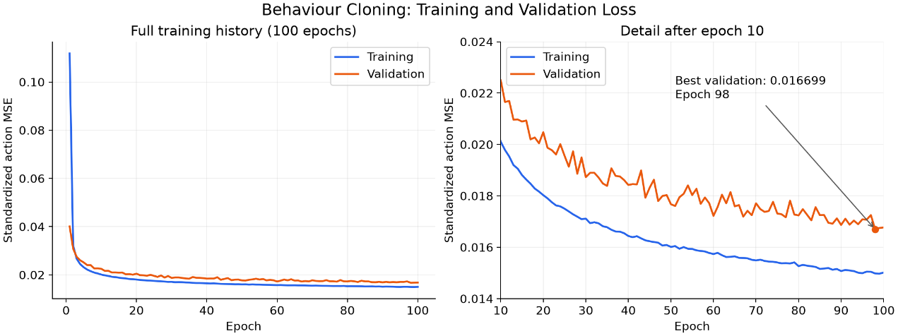

图3　22维基线的训练与验证MSE。离线拟合误差下降，不代表闭环必然稳定。

### 4.2 闭环表现

原Word记录中的一个10秒闭环案例结果如下。

| 指标 | 结果 |
|---|---:|
| 成功到达 | False |
| 终止原因 | `time_limit` |
| 最小末端误差 | 0.068863m，约6.89cm |
| 最终末端误差 | 0.975972m |
| 结束时间 | 10.000s |
| 动作被限幅的步数 | 1654 |

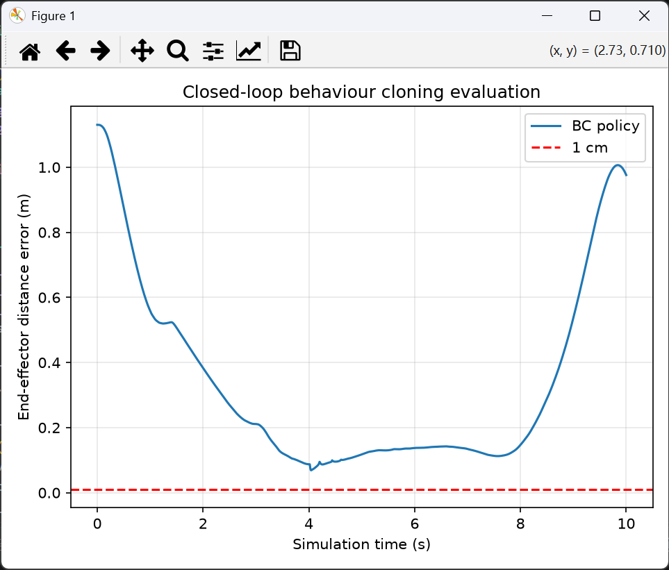

图4　模型曾接近目标，但随后误差重新增大。原始终端截图见[原始图12](原始图索引.md#图12)。这只是单个案例，不能据此给出整个数据集的成功率。

### 4.3 当时的判断

主要怀疑是闭环误差累积：模型的小动作误差改变后续状态，使机器人进入专家轨迹覆盖不足的区域，后续预测进一步失准。此外，专家有导航阶段和累积关节参考等内部信息，而单时刻22维输入没有完整表达这些信息。

以上属于解释失败的候选机制，并未通过单个失败轨迹得到独立因果验证。专家本身也只是一个能完成任务的示范策略，不能直接视为所有目标上的最优策略；学习模型无需逐点复现专家路径，只要满足任务条件即可。

## 5 实验二 增加导航阶段标志

### 5.1 从22维扩展到23维

在输入末尾添加一个二值变量 `base_active`：

| 数值 | 含义 |
|---:|---|
| 1 | 专家导航状态尚未结束 |
| 0 | 专家导航状态已结束，包括正常完成或超时结束 |

它是**一维二值特征**，不是二维向量，也不等同于“实际车轮速度是否大于零”。底盘短暂不动时，导航阶段也可能仍为1。

采集脚本为 `robotnik_arm_task_2.py`。训练结构为 `23 → 128 → 128 → 11`。阶段列在标准化时保留原值0或1。

闭环测试中，利用实际底盘状态更新相同的导航状态机，只取阶段标志作为输入；该辅助控制器返回的轮速被丢弃。模型预测全部11维动作，没有在阶段变为0时强制将轮速置零。

### 5.2 结果与限制

23维普通MSE训练在第114轮取得最佳验证MSE 0.014403，第129轮早停。原记录中的10秒闭环案例为：

| 指标 | 结果 |
|---|---:|
| 成功到达 | False |
| 最小末端误差 | 0.027909m，约2.79cm |
| 最终末端误差 | 0.530312m |
| 动作被限幅的步数 | 1326 |

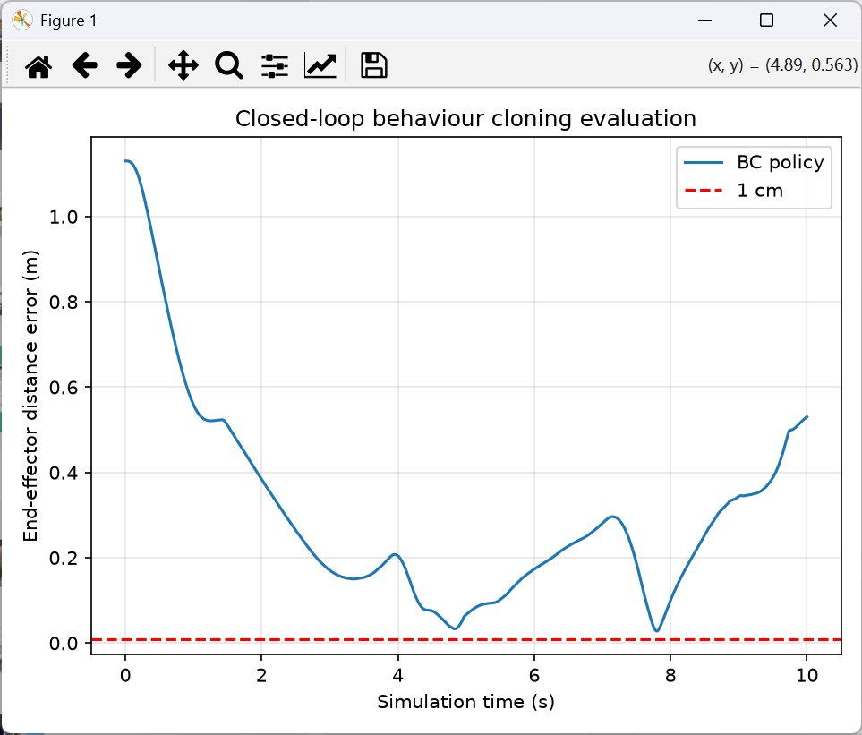

图5　增加阶段输入后，该案例能更接近目标，但仍未满足1cm标准，随后出现偏离。

该现象支持阶段信息值得保留，但不能只凭一个案例断言增加这一维已经解决阶段切换问题。输入标志的作用通过训练影响动作预测，并不是一个直接执行停车的命令。

## 6 实验三 调整动作损失权重

### 6.1 损失函数

原先把全部11维标准化动作的平方误差取平均，改为分别计算机械臂、轮速和停止阶段轮速误差：

```text
L = L_arm + WHEEL_WEIGHT × L_wheel + STOP_WEIGHT × L_stop
```

| 项目 | 定义 | 权重 |
|---|---|---:|
| `L_arm` | 所有样本、七个机械臂关节输出的平均平方误差 | 1 |
| `L_wheel` | 所有样本、四个轮速输出的平均平方误差 | 1 |
| `L_stop` | `base_active=0` 的样本中，四个轮速输出的平均平方误差 | 2 |

因此这里的1∶1∶2是三项**平均损失**的系数，不是23个输入特征的权重。停止阶段样本也包含在普通轮速项中，额外停止项用于增加约束。各项都在标准化动作空间计算，不能直接解释为物理单位下的误差。

训练仍然学习专家标签，而不是把标准化输出直接与数值零比较；物理零轮速经过输出标准化后不一定为零。

### 6.2 结果

加权模型最佳轮次为107，第122轮早停，最佳加权验证损失为0.022892。原记录中的闭环案例为：

| 指标 | 结果 |
|---|---:|
| 成功到达 | False |
| 最小末端误差 | 0.030571m，约3.06cm |
| 最终末端误差 | 0.547095m |
| 结束时间 | 10.000s |
| 动作被限幅的步数 | 818 |

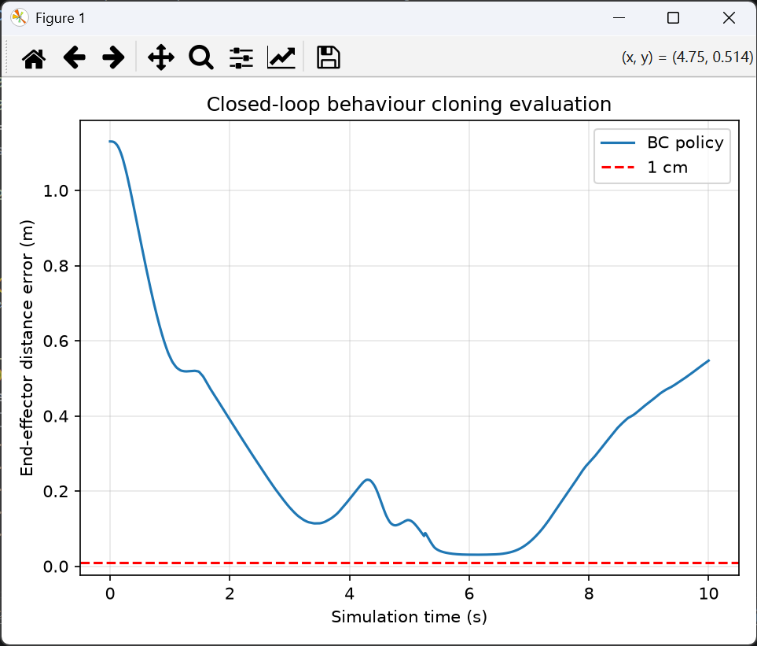

图6　加权损失后，模型在部分时段输出了更接近零的轮速，但末端仍未稳定收敛。终端记录见[原始图16](原始图索引.md#图16)。

接下来区分两个问题：一是模型在专家状态上是否已无法拟合力矩；二是在专家状态上拟合较好，但进入自身偏离状态后无法恢复。后续的数据改动主要尝试丰富目标附近的行为。

## 7 实验四 测量噪声与到达后保持

### 7.1 数据采集改动

使用 `robotnik_arm_task_3.py` 保留23维输入、11维专家标签，并增加到达后的连续保持记录。探索过程中曾同时测试配置噪声和任务脚本中的力矩脉冲；最终批量采集时，明确关闭力矩脉冲，只使用配置测量噪声。

| 设置 | 最终批量采集采用的值 |
|---|---|
| 采集脚本 | `robotnik_arm_task_3.py` |
| 配置文件 | `final/robotnik_arm_task/configs/robotnik_arm.json` |
| 配置测量噪声 | 开启，所讨论噪声项设置为0.001 |
| 任务脚本力矩脉冲 | `--noise-std 0`，关闭 |
| 到达标准 | 末端误差小于0.01m |
| 到达后保持 | 连续满足容差1秒，离开容差则重新计时 |
| 数据目录 | `RoboEnv/expert_data_23d_noise/` |
| 训练标签 | `actions`，即专家标签 |

底层实现把配置中这些噪声参数用于观测量的高斯扰动。不同观测量有不同单位，因此“全部0.001”不意味着它们对控制产生相同影响，也不等同于在执行力矩上添加0.001N·m的扰动。探索阶段的曲线保存在[原始图17至图19](原始图索引.md#图17)。

噪声通过反馈可能使专家访问更多邻近状态，但测量噪声不保证覆盖模型运行时的所有物理偏离。1秒保持则增加了接近目标后的持续控制数据。

### 7.2 训练与首次成功

新数据仍包含468个目标，沿用原目标分组。训练样本为2,983,301个，验证样本为615,849个。保持时间和轨迹长度变化使样本总数增加。核验时有467条轨迹满足连续保持条件，另1条达到步数上限但最终误差仍小于1cm；本阶段仍保留全部轨迹。

训练脚本 `train_bc_23d_noise.py` 沿用23维MLP和1∶1∶2加权损失。最佳轮次为71，第86轮早停；最佳加权验证损失0.060254。

离线损失比无噪声数据更高，不能直接据此认定控制性能下降：训练数据与观测条件已经变化。随后单目标闭环首次成功，记录如下。

| 指标 | 结果 |
|---|---:|
| 成功到达 | True |
| 终止原因 | `target_reached` |
| 末端误差 | 0.009998m |
| 到达时间 | 12.943s |
| 动作被限幅的步数 | 1136 |

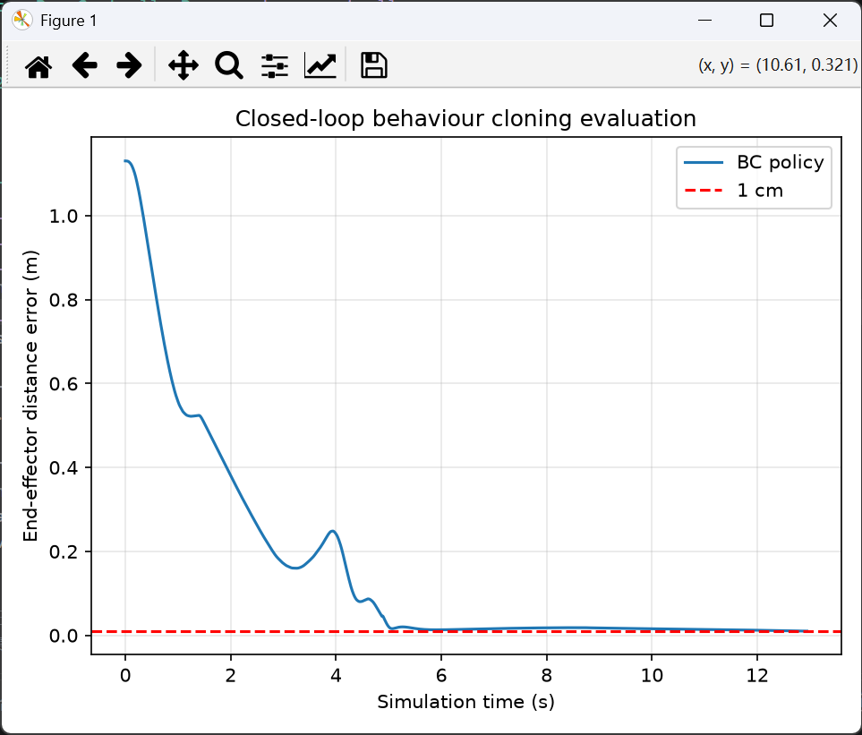

图7　首次成功案例。单次成功说明模型具有完成该实例的能力，但不能代表整体成功率。

### 7.3 统一批量评估标准

| 项目 | 统一设置 |
|---|---|
| 每个目标最长时间 | 20s仿真时间 |
| 环境测量噪声 | 关闭 |
| 成功判定 | 20秒内任意观测时刻，末端欧氏距离误差小于0.01m |
| 最短成功时间 | 无；不要求等待8秒 |
| 成功后保持 | 无；首次满足条件即可结束 |
| 模型动作限幅 | 轮速±3rad/s，机械臂力矩±30N·m |
| 阶段输入 | 根据实际底盘状态更新专家导航规则，仅取标志 |
| 强制停车 | 不使用 |
| 进程错误 | 计入总目标数，不从分母删除 |

采集中的“到达后保持1秒”和评估中的“首次到达即成功”是不同设置，不能混用。该成功标准评价到达能力，不单独证明长期保持稳定性。

最早批量程序保留了8秒最短判定时间，得到54/71。去掉这一限制后，利用已保存轨迹重新按首次到达判定，结果为56/71。该56/71是旧轨迹的事后重评，不是重新运行71次仿真。

| 指标 | 修正后 noise 模型测试集结果 |
|---|---:|
| 成功数／总数 | 56／71 |
| 到达成功率 | 78.87% |
| 失败数 | 15 |
| 平均首次到达时间，仅成功案例 | 7.55s |
| 目标高度0.3m的成功数 | 1／9 |

其中目标 `[-0.5, 1.0, 0.3]` 的最低误差约为0.0213m，即2.13cm，而不是0.021cm；虽然接近目标，仍高于1cm容差。其精细纠偏不足是待分析的解释，不能仅凭距离曲线确定具体力矩误差来源。

## 8 实验五 低高度近目标重采样

### 8.1 方法与实际采样比例

不重新采数据，也不改变目标划分、模型结构和动作损失。对训练集使用有放回加权随机采样，每轮抽取总次数仍等于原训练样本数。

| 样本条件 | 采样权重 |
|---|---:|
| 普通样本 | 1 |
| 同时满足目标z≤0.4m、`base_active=0`、末端误差≤0.05m | 3 |

重点样本判定使用原始物理单位，且仅影响训练样本的抽取；末端误差并没有额外加入策略输入。单个重点样本被抽中的相对概率为普通样本的三倍，并不表示生成三条新轨迹或重点样本一定占75%。

| 指标 | 数值 |
|---|---:|
| 重点训练样本数 | 278,730 |
| 重点样本原始占比 | 9.34% |
| 加权抽取后的预期占比 | 23.62% |
| 停止阶段样本原始占比 | 45.70% |
| 加权抽取后停止阶段预期占比 | 54.25% |

验证集保持自然分布，不进行加权抽取。标准化参数仍来自原始训练集；额外停止损失在小批次中的频率校正使用实际采样分布。

训练脚本为 `train_bc_23d_noise_resample.py`。最佳轮次136，加权验证损失0.059856，第151轮早停。

### 8.2 验证集结果

在70个验证目标上得到52/70，即74.29%，18个失败，进程错误为0。

| 目标高度 | 成功数／目标数 | 成功率 |
|---|---:|---:|
| 0.3m | 9／10 | 90.00% |
| 0.4m | 9／15 | 60.00% |
| 0.5m | 8／12 | 66.67% |
| 0.6m | 13／16 | 81.25% |
| 0.7m | 6／8 | 75.00% |
| 0.8m | 7／9 | 77.78% |

| 失败类别 | 数量 | 记录中的表现 |
|---|---:|---|
| 导航阶段未结束 | 9 | `base_active`始终为1 |
| 已切换阶段，但未成功到达 | 9 | 最终误差约1.24～5.58cm，包含精度不足或随后偏离 |

74.29%使用的是验证集70个目标，不能直接与旧noise模型在测试集71个目标上的78.87%比较，因此随后用同一测试集进行配对评估。

### 8.3 相同测试集上的比较

| 指标 | noise 模型 | resample 模型 |
|---|---:|---:|
| 成功数／总数 | 56／71 | 56／71 |
| 成功率 | 78.87% | 78.87% |
| z=0.3m成功数 | 1／9 | 7／9 |
| 成功案例平均首次到达时间 | 7.55s | 7.98s |

两组成功案例不完全相同，因此平均到达时间不是同一批成功目标上的纯速度对比。进一步按目标配对可见：

| 配对结果 | 目标数 |
|---|---:|
| 两个模型都成功 | 45 |
| noise失败、resample成功 | 11 |
| noise成功、resample失败 | 11 |
| 两个模型都失败 | 4 |

最低高度目标明显改善，但其他区域出现退步，整体成功数抵消。这支持训练样本分配会影响不同区域的表现，尚不能据此断言只增加训练轮数就可以全部解决。

## 9 实验六 小学习率微调

### 9.1 改动

在resample模型第136轮最佳权重上继续训练，沿用原标准化参数和目标分组。

| 设置 | resample原训练 | 微调 |
|---|---:|---:|
| 网络隐藏层 | 128、128 | 128、128 |
| 初始化 | 随机权重 | 加载resample最佳模型 |
| 学习率 | 0.001 | 0.0001 |
| 重点样本采样权重 | 3 | 2 |
| 动作损失权重 | 1∶1∶2 | 1∶1∶2 |
| 最大新增轮数 | 200 | 200 |
| 早停耐心 | 15 | 15 |

微调使用新的Adam优化器状态，不是完全恢复原优化器的断点续训。原模型记为epoch 0，并在新目录保留；只有验证损失更低才更新最佳模型。

倍率从3降到2后，重点样本预期占比从23.62%降为17.09%，停止阶段样本预期占比从54.25%降为50.34%。这改变了训练关注分配，但不改变验证集。

### 9.2 训练结果

最佳微调轮次为10，第25轮早停。

| 验证指标 | 微调前 | 微调后 | 降幅 |
|---|---:|---:|---:|
| 加权损失 | 0.059856 | 0.058963 | 1.49% |
| 普通MSE | 0.037165 | 0.036622 | 1.46% |
| 轮速MSE | 0.003349 | 0.003278 | 2.12% |
| 机械臂MSE | 0.056488 | 0.055676 | 1.44% |
| 停止阶段轮速MSE | 0.00000962 | 0.00000454 | 52.82% |

### 9.3 相同验证集上的闭环结果

| 指标 | resample | 微调模型 |
|---|---:|---:|
| 成功数／总数 | 52／70 | 59／70 |
| 成功率 | 74.29% | 84.29% |
| 未完成导航阶段切换 | 9 | 5 |
| 共同成功的47个目标平均到达时间 | 7.61s | 7.13s |
| 进程错误 | 0 | 0 |

配对比较中，12个目标从失败变为成功，5个从成功变为失败，47个保持成功，6个仍失败。成功率增加的是10.00个百分点。

| 目标高度 | resample成功数 | 微调成功数 | 目标数 |
|---|---:|---:|---:|
| 0.3m | 9 | 9 | 10 |
| 0.4m | 9 | 10 | 15 |
| 0.5m | 8 | 10 | 12 |
| 0.6m | 13 | 15 | 16 |
| 0.7m | 6 | 7 | 8 |
| 0.8m | 7 | 8 | 9 |

这次改进同时包含降低学习率和减轻采样偏重，不能把收益单独归因于其中某一个因素。截至整理时，尚无该微调模型在71个测试目标上完成批量评估的结果文件，因此不把84.29%写作测试集成功率。

## 10 导航失败案例复核

### 10.1 学习模型在正x目标上的表现

对目标 `[0.6, 0.9, 0.3]`，微调模型在20秒内没有完成导航切换。回放保存的底盘状态发现：

| 指标 | 结果 |
|---|---|
| 全程阶段输入 | `base_active=1` |
| 导航子阶段 | 一直为`align`，未进入`drive` |
| 最小末端误差 | 约42.49cm |
| 最终末端误差 | 约45.99cm |
| 最后底盘到预定停车位置的距离 | 约18.43cm |

模型在应对准停车位置的阶段已经产生明显平移，却没有满足状态机的退出条件。机械臂看似“没有启动”，与导航标志始终为1、训练中该标志对应维持姿态的现象一致；测试代码并没有禁止机械臂输出动作。

### 10.2 用专家复跑同一目标

关闭测量噪声和力矩脉冲后，专家在同一目标成功完成：

| 事件 | 仿真时间或误差 |
|---|---:|
| 导航结束 | 3.835s |
| 首次进入1cm范围 | 7.234s |
| 连续保持1秒后结束 | 8.234s |
| 最终末端误差 | 约2.7mm |

这排除了该实例在当前仿真中无法由专家完成的解释，更应关注模型底盘动作与阶段判断之间的配合。

`base_active=1`把`align`、`drive`、`orient`合并为一类，而专家仍保有具体子阶段记忆。这是后续可检验的输入信息不足假设。只观察一个案例还不能断言所有导航失败都由此造成，也不能仅凭两个不同目标认定失败由x坐标导致。

## 11 实验七 三隐藏层网络

### 11.1 网络结构与设置

新建 `train_bc_23d_noise_wide.py`，将网络扩展为：

```text
23 → Linear 256 → ReLU → Linear 256 → ReLU
   → Linear 128 → ReLU → Linear 11
```

| 项目 | 设置 |
|---|---|
| 隐藏层 | 256、256、128 |
| 参数总数 | 106,251 |
| 初始化 | 从随机权重开始，不加载旧128层模型 |
| 学习率 | 0.0001 |
| 重点样本采样权重 | 2 |
| 数据和划分 | 与微调模型相同 |
| 动作损失权重 | 1∶1∶2 |
| 历史输入 | 未增加 |
| 最大轮数／早停耐心 | 200／15 |

训练期间验证损失有起伏，并不保证逐轮下降：训练每轮有放回随机抽样，参数按小批次更新，不同动作任务又共享参数。验证集没有随机重采样，其波动来自不断变化的模型。

### 11.2 训练结果

文件记录显示，新网络最佳轮次为135，第150轮后结束，符合连续15轮未改善的早停设置。

| 验证指标 | 新三隐藏层网络 | 两隐藏层微调模型 |
|---|---:|---:|
| 加权损失 | 0.060024 | 0.058963 |
| 普通MSE | 0.037398 | 0.036622 |
| 轮速MSE | 0.002809 | 0.003278 |
| 机械臂MSE | 0.057163 | 0.055676 |
| 停止阶段轮速MSE | 0.00002612 | 0.00000454 |

新网络的总验证损失较高，但普通轮速项较低，各项并非一致退步。它从头训练，而微调模型已有多阶段训练经历，因此不是只改变结构的严格等训练预算对照。

测试代码随后已改为从检查点配置读取隐藏层结构，兼容`128、128`和`256、256、128`。闭环结果补记于下一节；本阶段没有额外实施历史输入或学习率调度。

### 11.3 加宽网络的闭环验证结果

2026年10月31日完成70个原验证目标的正式批量评估，得到60/70，成功率85.71%，进程错误为0。所有目标都完成了导航阶段切换；10个失败目标均发生在切换之后。此结果补齐了上一版记录中“加宽网络尚未完成闭环评估”的空缺。

| 目标高度 | 成功数／目标数 | 成功率 |
|---|---:|---:|
| 0.3m | 3／10 | 30.00% |
| 0.4m | 13／15 | 86.67% |
| 0.5m | 12／12 | 100.00% |
| 0.6m | 16／16 | 100.00% |
| 0.7m | 7／8 | 87.50% |
| 0.8m | 9／9 | 100.00% |

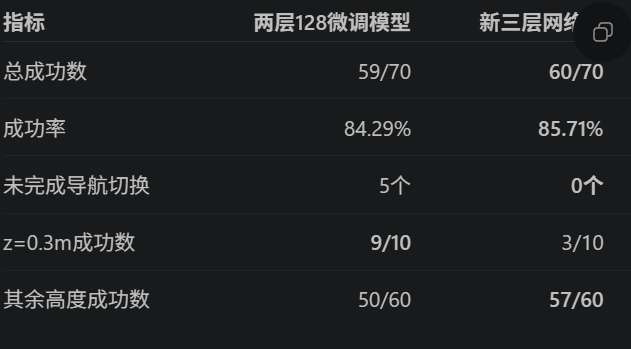

图8　原Word新增截图。该网络在这批目标上完成了导航切换，但低高度0.3m的末端到达仍有明显不足。

与E6的59/70相比，E7增加到60/70，净增加1个成功目标，不能仅据此认定更大的网络全面优于原模型。E6在z=0.3m上为9/10，而E7为3/10；收益和退步发生在不同目标区域。

## 12 实验八 加宽网络的小学习率微调

### 12.1 改动与训练结果

新建 `train_bc_23d_noise_wide_finetune.py`，从E7第135轮最佳权重开始，保留原标准化、隐藏层、数据划分、损失和采样倍率，仅将学习率从0.0001降为0.00001。最佳新增轮次为12，第27轮结束。

| 最佳验证指标 | 微调前 E7 | 微调后 E8 |
|---|---:|---:|
| 加权损失 | 0.060024 | 0.059560 |
| 普通MSE | 0.037398 | 0.037101 |
| 轮速MSE | 0.002809 | 0.002838 |
| 机械臂MSE | 0.057163 | 0.056679 |
| 停止阶段轮速MSE | 0.00002612 | 0.00002115 |

### 12.2 同一70个验证目标上的结果

| 指标 | 微调前 E7 | 微调后 E8 |
|---|---:|---:|
| 成功数／目标数 | 60／70 | 60／70 |
| 到达成功率 | 85.71% | 85.71% |
| z=0.3m | 3／10 | 3／10 |
| z=0.4m | 13／15 | 12／15 |
| z=0.5～0.8m | 44／45 | 45／45 |
| 导航阶段未结束 | 0 | 0 |
| 进程错误 | 0 | 0 |

逐目标比较有5个由失败变成功、5个由成功变失败，总成功数抵消。离线损失略降没有转化为总体到达成功率的提升。

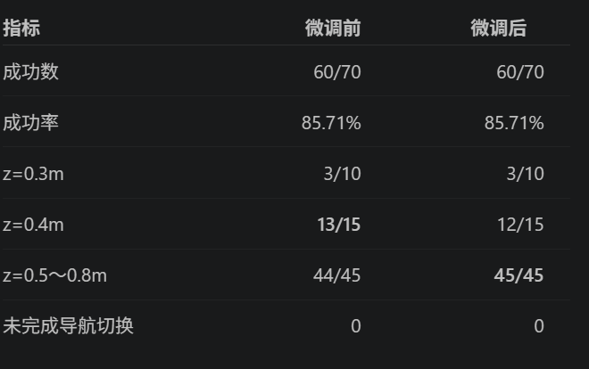

图9　原Word新增的微调结果表。该实验没有解决最低高度的主要问题。

### 12.3 接近目标后再次偏离的案例

对 `[0.2, 1.1, 0.4]`，旧加宽微调模型在约6.193s时曾接近至1.0572cm，略高于1cm阈值，随后发生明显姿态调整和偏离，20s时误差约20.27cm。阶段标志在约4.306s后一直为0，因此不能解释为程序重新安排了一次导航任务。

保存轨迹中，早期关节偏离出现在明显底盘漂移之前；后续轮速和底盘姿态也发生变化。由此只能判断机械臂与底盘误差可能互相影响，不能仅凭“看起来第二次接近”断言模型有明确的重试意图。失败目标的三维分布图用于定位空间区域，不用于独立证明失败原因。

## 13 专家高度探索与数据集扩展

### 13.1 先探索当前专家的完成范围

为改善低高度表现，并检查现有数据是否覆盖过窄，先使用 `collect_expert_z_probe.py`。固定目标平面坐标 `[0.0, 1.1]`、机器人初始化和专家控制参数，只扫描目标高度；底盘停车距离仍按目标高度的standoff规则计算。探索时关闭测量噪声和力矩脉冲，上限40s，采用1cm容差和连续保持1s的专家完成标准。

| 探索高度 | 结果 | 说明 |
|---|---|---|
| 0.1～1.3m，每0.1m一点 | 13／13完成到达并连续保持 | 支持把这些高度作为后续正式采集的候选范围 |
| 0.0m | 曾进入1cm，但未完成连续保持 | 首次到达32.166s；最低0.9930cm，最终1.1685cm，40s终止 |
| 1.4m | 未进入1cm | 最小误差7.1066cm |
| 1.5m | 未进入1cm | 最小误差16.9674cm |
| 1.6m | 未进入1cm | 最小误差26.8585cm |

这是当前专家、固定初始化和平面目标下的实测结果，不是机械臂全局几何工作空间的上下限。z=0m是保持条件失败，不是“从未进入1cm”。探索数据保存在 `expert_z_probe/`，未直接混入正式数据集。

### 13.2 仅补采缺失高度

修改 `collect_expert.py`，扫描现有NPZ内部的目标坐标，保留原468个目标及其轨迹，只补采新增高度。仍使用 `robotnik_arm_task_3.py`、配置测量噪声和到达后连续保持1s，关闭任务脚本中的力矩脉冲。

| 项目 | 原数据集 | 扩展后数据集 |
|---|---:|---:|
| x范围与步长 | −0.6～0.6m，0.1m | 相同 |
| y范围与步长 | 0.9～1.4m，0.1m | 相同 |
| z范围与步长 | 0.3～0.8m，0.1m | **0.1～1.3m，0.1m** |
| 目标组合数 | 13×6×6＝468 | **13×6×13＝1014** |
| 本次新增轨迹 | — | **546** |
| 每个高度的目标数 | 78 | 78 |

新增高度为0.1、0.2、0.9、1.0、1.1、1.2、1.3m。本次日志显示：计划546条、保存546条、连续保持成功546条、进程错误0、缺失目标0。数据仍追加到 `RoboEnv/expert_data_23d_noise/`，不覆盖旧文件。旧数据中原来保留的1条未满足连续保持结束条件的轨迹继续保留，未因扩展而删除。

E9/E10使用的扩展集共有9,514,061个时间步，仍是小车一侧的规则网格；在该训练阶段尚未实现环状目标、随机初始朝向、随机起点或不同距离带采集。后续环状采集进展见第19节。

### 13.3 扩展清单并保持旧目标归属

新建清单生成脚本 `split_expert_data_noise_extended.py`，以E8运行目录中冻结的旧清单为依据，原468个目标的train／val／test归属不变；新增546个目标按高度分层划分，随机种子42，不以最终误差或success标志筛选。

| 集合 | 保留旧目标 | 新增目标 | 总目标及轨迹数 | 时间步样本数 |
|---|---:|---:|---:|---:|
| train | 327 | 382 | **709** | **6,661,343** |
| val | 70 | 82 | **152** | **1,405,074** |
| test | 71 | 82 | **153** | **1,447,644** |
| 合计 | 468 | 546 | **1014** | **9,514,061** |

新清单位于 `RoboEnv/bc_training_23d_noise_extended/data_split.json`。旧目标和文件在各集合中保留原顺序，新增目标追加，因此新验证清单前70项恰好是原70个验证目标。对照实验应按目标坐标确认身份，不能在任意新清单里都假定“前70项就是旧验证集”。

当前数据已打包到 `RoboEnv/dataset_exports/robotnik_expert_23d_extended_1014_20261031.zip`，包内包含1014个NPZ、相对路径版划分清单和说明。共享时使用包内相对路径，不要求组员保留本机F盘目录。

## 14 实验九 扩展数据训练23维加宽模型

### 14.1 训练设置与结果

将 `train_bc_23d_noise_wide.py` 指向扩展清单，仍使用23维输入、11维输出、256／256／128隐藏层、学习率0.0001、采样倍率2和1∶1∶2损失，从随机权重重新训练。结果另存到 `bc_training_23d_noise_wide_extended/`。

最佳轮次138，第153轮结束；每轮读取的训练样本增多，实际训练持续约三小时。训练集和验证集同时扩大，输出标准化也重新计算，因此新损失比旧468目标实验低，不能单凭这一点认为控制一定更好。

| 第138轮最佳验证指标 | 数值 |
|---|---:|
| 加权损失 | 0.012104 |
| 普通MSE | 0.007006 |
| 轮速MSE | 0.002451 |
| 机械臂MSE | 0.009608 |
| 停止阶段轮速MSE | 0.00002232 |

### 14.2 先在原70个验证目标上比较

| 相同原验证目标 | E8 旧数据加宽微调模型 | E9 扩展数据23维模型 |
|---|---:|---:|
| 总成功数 | 60／70 | 56／70 |
| 成功率 | 85.71% | 80.00% |
| z=0.3m | 3／10 | 5／10 |
| z=0.4m | 12／15 | 7／15 |
| z=0.5m | 12／12 | 12／12 |
| z=0.6m | 16／16 | 15／16 |
| z=0.7m | 8／8 | 8／8 |
| z=0.8m | 9／9 | 9／9 |

配对比较中，4个目标从失败变成功、8个从成功变失败。这里80.00%是完整的“旧70目标对照”，但只是扩展后152个验证目标的一个子集，所以程序提示partial subset是合理的。该结果说明扩大高度范围没有自动改善原区域的所有目标。

### 14.3 再评估全部152个验证目标

完整评估得到115/152＝75.66%，37个失败，进程错误0。按高度分组见第16节。

| 高度分段 | 成功数／目标数 | 成功率 |
|---|---:|---:|
| 低高度0.1～0.4m | 22／48 | 45.83% |
| 中间高度0.5～1.0m | 67／68 | 98.53% |
| 高高度1.1～1.3m | 26／36 | 72.22% |

因此问题不只集中在原0.3、0.4m，高度0.1、0.2m和1.3m同样有不足。37个失败目标中，36个曾进入5cm，24个曾进入2cm；另1个目标 `[-0.6, 1.0, 0.2]` 未完成导航切换。多数失败已接近目标，但不能把全部失败统一归为最后几厘米的精度问题。

### 14.4 使用现有记录做单目标诊断

新建 `diagnose_bc_failure.py`，读取专家示范和模型闭环轨迹，不重新训练、不重新采集。绘制末端误差、底盘位置、阶段、关节角、关节速度、力矩和轮速。对专家状态再运行模型预测，用于区分两种比较：

| 曲线比较 | 能说明什么 |
|---|---|
| 同一专家状态上的专家标签与模型预测 | 直接检查已有状态上的离线动作拟合 |
| 专家轨迹与模型自身闭环轨迹 | 观察行为差异；相同时刻通常不是相同状态 |

在 `[0.2, 1.1, 0.4]` 上，E9约4.266s完成阶段切换，5.843s进入5cm，20s末误差仍为1.0639cm。首次进入5cm到结束，底盘平面位置累计变化约2.3cm。这个版本不同于E8的明显发散案例，主要表现为接近阈值但未进入。

专家轨迹中的末段力矩仍存在预测偏差，闭环底盘也有慢漂。现有叠加曲线不足以把失败归为唯一原因；专家观测带噪、评估关闭噪声也会影响比较。本阶段没有在模型访问状态上重新请求专家标签，没有实施DAgger或恢复示范补标。

## 15 实验十 增加三维末端位置误差

### 15.1 为什么不需要重新采集

检查采集代码及真实NPZ后确认，文件除23维 `observations` 和11维 `actions` 外，还保存了与观测对齐的 `ee_positions`。它来自当前测量状态的正运动学，末端链接为 `robot_j2s7s300_end_effector`。此前未把该三维位置直接送入网络。

| 文件字段 | 形状 | 当前作用 |
|---|---|---|
| `observations` | N×23 | 已有状态、目标和阶段输入 |
| `actions` | N×11 | 专家动作监督标签 |
| `ee_positions` | N×3 | 同一执行前状态的末端位置，可构造新增特征 |
| `ee_errors` | N | 距离大小，用于重点样本判定；不是三维方向误差 |
| `timestamps` | N | 对齐时间与轨迹分析 |
| `applied_actions` | N×11 | 实际执行动作，和专家标签分开保存 |
| `q_des_arm`、`qd_des_arm` | N×7 | 专家内部参考，用于诊断，不作为当前策略输入 |
| `base_orientations`、目标及结束信息 | 每步或每条轨迹 | 坐标和阶段复核、成功判定与追溯 |

读取文件时计算 `target_xyz - ee_positions` 并拼接到原观测末尾。原NPZ和划分清单不改写，只在内存中得到26维输入。

### 15.2 特征定义与组员方案的关系

| 输入内容 | 26维列号，从0开始 | 维度 |
|---|---|---:|
| 底盘位置xyz | 0～2 | 3 |
| 底盘朝向sin、cos | 3～4 | 2 |
| 七个机械臂关节角 | 5～11 | 7 |
| 七个机械臂关节角速度 | 12～18 | 7 |
| 目标位置xyz | 19～21 | 3 |
| `base_active` | 22 | 1 |
| **目标减末端的三维位置误差** | **23～25** | **3** |
| **合计** | | **26** |

新增特征为：

```python
ee_error_xyz = observations[:, 19:22] - ee_positions
x26 = np.concatenate([observations, ee_error_xyz], axis=1)
```

误差单位为米，使用相同坐标系和相同执行前时间步。三维误差需要标准化；阶段标志仍在第22列，保持0／1，不因追加特征而挪到最后一列。目标位置、朝向和关节状态理论上已能通过正运动学推导末端位置，因此这是显式表达已有信息，不是获得新的传感器。

组员提出的28维方案为原22维加末端位置3维、位置误差3维，表中未列阶段标志。我们借鉴其显式误差表达，但保留阶段输入，不同时追加末端位置；目标位置与误差已能推导末端位置。若保留我们的阶段标志再同时加入两组三维量，总维度应为29，而不是28。本次只实施26维方案。

### 15.3 训练设置与最佳检查点

新建 `train_bc_26d_noise_wide.py`，改动标注为 `[26D change]`。网络改为：

```text
26 → Linear 256 → ReLU → Linear 256 → ReLU
   → Linear 128 → ReLU → Linear 11
```

| 项目 | E9 23维扩展模型 | E10 26维扩展模型 |
|---|---|---|
| 原始NPZ与目标划分 | 1014条，709／152／153 | 相同 |
| 隐藏层 | 256、256、128 | 相同 |
| 输入／输出维度 | 23／11 | **26／11** |
| 参数总数 | 106,251 | **107,019** |
| 初始化 | 随机权重 | 随机权重，不加载23维旧模型 |
| 学习率 | 0.0001 | 相同 |
| 损失权重 | 机械臂∶轮速∶停止轮速＝1∶1∶2 | 相同 |
| 重点样本采样权重 | 2 | 相同 |
| 批次／上限／早停耐心 | 4096／200／15 | 相同 |
| 最佳轮次／结束轮次 | 138／153 | **162／177** |

| 最佳验证指标 | E9 | E10 |
|---|---:|---:|
| 加权损失 | 0.012104 | **0.011702** |
| 普通MSE | 0.007006 | **0.006778** |
| 轮速MSE | 0.002451 | **0.002384** |
| 机械臂MSE | 0.009608 | **0.009289** |
| 停止阶段轮速MSE | 0.00002232 | **0.00001452** |

两次训练使用相同的原始动作和输出归一化，验证损失可以直接比较。停止时间不同，随机初始化也因输入尺寸改变而改变，因此这不是完全等训练轮数或多随机种子的因果检验。

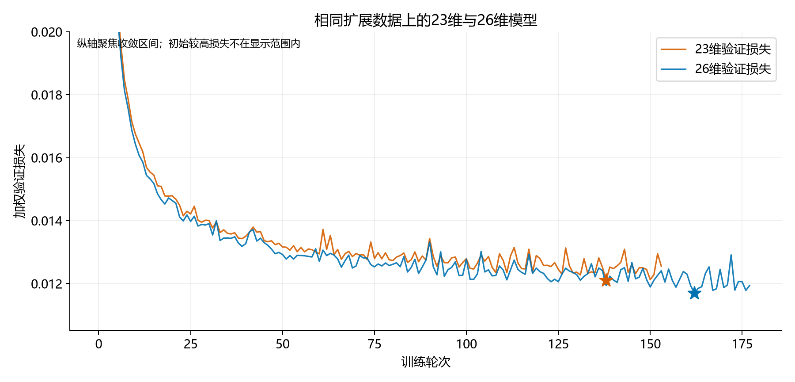

图10　相同扩展数据上的加权验证损失。星号为各自选中的最低验证损失，曲线止于各自的早停轮次。

### 15.4 测试实现与完整验证结果

新建 `test_bc_26d.py` 和 `batch_test_bc_26d.py`，推理时用相同末端链接进行正运动学，构造同一执行前状态的三维误差，再使用本次26维标准化。检查实际轨迹后确认新增特征与训练公式一致。

保留20s上限、无测量噪声、任意时刻误差小于1cm即可成功、无8s门槛、无需保持的评估标准。全部11维动作由模型预测；导航规则只产生阶段标志，轮速指令被丢弃；没有按阶段强制将轮速归零。

先完成单个验证目标的程序连通检查，随后运行完整152个验证目标。单个样本1/1不计作独立总体评估，也不与152个结果合并计数。

| 完整验证指标 | E9 23维 | E10 26维 |
|---|---:|---:|
| 成功数／目标数 | 115／152 | **138／152** |
| 到达成功率 | 75.66% | **90.79%** |
| 未成功目标数 | 37 | **14** |
| 进程错误 | 0 | 0 |
| 成功案例平均到达时间 | 不直接与不同成功集合比较 | 7.924s |
| 共同成功108个目标的平均到达时间 | 8.305s | **7.524s** |

核对评估配置后，目标列表、种子、仿真时限、噪声、容差、动作限幅和阶段规则一致；全部152个NPZ与CSV、summary的成功判定一致。净增加23个成功目标，成功率提高15.13个百分点。

| 同目标配对结果 | 数量 |
|---|---:|
| 两个模型都成功 | 108 |
| 23维失败，26维成功 | **30** |
| 23维成功，26维失败 | **7** |
| 两个模型都失败 | 7 |

对先前重点诊断的 `[0.2, 1.1, 0.4]`，26维模型在6.917s时达到0.9990cm，首次满足成功条件；23维模型在20s仍为1.0639cm。新增误差特征在这次对照中改善了到达表现，但尚不能据此证明持续保持稳定性。

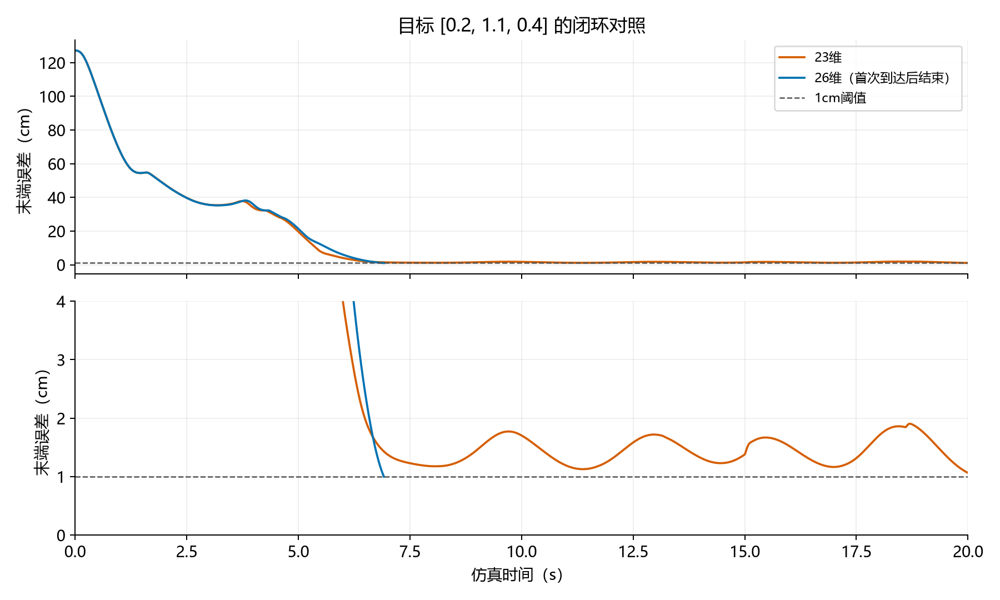

图11　上图保留完整仿真时间范围，下图放大目标附近。26维曲线在首次成功处结束，不表示之后已验证持续保持。

## 16 各阶段结果汇总

### 16.1 训练结果

| 编号 | 实验 | 目标数 | 输入维度 | 隐藏层 | 最佳轮次 | 结束轮次 | 最佳验证普通MSE | 最佳验证加权损失 |
|---|---|---:|---:|---|---:|---:|---:|---:|
| E1 | 原始行为克隆 | 468 | 22 | 128、128 | 98 | 100 | 0.016699 | 不适用 |
| E2 | 增加阶段标志 | 468 | 23 | 128、128 | 114 | 129 | 0.014403 | 不适用 |
| E3 | 加权动作损失 | 468 | 23 | 128、128 | 107 | 122 | 0.014107 | 0.022892 |
| E4 | 测量噪声与保持数据 | 468 | 23 | 128、128 | 71 | 86 | 0.037426 | 0.060254 |
| E5 | 低高度近目标重采样 | 468 | 23 | 128、128 | 136 | 151 | 0.037165 | 0.059856 |
| E6 | 小网络微调 | 468 | 23 | 128、128 | 10 | 25 | 0.036622 | 0.058963 |
| E7 | 三隐藏层网络 | 468 | 23 | 256、256、128 | 135 | 150 | 0.037398 | 0.060024 |
| E8 | 三隐藏层网络微调 | 468 | 23 | 256、256、128 | 12 | 27 | 0.037101 | 0.059560 |
| E9 | 扩展目标高度 | 1014 | 23 | 256、256、128 | 138 | 153 | 0.007006 | 0.012104 |
| E10 | 显式末端三维误差 | 1014 | 26 | 256、256、128 | 162 | 177 | **0.006778** | **0.011702** |
| E11 | 独立环状数据训练 | 931 | 26 | 256、256、128 | 120 | 135 | 0.009151 | 0.018776 |
| E12 | 环状底盘朝向坐标系 | 931 | 26 | 256、256、128 | 133 | 148 | 0.007703 | 0.015212 |

E6和E8的轮次是新增微调轮次。E1～E3、E4～E8、E9～E10分别有不同的数据或归一化背景，不跨组简单按损失高低排名。E9与E10的动作、划分和输出归一化相同，可直接比较其验证指标。E11使用独立环状数据、不同划分和新归一化，不能按loss数值直接给E10/E11作同任务排名。

E13只训练8维输入、4维输出的导航网络，E14和E15只优化7维力矩损失，且E15验证目标增至144，指标定义或集合不同，不混入上述11维整机损失排名；详见第28～29节。

### 16.2 闭环结果按集合分别列出

| 实验和口径 | 集合 | 成功数／目标数 | 成功率 | 说明 |
|---|---|---:|---:|---|
| E4 历史8s门槛 | 旧test | 54／71 | 76.06% | 历史口径 |
| E4 旧轨迹按任意时刻重评 | 旧test | 56／71 | 78.87% | 不是重新仿真 |
| E5 重采样 | 旧test | 56／71 | 78.87% | 同71个目标 |
| E5 重采样 | 旧val | 52／70 | 74.29% | 开发验证 |
| E6 小网络微调 | 旧val | 59／70 | 84.29% | 同70个目标 |
| E7 三隐藏层 | 旧val | 60／70 | 85.71% | 同70个目标 |
| E8 三隐藏层微调 | 旧val | 60／70 | 85.71% | 同70个目标 |
| E9 扩展数据23维 | 旧val子集 | 56／70 | 80.00% | 扩展清单中的原70目标 |
| E10 扩展数据26维 | 旧val子集 | 65／70 | 92.86% | 从完整152次结果中提取，不是额外重跑 |
| E9 扩展数据23维 | 完整新val | 115／152 | 75.66% | 完整扩展验证集 |
| E10 扩展数据26维 | 完整单侧val | **138／152** | **90.79%** | 单侧验证，非环状目标 |
| E10 扩展数据26维 | 新test | **待评估** | **待评估** | 核验时未发现完成的153目标正式测试记录 |
| E11 环状26维 | 完整环状val | **22／140** | **15.71%** | 新目标集合，不能与152目标直接当作同集合对照 |
| E11 环状26维 | 已见train分层抽测 | **4／21** | **19.05%** | 诊断，不代表完整651目标或泛化 |
| E11 环状26维 | 环状test | **待评估** | **待评估** | 尚无完成的140目标正式结果 |
| E12 底盘朝向坐标系26维 | 同140目标完整环状val | **65／140** | **46.43%** | 与E11同目标集合 |
| E12 原模型子集 | r≥0.8m的116个val | **63／116** | **54.31%** | 从已完成140目标结果按坐标提取 |
| E13 学习导航＋原机械臂 | 同116个val | **94／116** | **81.03%** | 两模型产生11维动作，仍使用规则阶段输入 |
| E14 仅机械臂微调 | 同116个val | **98／116** | **84.48%** | 相比E13净增加4个成功 |
| E15 补采后继续微调 | 新144个val | **待最终闭环核验** | **待最终闭环核验** | 需分别看原116点和新增28点，见第34节 |

上述完成的正式批量结果进程错误均为0。历史目录中还有未完成的70目标批次和1目标程序检查，不作为总体成功率结果。

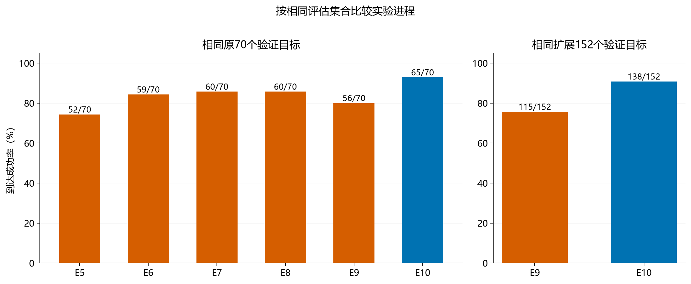

图12　左图仅比较相同旧70个验证目标，右图仅比较相同扩展152个验证目标。不同集合分开展示，避免把分母变化误解为性能变化。此历史图未包含E11，环状结果见上表及第22～24节。

### 16.3 扩展集按高度比较

| 目标高度z | 验证目标数 | E9 23维成功数 | E9成功率 | E10 26维成功数 | E10成功率 |
|---:|---:|---:|---:|---:|---:|
| 0.1m | 11 | 4 | 36.36% | **2** | **18.18%** |
| 0.2m | 12 | 6 | 50.00% | **12** | **100.00%** |
| 0.3m | 10 | 5 | 50.00% | **8** | **80.00%** |
| 0.4m | 15 | 7 | 46.67% | **13** | **86.67%** |
| 0.5m | 12 | 12 | 100.00% | **11** | **91.67%** |
| 0.6m | 16 | 15 | 93.75% | **16** | **100.00%** |
| 0.7m | 8 | 8 | 100.00% | 8 | 100.00% |
| 0.8m | 9 | 9 | 100.00% | 9 | 100.00% |
| 0.9m | 12 | 12 | 100.00% | 12 | 100.00% |
| 1.0m | 11 | 11 | 100.00% | 11 | 100.00% |
| 1.1m | 12 | 9 | 75.00% | **12** | **100.00%** |
| 1.2m | 12 | 10 | 83.33% | **12** | **100.00%** |
| 1.3m | 12 | 7 | 58.33% | **12** | **100.00%** |
| **合计** | **152** | **115** | **75.66%** | **138** | **90.79%** |

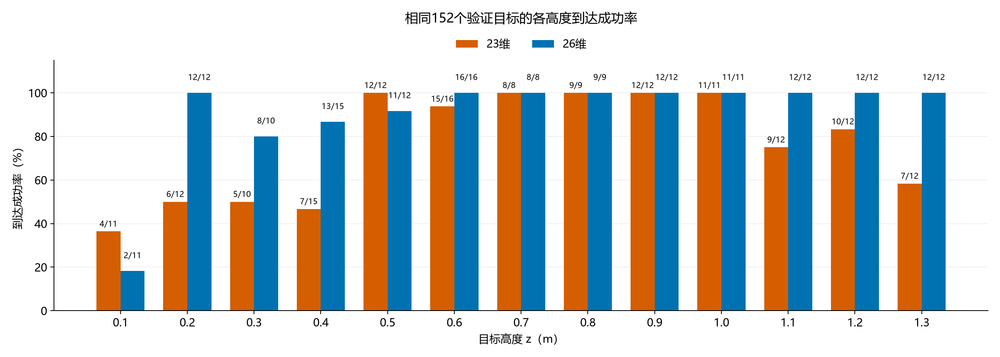

图13　柱高为成功率，柱上数字为成功数／该高度目标数。每个高度的验证目标数量不同，整体成功率按152个目标汇总，不对13个高度百分比直接取平均。

26维模型在0.2～0.4m及1.1～1.3m明显改善，但不是所有高度都改善。14个失败中9个位于0.1m，另外2个位于0.3m、2个位于0.4m、1个位于0.5m。14个均完成导航切换并因20s超时结束；全部曾进入5cm，其中12个进入2cm。

当前低高度0.1～0.4m合计35/48＝72.92%，中间高度0.5～1.0m为67/68＝98.53%，高高度1.1～1.3m为36/36＝100.00%。剩余问题应聚焦具体最低高度和末段控制，不能再笼统描述为所有低高度都失败。

### 16.4 仅统计0.2至1.3m的验证子集

在E10已完成的152个验证目标中，z=0.1m占11个，其中2个成功。排除这一高度后，现有模型在其余目标上的结果为：

```text
(138 − 2) / (152 − 11) = 136 / 141 = 96.45%
```

这是同一模型、同一次验证结果的高度子集统计，没有重新训练或重新仿真，不是改变训练范围后的性能，也不是新153目标测试集的结果。它帮助确定后续优先关注0.2～1.3m，但不能据此推断其他方向也有96.45%的成功率。

## 17 跨方向泛化与专家环状探索

### 17.1 26维模型在反方向目标上失败

为检查单侧训练之外的方向泛化，把熟悉目标 `[0, 1.1, 0.5]` 改为 `[0, -1.1, 0.5]`，水平距离和高度相近，方向相反。用户在GUI中观察到小车持续转圈；保存轨迹的结果为：

| 指标 | 结果 |
|---|---:|
| 学习模型 | E10，26维扩展模型 |
| 目标 | `[0.0, -1.1, 0.5]` |
| 仿真时限 | 20s |
| 成功到达 | False |
| 最小末端误差 | 0.740704m |
| 最终末端误差 | 1.643034m |
| 阶段切换时间 | 未记录有效值，导航未结束 |
| 终止原因 | `time_limit` |

专家随后能完成同一目标，说明该实例存在可用示范；学习模型的失败不能解释为专家也无法完成。该案例暴露了当前模型的方向泛化缺口，但一个反向失败点不代表所有陌生方向都会失败。

因此，后续先扩展目标方向、距离与高度的示范覆盖，保留26维结构；暂不同时改变机器人初始位置、朝向、网络结构或损失函数。

### 17.2 小规模圆环探索

创建 `collect_expert_ring_probe.py`，固定水平半径1.1m、高度0.5m，角度0～330度、每30度一点，共12个目标。角度按世界坐标+X方向起算，逆时针增加，90度为+Y，270度为−Y。

脚本最初沿用高度探索包装方式，默认在运行时关闭测量噪声。根据用户要求，随后改成与原 `collect_expert.py` 相同的直接subprocess调用，不再使用噪声包装器、运行时开关覆盖和自动绘图。

两轮正式方向探索均采用简化后的版本，使用以下设置：

| 项目 | 设置 |
|---|---|
| 专家脚本 | `robotnik_arm_task_3.py` |
| 唯一配置来源 | 项目 `configs/robotnik_arm.json`，文件未修改 |
| 测量噪声 | 完全沿用配置，噪声开关为1，各讨论噪声项为0.001 |
| 额外力矩脉冲 | `--noise-std 0`，关闭 |
| 每个目标上限 | 20s，20000步 |
| 到达与保持 | 记录首次进入1cm，并要求连续保持1s才以成功结束 |
| 原数据与清单 | 不修改、不混入正式集合 |
| 探索输出 | `RoboEnv/expert_ring_probe/run_时间戳/` |

### 17.3 两轮结果按相同角度比较

| 指标 | 第一轮 | 第二轮 |
|---|---:|---:|
| 曾进入1cm | **12／12** | **12／12** |
| 连续保持1秒 | 8／12，66.67% | 9／12，75.00% |
| 完成导航切换 | 12／12 | 12／12 |
| 程序错误 | 0 | 0 |

两次的目标、配置快照、时限与保持要求一致。保持结果有变化的方向及两次均未保持成功的方向如下，其余7个方向均完成保持：

| 角度 | 第一轮保持结果 | 第二轮保持结果 |
|---:|---|---|
| 60度 | 失败，最长0.331s | 成功，19.206s时完成保持 |
| 150度 | 失败，最长0.735s | 失败，最长0.017s |
| 210度 | 失败，最长0.076s | 失败，最长0.038s |
| 240度 | 成功 | 失败，最长0.786s |
| 300度 | 失败，最长0.114s | 成功 |

第一轮目录为 `run_20261102_002638_809959`，第二轮为 `run_20261102_004234_121394`。结论是：这两个独立批次中，12个离散方向都能曾经到达1cm；带噪条件下，连续保持结果仍有波动。不能把“保持失败”写成“这个方向到不了”，也不能由12个离散点推断所有半径和高度均可完成。

## 18 连续保持与噪声复核

### 18.1 60度目标的单独重跑

对目标 `[0.55, 0.952627944163, 0.5]` 进行带GUI的专家复跑，记录显示这次成功，并非此前保持结果读取错误：

| 指标 | 第一轮批量轨迹 | 单独重跑 |
|---|---:|---:|
| 首次进入1cm | 6.370s | 6.281s |
| 最长连续保持 | 0.331s | **1.343s** |
| 结束时间 | 20.000s，达到上限 | 8.000s，完成保持 |
| 最终误差 | 11.97mm | 5.07mm |

在同一7.5～8.0s时段，第一轮批量轨迹误差中位数7.32mm，单独重跑4.85mm；两次底盘平均XY位置相差约10.7mm。配置与批量快照一致，额外力矩脉冲均关闭。这里不仅是显示曲线的微小抖动，带噪反馈后经过的状态和控制参考也已经不同。

### 18.2 当前证据与尚未验证的解释

1秒连续保持约对应1000次0.001s检查，任一次观测误差离开1cm就重置计时。数毫米的误差分布变化，也可能表现为“8秒成功”和“20秒仍未满足保持”的二值差别。

专家机械臂参考由 `q_des_arm += qd_des_arm * dt` 累积更新，观测噪声会进入反馈与参考生成；底盘也按带噪状态判断切换。以上代码说明了差异可能发展的途径，但当前没有通过控制实验确定唯一原因。

`task_3` 的 `--seed` 当前只传给额外力矩脉冲的局部随机源，并未固定底层测量噪声的 `np.random.normal` 序列。因而同一目标、同一配置重复运行，不保证得到同一条带噪轨迹。固定测量噪声种子曾作为排查建议提出，但尚未实施；用户选择先保留现有噪声设置重复探索。

### 18.3 保留1秒设定的决定

继续保留采集中的连续保持1秒，不把它删掉。当初加入它，是为了补充首次接近后的小幅纠正、姿态维持力矩，以及机械臂阶段的停止轮速标签，回应早期模型接近目标后再次漂移或失稳的问题。

首次成功出现在“测量噪声＋保持数据”版本中，但两项同时变化，未独立量化保持1秒的贡献。该设定增加末段示范具有合理作用机制，不等于已通过消融实验证明它是全部改进来源。

采集时分别记录“曾到达”和“保持完成”；保持失败的轨迹仍保存，不自动删除或无限重采。连续保持计时可能被重置，所以实际到达后记录的尾段可以长于1秒。后续训练也需要注意不同轨迹长度产生的样本比例变化。

## 19 环状正式数据集与采集进度

### 19.1 最终确定的采样方案

方案从“少量半径、密集高度”调整为更密的水平距离、非均匀高度和外圈较多方向。以配置中的初始底盘XY为圆心，水平距离不超过2m；机器人初始化保持不变。

| 半径m | 每圈方向数 | 每个高度目标数 |
|---:|---:|---:|
| 0.0 | 1 | 1 |
| 0.2 | 4 | 4 |
| 0.4 | 6 | 6 |
| 0.6 | 8 | 8 |
| 0.8 | 10 | 10 |
| 1.0 | 12 | 12 |
| 1.2 | 14 | 14 |
| 1.4 | 16 | 16 |
| 1.6 | 18 | 18 |
| 1.8 | 20 | 20 |
| 2.0 | 24 | 24 |
| **合计** | | **133** |

圆心在每个高度仅采一次；非零半径均匀分配角度，排除360度重复端点。高度取：

```python
HEIGHTS = [0.20, 0.35, 0.50, 0.75, 1.00, 1.15, 1.30]
```

低端0.20、0.35、0.50m以及高端1.00、1.15、1.30m采用0.15m间隔；中间以0.25m间隔连接。共7个不同高度，因此基础计划为 **133×7＝931个不同目标**。

接近1000条预算的剩余约70条可作为后续低高度补充，但当前脚本没有加入重复轨迹，也没有为其承诺具体配额。旧1014条数据保留，新931条独立采集；随后E11选择仅用新环状数据训练，不将两者默认合并称作“总计约1000条”。

### 19.2 正式采集脚本

新建 `collect_expert_ring.py`，复制原 `collect_expert.py` 的直接subprocess采集方式，修改处标注 `[Ring dataset change]`。原采集器、12点探索器、机器人配置和专家控制器均保留。

| 设置 | 当前实现 |
|---|---|
| 配置 | 项目 `configs/robotnik_arm.json`，测量噪声沿用配置、不覆盖开关 |
| 专家 | `robotnik_arm_task_3.py` |
| 单条采集上限 | **40s／40000步**，沿用原正式采集上限，为2m外圈留出时间 |
| 额外力矩脉冲 | 关闭 |
| 保持 | 1cm范围内连续保持1s |
| 画面与绘图 | 无界面、关闭逐条绘图 |
| 轨迹目录 | `RoboEnv/expert_data_23d_noise_ring/` |
| 日志目录 | `RoboEnv/expert_collection_logs/ring_时间戳/` |
| 续采 | 按该环状目录NPZ内部target去重，跳过已有目标 |
| 未保持成功 | 仍保存；不因重新执行而自动重采 |
| 记录指标 | 首次到达、连续保持、最小／最终误差、导航结束、结束时间、半径和角度 |
| 源数据结构 | `observations`为N×23，`actions`为N×11，保留N×3的`ee_positions`供26维特征构造 |

启动命令如下，默认运行尚缺失的基础目标：

```powershell
pixi run -e ml python "F:\UCL\COMP0245 Labs\LAB_SESSION_COMP_0245_2026_PUBLIC\final\robotnik_arm_task\collect_expert_ring.py"
```

正式运行前已核验931个坐标唯一、各高度133点、各半径数量和2m范围；通过一个带配置噪声的真实采集样本和续采检查。小批检查输出放在独立工作目录，未混入正式环状目录。

### 19.3 正式采集完成与全量核验

运行 `expert_collection_logs/ring_20261102_011739_685582/` 已完成，状态为completed。原[进度快照](环状采集进度快照_20261102.json)保留，记录当时01:21:48 UTC仅36条的历史状态，不再代表最终结果。

| 最终指标 | 数量 |
|---|---:|
| 计划／已处理／已保存 | 931／931／931 |
| 不同目标 | 931 |
| 曾进入1cm | 930／931，99.89% |
| 连续保持1s完成 | 927／931，99.57% |
| 未完成保持 | 4 |
| 进程错误／缺失目标／重复目标 | 0／0／0 |
| 有效时间步总数 | 9,812,379 |

931个NPZ均已检查：输入23维、动作11维、末端位置3维，数组有限且时间对齐；phase为二值，三维误差的范数与保存的标量误差一致，步长0.001s，额外力矩扰动关闭，全部完成导航切换。回合时长最小8s、中位10.284s、最大40s。各高度133目标；0.5m有1个未保持，1.3m有3个未保持，其余高度全部保持成功。

| 未保持目标xyz（m，坐标作简写） | 曾进入1cm | 最小误差m | 最终误差m |
|---|---|---:|---:|
| [-0.647214, 0.470228, 0.5] | 是 | 0.002082 | 0.005729 |
| [-0.2, 0.346410, 1.3] | 是 | 0.008197 | 0.039706 |
| [-0.4, 0, 1.3] | 否 | 0.019026 | 0.050218 |
| [-0.2, -0.346410, 1.3] | 是 | 0.008892 | 0.038645 |

四个回合均到40s上限，原样保留；不把“曾到达”与“连续保持”混用，也不据此宣布2m范围任意目标都可达。之后完成独立划分和训练，见第20、21节。

## 20 环状数据划分

### 20.1 独立清单与旧目标归属

在原划分脚本基础上创建 `split_expert_data_ring.py`，使用种子42，按高度和水平半径分层，并按目标坐标分组。新数据仍为23维源观测，训练时追加三维末端误差得到26维；没有重写NPZ为26维。

新清单为 `RoboEnv/bc_training_26d_noise_ring/data_split.json`。旧1014条单侧数据及其清单保留，本次环状训练只用新931条，并未合并旧数据。两套数据共有8个重合目标，新清单继承其旧归属：5个train、2个val、1个test，避免同一目标跨集合。

| 集合 | 目标／轨迹数 | 时间步样本数 |
|---|---:|---:|
| train | 651 | 6,913,520 |
| val | 140 | 1,445,607 |
| test | 140 | 1,453,252 |
| 合计 | 931 | 9,812,379 |

每个高度有93个train、20个val、20个test目标。各半径在三个集合中均有覆盖；不同角度随机分配。4条未完成保持的轨迹全部保留，没有以成功标志或误差筛选。目标和文件不存在跨集合重复。

### 20.2 数据范围扩大与数据量的区别

旧单侧集共有1014个目标、709个训练目标、6,661,343个训练时间步；新环状集为931个目标、651个训练目标、6,913,520个训练时间步。训练时间步只增加约3.8%，独立训练目标反而减少，但覆盖从单侧窄区域扩展到0～2m整圈，并增加近距离先退让再操作等情况。

因此本次主要是“覆盖范围与控制情形扩大”，不能仅凭时间步超过六百万就认为各方向均有密集、充分的独立示范。相邻毫秒状态具有较强关联。

## 21 实验十一 环状26维模型训练

### 21.1 新副本与实际设置

创建 `train_bc_26d_noise_ring.py`，复制此前成功的 `train_bc_26d_noise_wide.py`。修改数据路径、独立清单、数量检查和结果目录，改动处标记 `[Ring training change]`。不加载旧模型，不合并旧数据，重新计算新训练集的输入和输出归一化。

网络仍为 `26 → 256 → 256 → 128 → 11`，三个隐藏层使用ReLU，参数107,019个。优化器Adam，学习率0.0001，batch size 4096，种子42，无历史输入。损失仍为标准化动作上的“机械臂MSE＋轮速MSE＋2×停止阶段轮速MSE”。

低高度近目标重点采样仍要求：目标z≤0.4m、base_active=0、末端误差≤0.05m；符合条件的时间步权重2，其余权重1，每轮有放回抽取与训练样本数相同的样本。环状数据中该部分原始占比7.18%，期望采样占比13.40%；停止阶段占比由自然44.13%变为期望47.87%。

用户启动训练前将最大轮次设为300。运行目录保存的config也为300；早停耐心仍为15，按加权验证损失选最佳检查点。

### 21.2 训练结果与核验

结果目录：`bc_training_26d_noise_ring/run_20261102_032833_505981`。

| 指标 | 结果 |
|---|---:|
| 最大轮次 | 300 |
| 最佳轮次 | 120 |
| 实际结束轮次 | 135 |
| 最佳轮次train loss | 0.012883 |
| 最佳轮次val loss | 0.018776 |
| 最佳轮次val普通MSE | 0.009151 |
| val轮速MSE | 0.009895 |
| val机械臂MSE | 0.008725 |
| val停止阶段轮速MSE | 0.00007761 |

历史轮次1～135连续、指标有限。最佳模型保存为第120轮，之后15轮未改善，正常早停；并非300轮设置没有生效。检查点网络形状与config一致，归一化形状为输入26维、输出11维，标准差有限且为正，第22列阶段保持mean=0、std=1。用真实验证状态执行预测得到有限输出。

离线核验只能说明文件与推理流程正常，不代表闭环控制已经成功。训练集与验证集也有不同采样分布，不能直接把两条loss的差全部解释成过拟合。

## 22 环状完整验证：22／140

### 22.1 评估设置和结果来源

继续使用 `batch_test_bc_26d.py` 和 `test_bc_26d.py`，显式指定环状运行目录及 `--split val --duration 20 --sensor-noise off`。实际加载第120轮最佳模型，所有11维动作由模型生成；专家导航规则仅提供阶段输入，不强制归零轮速。

每个目标最长20s，任意时刻观测末端误差小于0.01m即成功，无8s最短时间、无保持要求。动作限幅为四轮±3rad/s、机械臂±30N·m。

完整批次为 `val_20261102_103255_914568`：

| 指标 | 结果 |
|---|---:|
| 已处理／计划目标 | 140／140 |
| 成功 | 22 |
| 未成功的完整回合 | 118 |
| 进程错误 | 0 |
| 到达成功率 | **15.71%** |
| 最终误差中位数 | 0.05128m |
| 成功回合平均用时 | 9.238s |

另有 `val_20261102_103158_921194` 批次只用于早期查看；用户贴出的前三个失败来自该批次。本节完整统计以103255批次为准，不合并两个批次或把早期3次重复计入140目标。

### 22.2 高度与距离分组

| 高度m | 成功／目标数 | 成功率 |
|---:|---:|---:|
| 0.20 | 0／20 | 0.00% |
| 0.35 | 1／20 | 5.00% |
| 0.50 | 1／20 | 5.00% |
| 0.75 | 8／20 | 40.00% |
| 1.00 | 4／20 | 20.00% |
| 1.15 | 4／20 | 20.00% |
| 1.30 | 4／20 | 20.00% |
| **合计** | **22／140** | **15.71%** |

低高度最差，但较高位置也未达到原模型的成功率。按世界坐标方位分为8个45度扇区后，各方向均有失败，不能简单归为某一个x符号或某一侧的问题。

| 水平半径区间m | 成功／目标数 | 成功率 |
|---|---:|---:|
| [0, 0.8) | 1／24 | 4.17% |
| [0.8, 1.4) | 2／37 | 5.41% |
| [1.4, 2.0] | 19／79 | 24.05% |

近距离目标也不一定容易：低目标的专家停车距离可能大于目标到初始底盘的距离，需要底盘先向外移动或退让，再调整朝向。

### 22.3 阶段切换、底盘偏移与专家对照

118个失败中，22个没有在20s内完成阶段切换，96个已进入机械臂阶段。失败并不全部发生在导航阶段。已切换但失败的回合，从切换到结束的底盘XY位移中位数约2.62cm；该值是位置变化，并非测得的底盘速度，也不证明它是唯一失败原因。

失败回合中31个的最小误差曾小于2cm，79个曾小于5cm，但均未达到原定1cm标准。阈值不因结果接近而修改。

读取140个目标对应的原始专家轨迹发现：**全部曾在20s内进入1cm，且采集最终全部完成连续保持**。这里不把“最终完成保持”额外解释为“全部在20s前完成保持”。这排除了本批目标普遍不可达，以及专家普遍需要超过20s才首次到达的解释。

将专家记录状态直接送入环状模型，每20步取一个样本做离线动作对比；在机械臂阶段，z≤0.5m的J3、J5力矩RMSE分别约1.23、0.96N·m，z>0.5m对应约0.19、0.20N·m。此处0.5m的分析分组不同于采样器0.4m条件。该抽样结果说明低高度在专家状态上的拟合已有不足；它不是闭环误差、也不是在模型偏离后的状态上重新标注专家动作。

## 23 训练目标闭环抽测：4／21

### 23.1 为什么继续测训练目标

用户担心模型在训练集上也没有学到有效控制。为区分“主要是留出目标泛化”与“见过的目标也难以稳定控制”，新建 `batch_test_bc_26d_ring_train_probe.py`，保留原验证／测试脚本。

从651个训练目标中按7个高度、三个水平半径区间各取1点，共21个：近距离[0,0.8)m、中距离[0.8,1.4)m、远距离≥1.4m。固定种子42，无重复，不包含val／test目标。评估仍为无噪声、20s、任意时刻1cm，无强制停车。

### 23.2 结果与含义

批次为 `train_probe_20261102_111406_915106`，21个全部完成，进程错误0，成功4个，**抽测成功率19.05%**。

| 高度m | 成功／目标数 | 成功率 |
|---:|---:|---:|
| 0.20 | 0／3 | 0.00% |
| 0.35 | 0／3 | 0.00% |
| 0.50 | 1／3 | 33.33% |
| 0.75 | 1／3 | 33.33% |
| 1.00 | 0／3 | 0.00% |
| 1.15 | 2／3 | 66.67% |
| 1.30 | 0／3 | 0.00% |
| **合计** | **4／21** | **19.05%** |

这不是完整651个训练目标的成功率，更不是独立测试或泛化结果。但它足以说明，失败不能只归因于验证目标未见过。

“目标见过”不表示闭环运行会重现专家记录中的每个状态。训练以专家状态为输入，而测试以模型自身动作产生的状态为输入；小动作误差可使后续状态偏离。因而“见过的目标闭环失败”也不能直接等同于“网络完全没有拟合专家动作”。

## 24 与90.79%版本对比及11月2日当时的思考

### 24.1 逐项检查是否误改了配置

对比E10和E11的源脚本、实际运行config、检查点权重形状、归一化和评估配置。网络类、26维输入构造、数据加载、归一化算法、采样器、损失函数和每轮训练函数的抽象语法树逐项一致；主函数差异为数据／清单／输出路径、数量与来源检查、记录信息及最大轮次。

| 项目 | E10 单侧26维 | E11 环状26维 |
|---|---|---|
| 网络及参数量 | 26→256→256→128→11，107,019 | 相同 |
| 特征定义及顺序 | obs23＋世界坐标target减EE三维误差 | 相同 |
| 输出 | FR、FL、BL、BR轮速＋J1～J7力矩 | 相同 |
| 优化器／学习率 | Adam／0.0001 | 相同 |
| batch／种子 | 4096／42 | 相同 |
| 损失 | arm＋wheel＋2×stop wheel | 相同 |
| 重点采样条件和倍率 | z≤0.4、phase=0、误差≤5cm，倍率2 | 相同 |
| 早停 | val loss，patience=15 | 相同 |
| 初始化／历史 | 从头训练／无历史 | 相同 |
| 最大轮次 | 200 | 300 |
| 数据与训练目标 | 旧1014条中的709目标 | 新931条中的651目标 |
| 归一化算法 | 各自原始、未重采样训练集统计 | 相同算法，新统计数值 |

输入为底盘世界位置3、yaw的sin/cos 2、机械臂q 7、qd 7、目标世界位置3、base_active 1、世界坐标末端误差3。阶段位于第22列，新增误差位于23～25列，按零起算；没有把phase错移到末列。

两次已完成完整验证保存的 `test_bc_26d.py` SHA256相同，机器人配置快照相同，噪声关闭、20s时限、1cm容差、阶段规则和动作限幅均相同。没有发现误加载旧模型、误用26维顺序或本次额外启用8s门槛的证据。归一化数值不同由数据分布变化产生，不是沿用旧文件；本次检查没有为了让结果接近而改写归一化。

工作区另有同名ring训练脚本仍写最大200轮，实际F盘启动脚本和运行config写300；两份仅此差异。本实验参数以保存的运行config为准，且实际在135轮早停，所以该副本差异不能解释这次退步。

### 24.2 数据证据与尚未确定的原因

| 已有证据 | 能支持的判断 | 不能据此断言 |
|---|---|---|
| 验证22/140、训练目标抽测4/21 | 当前闭环方案在环状任务中表现差，不能仅归因于留出目标 | 模型完全没有学习，或整套方法永远无效 |
| 原始专家140/140在20s内曾到达 | 这些目标可由专家完成 | 专家是全局最优控制器 |
| 低高度离线力矩拟合更差 | 部分问题在专家状态上已存在 | 所有失败均来自低高度，或只需增加训练轮次 |
| 96个失败已经进入机械臂阶段 | 导航未切换不是全部原因 | 底盘停车偏差无关，或机械臂是唯一原因 |
| 训练核心与评估条件一致 | 未发现简单的配置／结构误改 | 输入表示、模型容量、数据覆盖和闭环稳定性已足够 |

最初预计保持原模型并扩大方向覆盖即可获得泛化，这个预期偏乐观。新的状态与动作关系明显更复杂，而独立目标数并未增加；旧90.79%对应单侧152个验证目标，新15.71%对应整圈140个验证目标，不能把它写成相同目标上的直接下降75.08个百分点。

当前仍使用世界坐标表达目标和末端误差。机器人旋转后，相似的相对操作情形对应不同输入数值，网络需要同时学习方向变换与控制。底盘坐标系特征可能减少该负担，但尚未通过新训练对照确认。

专家机械臂会累积 `q_des_arm`，导航维护align／drive／orient内部阶段；当前26维模型没有这些完整内部状态，也没有历史输入。两者可能使单帧观测难以完整决定专家下一动作。代码证明内部状态存在，但本次没有量化它对失败的贡献，也不能据此声称任何单帧网络都无法完成。

模型动作还会改变下一步观测，偏离专家状态后可能继续积累误差。这是闭环行为克隆的一种解释途径；[Ross等的原始研究](https://proceedings.mlr.press/v15/ross11a.html)讨论了此类分布变化。当前统计没有把网络容量、状态缺失、坐标表示、测量噪声和闭环误差积累的贡献逐一分离。

### 24.3 下一步建议与实施边界

当前建议先保留现有环状数据、划分、网络规模、损失和评估标准，单独创建底盘坐标系特征的训练／测试副本。目标相对位置可由目标与底盘位置之差再按−yaw旋转得到，末端误差也按同一朝向变换；现有记录包含所需位置和sin/cos，因此不必先重新采集。

这是完成E11后、11月2日当时提出的建议；随后已在独立副本实施底盘坐标系输入并完成训练与验证，见第26节。训练和测试必须同步使用相同新定义，不能仅在测试端旋转输入；即便维度不变，也需新特征版本标记、独立目录和重新计算归一化。

历史窗口或GRU、完整导航阶段／专家参考信息、更大网络、动态损失、更多重复示范和补标仍是后续可研究方向。暂不同时实施多项，也不保证单一修改就能恢复90%以上成功率。

## 25 11月2日阶段小结（后续进展见第26～30节）

### 25.1 目前已完成的步骤

已完成单侧1014目标的26维改进、反方向失败复核、两轮专家方向探索、931目标环状采集、独立651／140／140划分、E11从头训练、140个环状验证目标评估、21个已见训练目标抽测，以及与E10的代码和运行设置对比。

E10的90.79%和0.2～1.3m子集96.45%仍是单侧开发验证结果；E11的15.71%为环状开发验证结果。两者目标集合、训练覆盖和归一化背景不同。E11训练目标抽测19.05%只用于诊断，不代替完整训练集评估或独立测试。

### 25.2 结论与限制

显式末端误差曾在相同单侧验证集上带来改进，但不能由此推断同一26维MLP足以覆盖任意方向与距离。扩大采集范围不等于增加每种操作情形的覆盖密度，也不保证闭环成功率随轨迹时间步数量增加。

采集保留配置测量噪声和1秒保持，评估仍使用无噪声首次到达标准。当前没有证据把环状模型的失败单独归咎于噪声或保持；没有因此删除原始数据、改变1cm标准或加入强制停车。

底盘初始位置、初始朝向和机械臂初始化仍基本固定。环状目标覆盖并不等同于随机起点／朝向泛化。验证集用于早停和后续方案开发，当前结果不能冒充独立正式测试性能。

### 25.3 待开展事项

当时优先计划用底盘坐标系特征做对照，继续固定划分和闭环评估标准。该项后来已完成，既未重采数据，也未覆盖现有模型；后续阶段信息、独立导航和机械臂微调进展见第26～30节。

E10的153目标正式测试和E11的140目标正式测试，本次记录核验范围内尚无已完成结果。预留约70条低高度补充、旧单侧数据合并、随机初始化、GRU／Transformer、自动学习率调度和动态损失尚未实施。保留所有已有结果，后续修改继续使用独立副本和目录。

## 26 实验十二 底盘坐标系26维模型：65／140

### 26.1 不重采数据，只改变输入表示

E11扩展到环状目标后表现较差，先检查能否利用已有位置记录减少网络学习坐标变换的负担。新建 `train_bc_26d_noise_ring_bodyframe.py`，保留原始NPZ和651／140／140划分，从头训练独立模型。训练和推理共用 `robotnik_bodyframe_features.py`，特征版本为 `obs23_target_and_ee_error_base_yaw_frame_v1`。

| 零起算列 | 输入内容 | 维度 |
|---|---|---:|
| 0～2 | 底盘世界坐标位置，仍保留 | 3 |
| 3～4 | 底盘yaw的sin、cos，仍保留 | 2 |
| 5～11 | 机械臂关节角 | 7 |
| 12～18 | 机械臂关节角速度 | 7 |
| 19～21 | `Rz(-yaw) @ (target_world - base_world)` | 3 |
| 22 | 导航是否仍处于活动状态 `base_active` | 1 |
| 23～25 | `Rz(-yaw) @ (target_world - ee_world)` | 3 |
| **合计** | **单时刻输入，无历史窗口** | **26** |

这里仅按yaw旋转：x朝前、y朝左、z保持世界向上，不包含roll／pitch旋转。并非把全部输入都变为相对量，底盘绝对位置和绝对朝向仍在输入中。原始记录依旧保存世界坐标，训练时在线转换即可，不需要重做采集。

网络仍为26→256→256→128→11，ReLU；输出仍是4轮速＋7力矩。沿用Adam、学习率1e-4、batch=4096、最多300轮、验证损失早停15轮、原动作加权和重点采样机制，按该版本训练集重新计算归一化。

### 26.2 训练与同集合闭环结果

结果目录：`bc_training_26d_noise_ring_bodyframe/run_20261102_184221_743102`。

| 项目 | 结果 |
|---|---:|
| 最佳轮次／最后轮次 | 133／148 |
| 最佳加权验证损失 | 0.015212 |
| 最佳轮次普通验证MSE | 0.007703 |
| 完整环状验证成功数 | **65／140** |
| 验证成功率 | **46.43%** |
| 进程错误 | 0 |

完整评估批次为 `val_20261102_230205_714031`，与E11使用相同140个验证目标，仍为无噪声、最长20s、任意时刻末端误差小于1cm即成功；没有8s门槛或保持要求。E11为22／140＝15.71%，本次提高30.71个百分点，但仍有75个失败。

这支持输入表示值得改进，不能说明坐标转换已解决全部问题，也不能将单帧网络的失败直接归因为“没有历史”。坐标改动后归一化数值也相应变化。

## 27 分开诊断底盘与机械臂，再调整目标半径

### 27.1 混合控制仅用于定位问题

从E12失败目标中选择10个案例，各运行两种干预，共20回合。批次：`hybrid_diagnostics/batch_20261103_010224_747899`。

| 诊断模式 | 成功／案例数 | 作用 |
|---|---:|---|
| 专家底盘＋学习机械臂 | 7／10 | 观察底盘更准确时，原学习机械臂能否完成 |
| 学习底盘＋专家机械臂 | 6／10 | 观察机械臂换成专家后，底盘与阶段是否仍限制结果 |
| 原模型在这10个目标上的结果 | 0／10 | 对照来自原失败案例 |

两种干预都成功5个，仅专家底盘组合成功2个，仅专家机械臂组合成功1个，两种干预都失败2个，进程错误0。

这些结果说明底盘与机械臂的配合值得分别处理；并未把全部失败归因于某一个模块。样本是主动选出的失败案例，且应用了专家动作，因此70%和60%不能报告为纯学习模型的泛化成功率。最终部署方案仍要求全部11个执行器指令来自学习模型。

### 27.2 从原环状记录中筛选r≥0.8m

空间图显示原数据含0、0.2、0.4、0.6m等近半径目标，其中部分目标位于初始机器人投影内部或附近。为先聚焦有足够水平间隔的到达任务，使用 `prepare_expert_data_ring_r08.py` 生成新清单，筛选相对于初始底盘中心的水平半径r≥0.8m，保留上限2m和原7个高度。

| 集合 | 原931目标清单 | 保留r≥0.8m | 此次排除 |
|---|---:|---:|---:|
| train | 651 | 558 | 93 |
| val | 140 | 116 | 24 |
| test | 140 | 124 | 16 |
| **合计** | **931** | **798** | **133** |

新清单是 `RoboEnv/bc_training_nav_ring_r08/data_split.json`。保留目标继承原train／val／test归属，没有重新洗牌；全部931个原始NPZ仍保存在 `expert_data_23d_noise_ring/`，不删除、不重采。

r是水平中心距离，不是离车体外壳的最短距离，也不是碰撞检测。筛选缩小了任务范围，因此后续116目标结果必须与原模型在相同116点上的结果比较，不能直接与完整140点比较。原机械臂预训练曾使用651个训练目标，包含此次排除的93个近半径训练目标；其权重被保留，没有将这些目标描述成“从未见过”。

原 `target_splits.html` 展示的是完整931目标（651／140／140），并未自动变成当前798目标清单。机器人初始位置、朝向和关节初始化仍基本固定，本次筛选不代表已实现随机初始化泛化。

## 28 实验十三 单独学习导航，组合原机械臂：94／116

### 28.1 两个模型分别负责哪些动作

新建训练脚本 `train_nav_bc_ring_r08.py`，只训练导航网络；测试脚本为 `test_bc_split_nav_arm.py` 和 `batch_test_bc_split_nav_arm.py`，训练与测试分开运行。

| 模块 | 网络 | 输入 | 实际使用的输出 |
|---|---|---|---|
| 新导航模型 | 8→64→64→4，ReLU | 停车目标相对底盘XY 2维、驶向停车点的航向误差1维、最终朝向误差1维、align／drive／orient／done独热编码4维 | 四个车轮目标角速度 |
| 冻结的E12模型 | 26→256→256→128→11，ReLU | 第26节的底盘朝向坐标系26维观测 | 只取后7维机械臂关节力矩；前4维轮速输出丢弃 |

停车目标仍由原几何规则和随高度变化的standoff计算，状态机继续依据当前观测生成导航子阶段。**状态机提供阶段信息，最终轮速由导航网络预测；控制器计算出的专家轮速不应用到机器人。** done被锁存，但不会在测试中把网络轮速强制设为零。

因此，这是“规则生成停车目标与阶段＋学习底盘动作＋学习机械臂动作”的方案；全部11个实际执行器指令来自两个学习模型，但阶段与停车几何尚未完全端到端学习。轮速仍限幅±3rad/s、关节力矩±30N·m，手指维持固定姿态。没有额外的世界XY运动边界，也没有利用r≥0.8m条件限制机器人运动；该条件只筛选目标。

### 28.2 导航训练与记录核验

| 参数 | 设置 |
|---|---|
| 训练／验证目标 | 558／116 |
| 导航训练方式 | 从头训练，只拟合4轮速；E12机械臂权重冻结 |
| 优化器／学习率 | Adam／1e-3 |
| batch／最多轮数／早停耐心 | 8192／120／12 |
| 训练帧处理 | 原轨迹每10步取样，并保留阶段边界附近必要帧 |
| 每轮采样 | 250,000帧，按导航阶段平衡采样 |
| 停止阶段损失系数 | 2 |
| 训练原始／保留帧数 | 5,881,845／593,247 |
| 验证原始／保留帧数 | 1,207,380／121,782 |

训练数据通过原状态机重建子阶段，全部558个训练目标和116个验证目标的二值阶段记录均无不一致；重建专家轮速与标签的最大差约4.2×10⁻⁶rad/s。该核验检查标签转换，不代表学习模型已经闭环成功。

训练结果目录：`bc_training_nav_ring_r08/run_20261103_022339_570160`。最佳与最后轮次均为120，达到轮数上限；最佳加权导航验证损失为0.000134710，普通4维验证MSE为0.000126521。这是导航输出指标，不能直接与原11维整机损失比较。

机械臂继续加载 `bc_training_26d_noise_ring_bodyframe/run_20261102_184221_743102` 的第133轮权重及其原归一化。两个网络有各自的归一化文件，测试不混用。

### 28.3 相同116目标上的闭环对照

完整批次：`bc_training_nav_ring_r08/run_20261103_022339_570160/batch_tests/val_20261103_024111_247391`。条件保持无噪声、20s、任意时刻小于1cm成功，无8s最短时间、无保持要求、无强制停车。

| 模型／组合 | 相同116个验证目标成功数 | 成功率 |
|---|---:|---:|
| E12原整机模型，提取r≥0.8m子集 | **63／116** | **54.31%** |
| E13学习导航＋冻结E12机械臂 | **94／116** | **81.03%** |

同目标净增加31个成功，提高26.72个百分点：35个原失败变成功、4个原成功变失败、59个都成功、18个都失败。进程错误0，116个目标均完成了导航阶段切换；成功回合平均用时8.768s。

| 目标高度m | 原E12成功／同高度目标数 | 新组合成功／同高度目标数 | 新组合成功率 |
|---:|---:|---:|---:|
| 0.20 | 4／16 | 6／16 | 37.50% |
| 0.35 | 6／17 | 7／17 | 41.18% |
| 0.50 | 8／17 | 15／17 | 88.24% |
| 0.75 | 12／18 | 18／18 | 100.00% |
| 1.00 | 11／16 | 16／16 | 100.00% |
| 1.15 | 9／15 | 15／15 | 100.00% |
| 1.30 | 13／17 | 17／17 | 100.00% |
| **合计** | **63／116** | **94／116** | **81.03%** |

低高度0.2、0.35m合计13／33＝39.39%；z≥0.5m为81／83＝97.59%，z≥0.75m为66／66＝100%。这些都是当前验证子集的统计，不能写成“所有高度都达到97.59%”或正式测试结果。

22个失败中20个在0.2或0.35m，另2个在0.5m；15个失败曾接近到3cm内，21个曾进入5cm内。相较先前大量导航未切换的情况，当前开发重点转向低高度末段接近与保持附近的控制误差，但仍不能据此断言底盘误差完全无关。

本次同时改变了导航输入、阶段信息、网络拆分与训练采样，不能把全部收益仅归因于“拆成两个网络”。当前结果仍来自开发验证；124个r≥0.8m正式测试目标尚未由本次记录核验为已完成。

## 29 实验十四 冻结导航，仅微调低高度机械臂

### 29.1 已实施的代码方案

E13高处表现较好而低处仍容易接近后偏离，下一步选择保留底盘模型，微调原机械臂，避免同时重训两个模块。保留原始数据与清单，不重新采集，也不加入历史输入。

| 项目 | 本次设置 |
|---|---|
| 训练脚本 | `finetune_arm_bc_ring_r08.py` |
| 机械臂初始化 | E12第133轮权重 |
| 冻结导航 | `bc_training_nav_ring_r08/run_20261103_022339_570160` |
| 网络／输入 | 保留26→256→256→128→11及第26节特征定义 |
| 实际训练损失 | 仅后7维标准化关节力矩的MSE；前4维轮速不参与损失 |
| 优化器／学习率 | Adam／1e-5 |
| batch／最多轮数／早停耐心 | 4096／30／8 |
| 采样组 | 原始世界目标高度z≤0.35m与其他高度 |
| 期望采样比例 | 两组各50%，有放回采样 |
| 每轮采样量 | 最多500,000帧；原始池保留全部5,881,845训练帧 |
| 验证 | 完整116目标、1,207,380原始帧，不重采样 |
| 最佳模型选择／早停 | `0.5 × 低高度验证arm MSE + 0.5 × 其他高度验证arm MSE` |
| 归一化 | 原机械臂统计量原样继承，不重新计算 |

train低高度原始帧占28.47%，val占29.06%；50%是抽样期望比例，不是复制出新的目标或修改验证集占比。新日志同时记录全部验证帧普通arm MSE、低高度arm MSE、其他高度arm MSE与两组等权指标。

底盘网络不进入优化器，原文件通过哈希检查保持不变。机械臂网络共享隐藏层会更新，但它的前4维轮速输出在组合中始终不用；因此“只微调机械臂”指单独导航网络完全冻结、训练损失仅覆盖力矩，不意味着机械臂网络只更新最后一层。

微调前先计算初始验证指标并保存epoch 0。若后续没有更好的两组等权验证指标，`best_model.pt`保留初始权重；不能把epoch 0误报为取得了微调提升，也不能仅根据离线指标宣布闭环成功率提高。

### 29.2 独立测试入口与当前运行状态

新测试文件是 `test_bc_split_nav_arm_finetuned.py` 和 `batch_test_bc_split_nav_arm_finetuned.py`，共用 `arm_finetune_experiment.py` 核对组合。测试不导入或启动训练，默认选择最新完成的正式机械臂微调，并绑定其训练时记录的原导航模型；程序小批检查不参与自动选择。

测试结果保存到新机械臂结果目录内的 `rollouts/` 或 `batch_tests/`。默认完整116个验证目标、20s、无噪声、任意时刻1cm；原E13的94／116组合、脚本和结果保留，可做同目标比较。全部11维实际动作仍来自两个模型，没有专家动作接管或强制轮速归零。

上次11:21 UTC整理时，E14尚无完成标记；该历史快照仍保留。此后正式训练和116点闭环评估均已完成，结果补记如下。

代码已通过4条训练轨迹＋4条验证轨迹的1轮小规模训练，以及0.02s无GUI单回合的流程检查；核对了力矩损失梯度、约50／50采样、继承归一化、冻结导航哈希和“学习轮速＋学习力矩”的动作拼接。该检查只验证程序接通，**不构成微调效果评估**。正式运行记录与程序检查目录分开。

### 29.3 正式训练完成：最佳新增第11轮

正式结果目录为 `bc_training_arm_ring_r08_finetune/run_20261103_111655_849512`。最佳新增轮次11，最后轮次19；第12～19轮连续8轮没有改善两组等权验证指标，正常触发早停。检查点保存的是第11轮，底盘权重与继承的归一化均未改变。

| 验证指标 | 微调前epoch 0 | 最佳第11轮 | 相对降幅 |
|---|---:|---:|---:|
| 全部验证帧arm MSE | 0.008125 | 0.008034 | 1.12% |
| z≤0.35m的arm MSE | 0.021011 | 0.020779 | 1.10% |
| z>0.35m的arm MSE | 0.002847 | 0.002813 | 1.17% |
| 两组等权arm MSE | **0.011929** | **0.011796** | **1.11%** |

上述值是7维标准化关节力矩误差，不是末端距离误差。低高度最佳MSE仍约为其他高度的7.4倍。离线指标只小幅下降，是否转化为任务成功，需要闭环评估。

### 29.4 相同116个验证目标：98／116＝84.48%

批次为 `batch_tests/val_20261103_112737_933813`，全部116目标完成，进程错误0。与E13逐目标核对：目标、种子、噪声关闭、20s、首次进入1cm、阶段规则和动作限幅均一致；底盘仍使用原导航网络。全部116条结果核对了学习动作拼接，没有专家接管或强制轮速归零。

| 对照 | 成功／目标数 | 成功率 |
|---|---:|---:|
| E13学习导航＋冻结原机械臂 | 94／116 | 81.03% |
| E14学习导航＋微调机械臂 | **98／116** | **84.48%** |
| 变化 | 净增加4个 | **提高3.45个百分点** |

逐点转移为：7个原失败变成功、3个原成功变失败、91个两次都成功、15个两次都失败。这是一次固定条件下的开发验证对照，不构成多种子统计显著性结论。

| 目标高度m | E13成功／目标数 | E14成功／目标数 | 净变化 |
|---:|---:|---:|---:|
| 0.20 | 6／16 | 5／16 | -1 |
| 0.35 | 7／17 | 11／17 | +4 |
| 0.50 | 15／17 | 16／17 | +1 |
| 0.75 | 18／18 | 18／18 | +0 |
| 1.00 | 16／16 | 16／16 | +0 |
| 1.15 | 15／15 | 15／15 | +0 |
| 1.30 | 17／17 | 17／17 | +0 |
| **合计** | **94／116** | **98／116** | **+4** |

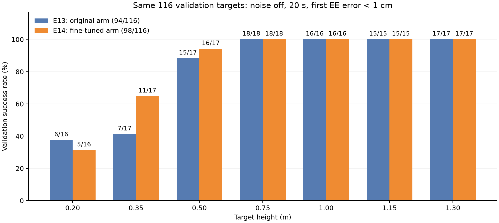

图：各高度的目标数一致，原始目标与种子逐点对齐；低高度0.35m明显改善，0.2m略有退步。图中比例都是验证结果。

z≥0.5m合计由81／83提高到82／83＝98.80%；z≥0.75m仍为66／66。最低0.2m为5／16，0.35m为11／17，两者合计16／33＝48.48%。18个失败分别为0.2m的11个、0.35m的6个、0.5m的1个；6个曾进入2cm，但未进入1cm。所有目标都完成导航切换，故本批剩余失败均发生在切换后的控制过程中；这不等于底盘残余误差已经完全无关。

3个退步目标为 `[1.081163,-0.520660,0.2]`、`[0.517638,1.931852,0.2]`、`[-1.081163,-0.520660,0.35]`。在共同成功的91个目标上，平均成功用时由8.644s变为8.729s；本次没有证明控制更快。


## 30 11月3日上午阶段小结（补采进展见第31～35节）

| 阶段 | 已完成结果 | 当前应如何理解 |
|---|---|---|
| E11世界坐标环状模型 | 完整val 22／140＝15.71% | 环状扩展暴露原单帧整机方案的不足 |
| E12底盘朝向坐标系模型 | 同140个val 65／140＝46.43% | 特征表示改进有帮助，尚不足够 |
| 失败案例混合诊断 | 7／10、6／10 | 定位底盘与机械臂配合；不算纯模型性能 |
| E13单独学习导航＋原机械臂 | 同r≥0.8m val 94／116＝81.03%，原模型同集合63／116 | 导航专用输入和独立训练有效；低高度仍是主要短板 |
| E14冻结导航、力矩微调 | 最佳新增第11轮，同116点验证98／116＝84.48% | 原高处表现保住，0.35m改善，0.2m仍不足；后续已补采见第31～35节 |

这一阶段E14已经完成，同116点验证净增加4个成功，但最低高度仍困难。后续转向连续高度补采和合并清单训练，见第31～35节。旧124点正式测试未作为本次已完成结果报告；合并后新清单的test为156点，两者需区分。

以上为E14阶段的实施边界：当时尚未新增采集，随后已补采200条。1cm阈值、模型评估的首次到达标准、机器人配置与初始化未变；没有引入历史窗口或GRU／Transformer。训练用带测量噪声的专家记录，闭环开发评估仍关闭测量噪声；噪声与随机初始化泛化均需另测。


## 31 中间高度单点对照与40秒诊断

### 31.1 先观察验证成功点，再尝试较远目标

使用E14模型在GUI中观察目标 `[-0.647214,0.470228,0.35]`，9.345s首次到达1cm。随后用户改变目标位置，探索更远位置与未采集高度。当前环状训练高度为0.2、0.35、0.5、0.75、1.0、1.15、1.3m，没有0.4m固定层。

| 顺序 | 目标XYZ，m | 时限s | 结果 | 最小误差cm | 最终误差cm | 结束时间s |
|---:|---|---:|---|---:|---:|---:|
| 1 | `[-0.647214,0.470228,0.35]` | 20 | 成功 | 0.999 | 0.999 | 9.345 |
| 2 | `[-1.64721,1.47023,0.4]` | 20 | 未到达 | 3.366 | 3.671 | 20.000 |
| 3 | `[-1.64721,-1.47023,0.35]` | 20 | 成功 | 0.998 | 0.998 | 12.033 |
| 4 | `[-1.64721,-1.47023,0.5]` | 20 | 成功 | 1.000 | 1.000 | 12.792 |
| 5 | `[-1.64721,-1.47023,0.4]` | 20 | 未到达 | 2.256 | 2.256 | 20.000 |
| 6 | `[-1.64721,-1.47023,0.4]` | 40 | 未到达 | 1.193 | 5.555 | 40.000 |

这些是手动选择的探索点，不计入116点验证成功率。远点水平半径约2.208m，超过原数据2m上限，属于距离外推；其中0.4m还同时考察未采集高度的插值表现。

### 31.2 修正第一次对照中的方向变化

最早0.4m失败点的Y为 **+1.470228**，后来的0.35、0.5、0.4m点的Y为 **−1.470228**。最初把前一次0.4m与后两次当作“同XY”解释并不准确，核对NPZ后已纠正。

真正同XY的三点是 `[-1.647214,-1.470228,z]`：z=0.35与0.5m分别在12.033、12.792s成功；z=0.4m在20s内未成功，末段误差2.256cm。该对照支持研究高度间的厘米级控制差异，但不能直接证明模型仅记忆离散高度，也不能把距离外推和状态变化的影响完全排除。

最早正Y的0.4m点，最终水平误差约2mm、末端高于目标3.665cm，主要剩余高度误差；负Y的0.4m在20s时同时存在约1.36cm水平误差和1.80cm高度误差。因此不能把后续全部失败笼统称为纯竖直误差。

### 31.3 延长至40秒仍未进入1cm

负Y的0.4m点延长到40s后，21.654s曾接近到 **1.193cm**，随后又偏离，40s最终误差 **5.555cm**。这次探索不是20s内到达，更没有在40s内进入1cm。

| 时间s | 误差cm |
|---:|---:|
| 15 | 2.518 |
| 20 | 2.256 |
| 25 | 3.604 |
| 30 | 4.332 |
| 35 | 5.014 |
| 40 | 5.555 |

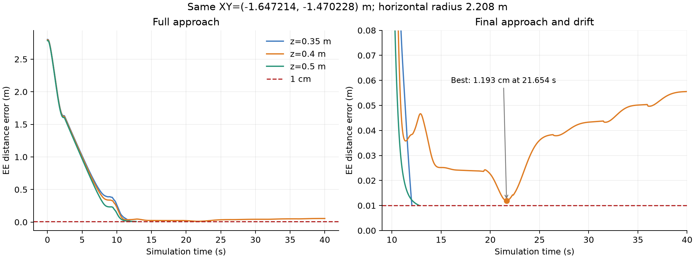

图：同为负Y的三个高度，曲线仅画到实际记录结束；0.35与0.5m成功后停止，0.4m画40秒诊断。右图放大末段误差，红色虚线是1cm。该远点半径约2.208m。

20s时仍在缓慢接近，所以曾提出“可能只是收敛较慢”；40s结果表明，单纯延长时间没有完成任务。当前更值得关注接近目标后的纠偏和稳定性。这里仍是案例证据，不能推出所有未采集高度都失败。

正式验证标准继续保持20s，不因这个探索改为40s，也不放宽1cm阈值。按同一方向缩回2m内的0.4m单独对照曾被建议，但本次记录没有该对照的已完成结果。

## 32 低高度连续补采：新增200条，保留原931条

### 32.1 为什么补采，以及实际方案

用户决定补充垂直方向覆盖，不重采原数据。新建 `collect_expert_ring_lowz_supplement.py`，继续调用 `robotnik_arm_task_3.py`，沿用项目 `configs/robotnik_arm.json` 中启用的测量噪声；额外力矩脉冲设为0，到达后要求连续1秒保持，最多40000步。保留专家模板的最短8s规则；模型正式评估仍没有8s门槛。

| 设计项 | 实际配置 |
|---|---|
| 水平范围 | 相对初始底盘中心半径0.8～2m，整圈 |
| 水平位置 | 5个半径区间×10个方向区间，各随机取1个XY，共50个 |
| 高度 | 每个XY在4个区间内各随机采1个z，合计200点 |
| 高度区间m | [0.20,0.275]、[0.275,0.35]、[0.35,0.425]、[0.425,0.50]，采样避开端点 |
| 目标计划种子 | 42；只固定目标布局，不固定底层测量噪声序列 |
| 预留新分组 | 35个XY归train、7个归val、8个归test，即140／28／32条 |
| 分组规则 | 同一新XY的4个高度放在同一集合；原目标分组不变 |
| 保存目录 | `expert_data_23d_noise_ring_lowz_supplement/` |

与固定加密几个高度层相比，本次采用区间内随机取值，让模型见到更多层间位置。新XY与旧XY也不同，所以本次同时增加低处高度与水平目标覆盖；后续收益不能全部单独归因于z连续采样。

脚本按NPZ中的target跳过已采目标，可断点续采；采集计划保存为 `collection_plan.json`。没有重新运行931个原目标，没有覆盖或删除原数据、修改机器人初始朝向或改变专家控制器。

### 32.2 正式采集与全量核验

采集日志：`expert_collection_logs/ring_lowz_supplement_20261103_125815_767056`。200个计划目标全部保存，200个均首次到达并最终完成连续保持，采集失败0、进程错误0。

| 指标 | 结果 |
|---|---:|
| 新轨迹／独立XY | **200／50** |
| 新增时间步 | **2,019,173** |
| 实际目标高度范围 | 0.202405～0.498077m |
| 实际水平半径范围 | 0.831181～1.981033m |
| 首次到达时间中位数／最大值 | 8.4645／11.752s |
| 回合结束时间中位数／最大值 | 9.926／39.881s |
| 最终误差中位数／最大值 | **2.625／6.779mm** |

首次到达与完成保持时间不同：虽然首次到达均在20s内，少数回合因容差内连续保持需要更久，不能写成“全部20s内完成保持”。数值误差下最短保持记录约0.9999999999999991s，按采集器1e-9容差视为1秒。

检查了全部200个文件的23维观测、11维动作、N×3末端位置、时间对齐、有限数值、二值阶段、目标唯一性与预留分组；均能用共用转换函数构造26维输入。监督标签仍为 `actions`，不把 `applied_actions` 当作另一种输出定义。

原931条与新200条合计保留 **1131条原始轨迹**。这与下一节用于当前任务的998条清单是两个不同数量：原始全集中的133个近半径目标依旧保存，但不纳入r≥0.8m当前方案。

## 33 合并清单：698／144／156，共998条

新建并执行 `merge_expert_data_ring_lowz.py`，将原r≥0.8m的798条和补采200条合并；输出 `bc_training_arm_ring_r08_lowz_supplement/data_split.json`、`merge_audit.json`、`split_report.md`。

| 集合 | 原798清单 | 补采 | 合并目标／轨迹数 | 时间步 |
|---|---:|---:|---:|---:|
| train | 558 | 140 | **698** | **7,306,407** |
| val | 116 | 28 | **144** | **1,481,313** |
| test | 124 | 32 | **156** | **1,613,639** |
| **合计** | **798** | **200** | **998** | **10,401,359** |

新清单直接引用两个数据目录中的NPZ，不复制、不移动。`data_dir`指向RoboEnv，每个`splits`路径带来源目录，例如：

```text
data_dir = F:/UCL/COMP0245 Labs/RoboEnv
splits/train[i] = expert_data_23d_noise_ring/某个原始文件.npz
splits/train[j] = expert_data_23d_noise_ring_lowz_supplement/某个补采文件.npz
```

现有加载方式 `Path(manifest['data_dir']) / filename` 可以解析两类路径。源数据仍为23维，派生网络输入仍为26维。

每个集合保留原目标的归属、顺序和文件对应关系，在末尾追加补采目标。998个目标互不重复，各集合无同目标交叉。原116个验证点的评估种子保留；新增val28点使用10042起的种子，新test32点使用20042起的种子。XY整组留出的规则只适用于新补采50组，不追溯改写原798条的目标级分组。

原798条中仍有1条未完成保持但曾进入1cm，本次按既定保留策略继续使用，没有临时增加成功筛选。未改变原931清单、798清单或历史模型内冻结清单。

144点完整验证结果不能直接拿来与旧116点的84.48%作同集合比较；应分别报告原116点、新28点与完整144点。新156点正式测试也需与原124点的定义区分。

## 34 实验十五 补采数据上的机械臂继续微调

### 34.1 从哪个模型继续，改动了什么

新训练副本为 `finetune_arm_bc_ring_lowz_supplement.py`。从E14最佳新增第11轮继续训练，而非回到E12第133轮或从随机权重开始。独立底盘继续冻结为 `bc_training_nav_ring_r08/run_20261103_022339_570160`，原84.48%模型保留。

| 项目 | 补采版实际配置 |
|---|---|
| 训练清单 | 新998条清单；train698、val144、test156 |
| 模型／特征 | 26→256→256→128→11，ReLU，底盘朝向坐标系特征 |
| 优化范围 | 机械臂网络全部层；只用后7维力矩计算损失，独立导航不更新 |
| 学习率／优化器 | 1e-5／Adam |
| batch／最多轮数／早停耐心 | 4096／30／8 |
| 每轮训练帧数 | 最多500,000，有放回采样 |
| 采样与选模分组 | **仍为z≤0.35m与z>0.35m**，采样期望各50%，验证MSE两组等权 |
| 归一化 | 继续继承E14原统计，不重新计算 |
| 验证 | 完整144点的1,481,313帧，不重采样 |
| 历史输入／新动作限制 | 均未增加 |

0.35～0.5m之间的新样本会参与训练，但按现有分组属于“其他高度”；本轮没有悄悄把低高度阈值改成0.5m，也没有对补采文件另加额外来源权重。新训练原始帧中z≤0.35m约占32.68%，验证约33.13%；50%是训练抽样的期望比例。

程序检查使用旧目录与补采目录各自的低／高组文件，确认可训练，并分别检查了原目标与新目标的测试入口；这些小批结果没有并入正式训练或成功率。

### 34.2 为什么本轮优先微调

新增训练目标140条，占合并后698条约20.06%；新增训练时间步1,424,562，占全部训练时间步约19.50%。任务、输入／输出、专家控制器和模型架构未变，主要补充原范围内低处连续高度与新XY，因此优先利用已有权重继续学习，并让旧数据参与以减少能力退步。

微调不等于只更新最后一层，本轮机械臂共享隐藏层也更新。保守学习率可能限制对旧低高度偏差的修正，所以当前决定不是认定“从头训练一定更差”。若同目标闭环结果仍没有改善，可考虑更大学习率或在相同新清单上从头训练机械臂作对照；本次尚未实施这两项。

### 34.3 当时的正式运行状态（11月4日已补全）

截至UTC 2026-11-03T14:23:03+00:00，正式运行 `bc_training_arm_ring_r08_lowz_supplement/run_20261103_141232_983306` 已启动并保存配置、初始化验证与检查点，history中已记录15轮完整结果，但尚无 `training_finished.json`。这里记录当时进度，不将已有最佳检查点当成训练已完成。

本轮同144点验证起点：普通arm MSE=0.011277，两组等权MSE=0.013544。当时最后完整第15轮，两组等权验证MSE=0.013017；这些是进行中的离线指标，不能据此填写闭环成功率。

新的epoch 0和后续验证指标使用144点，而E14的0.011796来自116点，两者不可直接按数值高低判定退步。应先比较本轮同144点的初始化指标与训练后指标，再做闭环验证。

### 34.4 后续测试入口

新单点测试：`test_bc_split_nav_arm_lowz_supplement.py`；新批量测试：`batch_test_bc_split_nav_arm_lowz_supplement.py`；读取核验：`arm_lowz_supplement_experiment.py`。训练与测试仍分文件，不因启动训练而自动跑仿真。

批量默认测试完整val144点，并在summary中按 `base` 原116点与 `supplement` 新28点分别统计。也可用 `--subset base`、`--subset supplement` 单独运行，种子按原目标索引保留；`--split test`则选新156个测试目标。

正式比较继续为无噪声、最长20s、任意时刻末端误差小于1cm；不加入8s门槛、保持要求或强制停车。单点40s只作为故障诊断，不改正式标准。

## 35 截至11月3日补采时的阶段结论与下一步

| 已完成工作 | 结论边界 |
|---|---|
| E14同116点验证98／116＝84.48% | 比E13净增4个，主要改善0.35m；0.2m仍困难且略有退步 |
| 同XY的0.35、0.4、0.5m对照 | 支持研究层间表现差异；这些点半径约2.208m，仍混有距离外推因素 |
| 0.4m的40s诊断 | 最好1.193cm后再次偏离，单纯延时没有完成任务；不能笼统只归因于收敛慢 |
| 连续低高度补采200条 | 200条均到达并保持；同时新增高度与XY覆盖，不宣称已证明哪一种因素单独有效 |
| 新998条清单 | train698／val144／test156；原数据、归属和旧模型保留 |
| E15训练／测试副本 | 已接入新清单并启动正式运行；最终成绩按第34.3节核验状态，不预报成功率 |

接下来先完成E15并进行同条件闭环评估，分别关注原116点是否保住、补采后的28点以及0.35～0.5m区间是否改善。由于新28点属于开发验证且用于选模，不称其为独立最终测试。方案确定后，再报告156点正式测试，并避免根据测试结果反复调参后仍将其称为未见过的最终检验。

随机初始位置／朝向、历史窗口、GRU／Transformer、动态损失、学习率调度和本轮从头训练对照仍未实施。当前阶段保留“规则停车几何和阶段＋两个模型产生动作”的实现边界；不将全部动作由模型产生等同于阶段也由模型学习。


## 附录A 训练文件与结果目录

以下结果目录均相对于 `F:/UCL/COMP0245 Labs/RoboEnv/`。历史脚本可能已经调整，复核过去设置优先读对应运行目录的 `config.json`、`history.csv`、`data_split.json` 和模型检查点。

| 编号 | 训练脚本 | 冻结结果目录 |
|---|---|---|
| E1 | `train_bc.py` | `bc_training/run_20261023_135447_849619` |
| E2 | `train_bc_23d.py` 历史普通MSE版本 | `bc_training_23d/run_20261028_012502_944390` |
| E3 | `train_bc_23d.py` 后续加权版本 | `bc_training_23d/run_20261028_204007_921743` |
| E4 | `train_bc_23d_noise.py` | `bc_training_23d_noise/run_20261029_024749_959833` |
| E5 | `train_bc_23d_noise_resample.py` | `bc_training_23d_noise_resample/run_20261029_170007_131617` |
| E6 | `train_bc_23d_noise_finetune.py` | `bc_training_23d_noise_finetune/run_20261030_100242_765759` |
| E7 | `train_bc_23d_noise_wide.py` 468目标版本 | `bc_training_23d_noise_wide/run_20261030_112637_239667` |
| E8 | `train_bc_23d_noise_wide_finetune.py` | `bc_training_23d_noise_wide_finetune/run_20261031_025012_026265` |
| E9 | `train_bc_23d_noise_wide.py` 1014目标版本 | `bc_training_23d_noise_wide_extended/run_20261031_130737_274460` |
| E10 | `train_bc_26d_noise_wide.py` | `bc_training_26d_noise_wide_extended/run_20261101_150934_422124` |
| E11 | `train_bc_26d_noise_ring.py` | `bc_training_26d_noise_ring/run_20261102_032833_505981` |
| E12 | `train_bc_26d_noise_ring_bodyframe.py` | `bc_training_26d_noise_ring_bodyframe/run_20261102_184221_743102` |
| E13 | `train_nav_bc_ring_r08.py` | `bc_training_nav_ring_r08/run_20261103_022339_570160` |
| E14 | `finetune_arm_bc_ring_r08.py` | `bc_training_arm_ring_r08_finetune/run_20261103_111655_849512`，116点验证84.48% |
| E15 | `finetune_arm_bc_ring_lowz_supplement.py` | `bc_training_arm_ring_r08_lowz_supplement/run_20261103_141232_983306`，状态见第34.3节 |

| 批量评估 | 对应模型目录内位置 |
|---|---|
| E4 原始测试 | `batch_tests/test_20261029_035552_459886/summary.json` |
| E4 按任意时刻重评 | `batch_tests/test_reassessed_anytime_20261029_041045_181737/summary.json` |
| E5 旧验证集 | `batch_tests/val_20261029_183200_912219/summary.json` |
| E5 旧测试集 | `batch_tests/test_20261030_093809_840278/summary.json` |
| E6 旧验证集 | `batch_tests/val_20261030_102348_861305/summary.json` |
| E7 旧验证集 | `batch_tests/val_20261031_022415_233671/summary.json` |
| E8 旧验证集 | `batch_tests/val_20261031_031404_387244/summary.json` |
| E9 旧70目标子集 | `batch_tests/val_20261031_162225_208887/summary.json` |
| E9 完整152验证目标 | `batch_tests/val_20261031_163737_032444/summary.json` |
| E10 完整152验证目标 | `batch_tests/val_20261101_185116_959689/summary.json` |
| E11 完整140环状验证目标 | `batch_tests/val_20261102_103255_914568/summary.json` |
| E11 训练目标21点抽测 | `batch_tests/train_probe_20261102_111406_915106/summary.json` |
| E14 同116目标完整验证 | `batch_tests/val_20261103_112737_933813/summary.json`，位于E14目录内 |

专家探索为 `expert_z_probe/run_20261031_104243_693459`、`run_20261031_104546_616562`、`run_20261031_104655_436133`；扩展采集日志为 `expert_collection_logs/extend_z_20261031_115340_941606/summary.json`；扩展划分清单为 `bc_training_23d_noise_extended/data_split.json`。

11月2日新增依据包括两轮环状探索、正式采集最终日志、环状划分、E11训练记录、完整140点验证、21点训练目标抽测，以及与E10的配置和代码对比。

原Word：记录 张书畅 26.10.23.docx（历史来源未随本分支归档：`../记录 张书畅 26.10.23.docx`）。本版29张Word原图均归档至 `assets/`，见[原始图索引](原始图索引.md)；6张派生统计图由运行记录生成，其中2张为本次新增。更细的对应来源见[结果核验索引](结果核验索引.md)。

## 附录B 表述与单位修订

| 原记录或讨论中的说法 | 本文采用的表述 | 依据 |
|---|---|---|
| 改变初始朝向 `[0.6, 1.1, 0.5]` | 改变末端目标位置 | 三元数对应 `TARGET_EE_POS` |
| 新增一维，称为二维数据 | 新增一维二值阶段特征 | 只有0、1两个取值，不代表二维向量 |
| 0.021cm却未进入1cm | 约0.021m，即2.1cm | 修正单位换算 |
| 改损失提高输入这一维权重 | 加强轮速和停止阶段轮速动作误差的损失 | 输入特征与输出损失系数不同 |
| 噪声加在训练过程中 | 专家采集时启用测量噪声，之后训练 | 区分观测噪声、动作扰动与随机采样 |
| 小车停了就是阶段0 | 阶段0表示导航已结束 | 不保证实际速度严格为零 |
| 专家力矩是计算值，所以必为最优 | 当前专家是可用示范，不证明全局最优 | 未定义并求解最优性问题 |
| 新模型74.29%比旧模型78.87%差 | 先区分val70和test71，再作同目标对照 | 分母和目标不同 |
| 加大数据后loss降了，所以效果更好 | 数据和标准化变化后先看同目标闭环结果 | E9旧70目标成功率实际为80.00% |
| 28维组员结构就是我们的26维 | 组员22+3+3；我们23+3 | 是否保留阶段标志及末端位置不同 |
| 当前90.79%是测试集成功率 | E10为完整152个单侧目标的验证成功率 | 153目标新test尚待评估 |
| 训练集成功率19.05% | E11训练目标21点分层抽测成功率 | 未遍历完整651目标 |
| 数据更多，所以同模型必然更好 | 覆盖与任务难度扩大，独立训练目标减少 | E10/E11数据及闭环结果 |
| 到达目标等于稳定抓取 | 首次达到末端位置容差 | 当前不评价抓取，也不要求模型持续保持 |


## 36 补采版MLP完成：后续对照的起点

本次补记日期为2026年11月4日（Europe/London）。下面补全第34节当时尚在运行的实验，继续记录B1历史模型、带噪评估、B2辅助监督及其对照。旧记录中的核验时间和历史结果保留；“当时未完成”不代表现在仍在训练。运行编号采用原始目录名称，不重新解释为实验发生的时区。

E15运行 `bc_training_arm_ring_r08_lowz_supplement/run_20261103_141232_983306` 最终在第30轮结束，最佳也为第30轮，平衡验证力矩MSE为0.0129408632。实际是达到最大30轮上限，并非早停确认收敛；当时patience=8。后续讨论发现，这一点之前没有得到足够重视。

完整144目标无噪声闭环验证为111/144＝77.08%，其中原116点为97/116，新补采28点为14/28。分母已从旧116点扩为144点，不能仅用77.08%和旧84.48%直接判断补采效果。该模型后来又在带噪声、真实位置评分条件下得到106/144，具体见第39节。

后续所有本阶段训练继续使用同一份998目标清单：train698、val144、test156；训练帧7,306,407，验证帧1,481,313。原始23维NPZ不修改，派生26维输入的坐标含义不变。逐目标种子保留。156点正式测试在本阶段没有新增已核验结果。

## 37 B1：加入150ms因果历史的GRU分支

### 37.1 想解决的问题与结构

我们观察到机械臂接近后偏离、阶段切换前后出现不同动作，怀疑单帧输入不能充分表示运动趋势。B1保持现有26维单帧特征，再增加有限历史分支。它是一次结构实验，不是证明所有失败都来自缺少历史。

| 项目 | B1实际实现 |
|---|---|
| 当前状态路径 | 原26→256→256→128→11的MLP，取后7维机械臂输出 |
| 历史路径 | 每帧26→Linear64→ReLU→GRU64→Linear7，预测归一化力矩修正 |
| 合成 | MLP后7维＋历史分支7维修正，再按继承统计量反归一化 |
| 历史范围 | 16帧，间隔10个物理时间步；dt=0.001s，覆盖150ms |
| 时间因果性 | 窗口最老到当前；不取未来帧，不跨轨迹；轨迹开头重复首帧补齐 |
| GRU状态 | 每个有限窗口从初始隐藏状态计算，不跨窗口无限累计 |
| 参数 | 134,162个；原MLP107,019个 |
| 初始化 | 完整继承原MLP，修正头初始为零；初始力矩输出与父模型相同 |
| 优化 | MLP和GRU均可更新，仅7维力矩损失；导航模型冻结 |

训练脚本为 `train_arm_bc_ring_gru.py`，共用模型为 `robotnik_arm_gru_policy.py`，续训为 `resume_arm_bc_ring_gru.py`。单点、串行批量及后来新增的并行测试均独立于训练。没有给模型输入专家参考角度，没有强制轮速归零。

B1从E14最佳第11轮模型开始，使用合并998清单微调；后面的B2从已完成的E15第30轮开始。因此，跨B1/B2的结果还混有父模型及训练预算差异，不能直接当作只有一个变量的结构消融。

### 37.2 训练与续训过程

| 运行目录（均在`bc_training_arm_ring_r08_gru_b1`） | 继承检查点轮次 | 实际轮数上限／早停耐心 | 最佳／最后轮次 | 最佳平衡验证力矩MSE |
|---|---:|---:|---:|---:|
| `run_20261103_203745_353439` | E14第11轮MLP | 30／8 | 30／30 | 0.01292190 |
| `run_20261103_214030_030129` | B1第30轮 | 60／8 | 55／60 | 0.01285848 |
| `run_20261103_215456_176247` | B1第55轮 | 100／15 | 96／100 | 0.01281240 |
| `run_20261103_220030_514697` | B1第96轮 | **400／20** | **269／289** | **0.01268819** |

最后一轮续训先讨论并准备过300轮／15轮，但实际运行保存的是400轮／20轮；表格以运行配置和完成文件为准。最佳第269轮后20轮未改善，最终第289轮早停，不是只训练了269轮。

原B1第30轮检查点未保存Adam状态，因此第一次续训重新初始化Adam并显式记录；后续检查点保存了优化器、采样器与随机数状态，第55→100和第96→400轮的续训恢复了优化器状态。旧运行和权重均保留。

最佳平衡MSE从第30轮到269轮降低约1.81%，但离线MSE改善不能直接换算为闭环成功率改善。

### 37.3 无噪声闭环：改善小，而且有取舍

同144目标、相同逐目标种子、20s、1cm任意时刻到达标准、相同导航模型和机器人配置，比较如下：

| 验证目标 | E15单帧MLP | B1最佳第30轮 | B1最佳第269轮 |
|---|---:|---:|---:|
| 全部144点 | 111/144＝77.08% | 112/144＝77.78% | 113/144＝78.47% |
| 原116点 | 97/116＝83.62% | 95/116＝81.90% | 95/116＝81.90% |
| 补采28点 | 14/28＝50.00% | 17/28＝60.71% | 18/28＝64.29% |
| z≤0.35m | 21/47＝44.68% | 21/47＝44.68% | 20/47＝42.55% |
| 0.35<z<0.5m | 7/14＝50.00% | 9/14＝64.29% | 10/14＝71.43% |
| z≥0.5m | 83/83＝100% | 82/83＝98.80% | 83/83＝100% |
| 原固定z=0.2m | 8/16＝50.00% | 6/16＝37.50% | **3/16＝18.75%** |
| 原固定z=0.35m | 6/17＝35.29% | 7/17＝41.18% | 9/17＝52.94% |

从B1第30到269轮，8个目标由失败变成功、7个反向变化，净增1个。E15与B1第269轮相比，12个改善、10个退步，净增2个；平均最终距离由2.453cm降到2.055cm。第269轮的完整并行验证0进程错误，4进程耗时609.7s。

**本次未取得的效果：** GRU没有普遍修复低高度；0.2m反而明显退步，原116点总体也没有超过E15。现有证据只能说部分补采连续高度目标获益，不足以声称历史模型有稳定整体优势。没有多训练种子和相同参数量／预算的完整消融，也不能将小幅改善单独归功于历史。

## 38 单点诊断：高度残差与底盘小幅漂移

选取 `[-0.866025,-0.5,0.2]`，seed=48，用B1第269轮观察20s。该点原E15无噪声成功，而B1无噪声失败。

| 时刻 | X偏差 | Y偏差 | Z偏差 | 总距离 |
|---|---:|---:|---:|---:|
| 最近时刻14.173s | −4.22mm | +0.84mm | **+10.38mm** | **11.24mm** |
| 最终20s | −9.41mm | −4.13mm | **+12.55mm** | **16.22mm** |

偏差定义为末端位置减目标位置，Z正值代表末端偏高。最接近时，单独Z偏差已大于1cm。最后3s底盘水平位移约4.8mm，轮速命令仍小幅非零；关节速度很低，力矩未到±30Nm限幅。表现更像残余偏差与缓慢漂移，而非大幅振荡。

轨迹为 `run_20261103_220030_514697/rollouts/arm_gru_b1_20261104_013741_520135.npz`。当时无噪声，位置来自原FK计算。该轨迹没有记录接触或所有关节限位诊断，所以不能排除这些影响，也不能用一个点证明全部低高度失败都是Z方向问题。

据此讨论过目标附近专家纠偏、分段精调和参考辅助监督。到本次记录时，目标附近纠偏数据尚未采集，接近／精调双分支尚未实施；后续只实现了第40节B2。

## 39 开启测试噪声，并区分观测位置与真实位置

### 39.1 配置路径与评分修正

之前测试入口默认 `--sensor-noise off`，即使JSON开启，也在内存中覆盖为关闭。并且测试实际读取的是 `RoboEnv/configs/robotnik_arm.json`，不是任务目录的 `final/robotnik_arm_task/configs/robotnik_arm.json`。核对时两份配置曾分别为关噪声／0.0001和开噪声／0.001。随后用户把RoboEnv配置也打开，各项改为0.001；新测试显式传 `--sensor-noise config`。

这里主要是传感器读数噪声，不能笼统称为直接给机器人物理位置或执行力矩施加随机扰动。仿真实现把名为`*_cov`的参数传给 `np.random.normal` 的scale参数，实际按标准差使用；关节角为rad、底盘位置为m等，不是所有字段都表示1mm，也不能简单把0.001再开平方。采集器额外力矩脉冲是另一机制，不能与这些传感器参数混为一谈。

原测试由带噪底盘位置、朝向和关节角通过FK得到末端位置，并用它判1cm。这样可能观测达标、实际未达标。新建以下副本：

- `test_bc_split_nav_arm_mlp_noise.py`：单点，无GRU补采MLP。
- `batch_test_bc_split_nav_arm_mlp_noise_parallel.py`：独立并行批量，不训练。
- `MLP带噪测试说明.md`：使用说明。

模型与阶段规则仍使用带噪观测和带噪FK估计；评分直接读PyBullet中 `robot_j2s7s300_end_effector` 的link frame世界位置（`getLinkState(...)[4]`），不是质心位置。真实位置不输入模型。1cm严格小于、20s、无8s门槛、无保持要求，均不改变。

NPZ的`ee_positions`、`ee_errors`现在表示真实位置及误差；另存`observed_ee_positions`、`observed_ee_errors`。必须区分新旧同名字段的评分来源。无噪声短时检查中，新旧控制动作与输入逐元素一致，PyBullet真实位置与原FK最大坐标差约2.97×10⁻⁸m；这只是短时验证，不冒充全量无噪声新口径复测。

### 39.2 原E15带噪结果

同一E15模型、144目标、相同逐目标种子，完整带噪真实评分为 **106/144＝73.61%**，0进程错误，4进程472.4s。

| 高度 | E15原无噪声FK评分 | E15带噪真实评分 |
|---|---:|---:|
| z≤0.35m | 21/47＝44.68% | 16/47＝34.04% |
| 0.35<z<0.5m | 7/14＝50.00% | 7/14＝50.00% |
| z≥0.5m | 83/83＝100% | 83/83＝100% |
| 全部 | 111/144＝77.08% | 106/144＝73.61% |

3个目标改善、8个退步，净少5个，下降集中低高度。虽然旧无噪声FK与真实位置预期接近，严格抗噪消融仍应再用同一新版真实评分入口跑无噪声对照；本次只记录现有证据。

有7条真实失败轨迹的观测距离曾小于1cm。例如 `[0.748188,0.938198,0.2]`，观测最近9.94mm，真实最近12.67mm。这说明真实评分确有必要。不能把这7条简单加到106上，声称旧程序一定会有113次成功：旧程序会在观测首次达标时提前终止，后续轨迹和真实成功集合可能不同。

**本次未取得的效果：** 训练数据带噪声，并不意味着测试开噪声就会自动更好。当前带噪成绩主要下降在低高度。每目标仅一组种子，不是多种子的平均鲁棒成功率。

## 40 B2：专家参考偏差作为辅助训练目标

### 40.1 做了什么

我们提出的假设是：只拟合力矩可能没有充分利用专家内部的运动参考，因此增加“专家还希望关节调整多少”的监督。它不是拓展26维输入，也不是测试时给专家接管。

| 项目 | B2实现 |
|---|---|
| 父模型 | E15第30轮，原无噪声111/144、带噪106/144的MLP |
| 主路径 | 完整继承26→256→256→128→11；只用后7维机械臂力矩参与主损失 |
| 新分支 | 从共享128维特征增加Linear(128,7)，共新增903个参数 |
| 辅助标签 | `q_des_arm[t] - observations[t,5:12]`，同一执行前状态帧，单位rad |
| 初始化 | 辅助头W/b为0；初始力矩输出严格继承原MLP |
| 损失 | 归一化力矩MSE＋λ×归一化参考偏差MSE |
| 统计量 | 输入／力矩统计沿用旧文件；辅助统计只用训练帧拟合，验证不参与 |
| 训练与部署 | 主干及辅助头联合微调；部署只执行原力矩路径，不读取专家参考 |
| 选模与早停 | 仍只看两类高度等权的力矩验证MSE，不看总损失或辅助指标 |

采集器在同一帧计算参考、力矩，再保存执行前状态；已核对全部train698及val144文件的辅助字段与行数，无需重采。原始数据、划分和配置不修改；手指和底盘模型不变。辅助标签不是新的传感器数据，也不是直接向机器人施加的位置命令。

文件：`robotnik_arm_aux_policy.py`、`train_arm_bc_ring_aux_b2.py`、`test_bc_split_nav_arm_aux_b2.py`、`batch_test_bc_split_nav_arm_aux_b2_parallel.py`、`B2_辅助参考监督说明.md`。训练、单点、批量测试分开。GPU小样本1轮、模型重载和2进程0.2s仿真仅作程序检查，均标记smoke，不并入正式结果。

### 40.2 两组辅助权重：尚未见到主任务收益

共同起点的平衡力矩验证MSE为0.0129408637，普通辅助验证MSE为1.020298。

| λ | 运行目录 | 早停耐心 | 最佳／最后轮次 | 最佳平衡力矩MSE | 最后轮平衡力矩MSE | 最后轮辅助MSE |
|---:|---|---:|---:|---:|---:|---:|
| 0.1 | `bc_training_arm_ring_r08_aux_b2/run_20261104_024810_354398` | 15 | 2／17 | 0.01293878 | 0.01421793 | 0.629100 |
| 0.01 | `bc_training_arm_ring_r08_aux_b2/run_20261104_025320_198389` | 20 | 2／22 | 0.01292477 | 0.01296102 | 0.743263 |

“最佳第2轮”不是只训2轮，而是其后连续15／20轮未刷新最佳主指标。λ=0.1的辅助任务不断改善，但到17轮主力矩MSE恶化约9.9%；降低到0.01后主指标基本横盘，仍没有持续收益。最佳值相比起点分别只改善约0.016%和0.124%。

辅助头从零开始，辅助MSE初始约1；λ=0.1时加权数值比约0.01的主力矩损失大。但损失数值大小不等价于共享梯度大小；尚未记录梯度范数或夹角，不能写成“已经证明梯度冲突”。现象支持研究负迁移、辅助预热等解释，但不是最终因果结论。

**本次未成功之处：** 目前这种“新辅助头立即与成熟力矩网络联合微调”的方案，没有体现离线主任务优势。两组辅助模型尚无本次已核验的完整闭环结果，不能编造其成功率，不能仅凭MSE宣布其闭环一定失败，也不能声称所有辅助学习方法都无效。

## 41 关闭辅助损失的对照：继续训练本身取得了收益

### 41.1 对照为何重要

为判断停滞是否由辅助任务造成，用完全相同的B2代码、相同E15起点、相同输入、统计量、数据、种子、500,000次每轮抽样、lr=1e-5、batch4096，设置 `--aux-weight 0`。辅助头结构仍存在，但不影响力矩路径，辅助损失不更新网络；它在训练日志中仍有误差数值，不代表参与了优化。

正式运行 `bc_training_arm_ring_r08_aux_b2_control/run_20261104_025706_206181`，最大300轮、patience=20，最佳新增第185轮，最终205轮早停，最佳平衡力矩MSE **0.0127534703**。初始为0.0129408637，改善约1.45%。该实验Adam重新初始化，继承的是模型权重，不是连续恢复旧优化器；与B1的完整状态续训需区分。

相同前22轮预算下，λ=0对照的最好MSE为0.01288732，优于λ=0.01的0.01292477。因此辅助组较差并非仅仅因为最终训练轮数不同。不过只有一个训练种子，当前主任务选择标准也会提前结束辅助组，不能据此排除长期预热等其他训练方案。

### 41.2 同条件带噪闭环验证

用 `batch_test_bc_split_nav_arm_aux_b2_parallel.py` 显式指定对照运行，噪声config／0.001，真实PyBullet评分，20s，144相同目标与种子。全部完成，0进程错误，4进程442.9s。

| 分组 | E15带噪旧基线 | λ=0继续训练后 |
|---|---:|---:|
| 全部 | 106/144＝73.61% | **113/144＝78.47%** |
| 原116点 | 94/116＝81.03% | 94/116＝81.03% |
| 补采28点 | 12/28＝42.86% | **19/28＝67.86%** |
| z≤0.35m | 16/47＝34.04% | **21/47＝44.68%** |
| 0.35<z<0.5m | 7/14＝50.00% | **10/14＝71.43%** |
| z≥0.5m | **83/83＝100%** | 82/83＝98.80% |
| 原固定z=0.2m | 6/16＝37.50% | 6/16＝37.50% |
| 原固定z=0.35m | 5/17＝29.41% | 6/17＝35.29% |

12个失败目标变成功，5个原成功目标变失败，净增加7个，提升4.86个百分点。全部目标平均最终距离从3.107cm降到2.251cm。观测曾达标、真实始终失败的目标从7个减为4个；31个失败中12个曾进入2cm，只有2个最终仍在2cm内。

当前采用此对照模型作为**新的带噪基线**。这是没有使用GRU、没有辅助损失的继续训练收益，不作为辅助任务的成功结果。虽然与B1无噪声第269轮同为113/144，两者噪声和评分来源不同，不能凭同分判断架构优劣。新基线尚未新增完整无噪声或156点正式测试成绩。

### 41.3 为什么以前停了，这次却能训练很久

E15在最大30轮时结束，且第30轮仍为最佳；这不是已经早停收敛。新对照提供300轮预算，并在持续刷新主指标时重置早停计数，所以到第185轮仍有小幅改善，最终第205轮才停。实际耐心从原8改为20，优化器也重新初始化，均应在报告中说明。不能把本次进步归因于“辅助结构本身更强”。

## 42 训练和测试速度：优化了什么，哪些比较不能直接做

| 环节 | 已实施的改动与边界 |
|---|---|
| 训练数据 | CPU预分配，归一化帧一次拷入GPU；避免旧DataLoader逐批搬运和大数组重复拼接 |
| 每轮训练量 | 当前每轮抽样50万帧／窗口末端，约123个batch；验证全148万帧。早期wide按训练集长度抽样，epoch工作量并不相同 |
| 历史构造 | B1在GPU按索引批量取同轨迹因果窗口，不预展开N×16倍数据 |
| 指标 | GPU累计，每轮读取汇总；计时不包含首次读NPZ、预处理和部分保存 |
| 已有轮内耗时 | B1约1.9s／轮；B2与对照约1.0～1.2s／轮；不是“谁代跑就更快”，都使用同一台RTX5060笔记本 |
| 批量仿真 | 多个独立子进程，每进程数值线程数1，父程序负责调度和落盘；目标、种子、模型互相隔离 |
| 自动并行 | 读取CPU短时负载与可用RAM，最多4进程，预留1.5GiB，按每子进程800MiB估算；显式workers可覆盖 |

新带噪MLP基线验证472.4s，新对照442.9s。B1的609.7s不作为相同负载／相同架构的纯并行加速比。4进程是目前保守配置，不是已证明最优；未进行正式4／6／8进程测速。

16GB机器截图中曾显示10.7GB物理内存使用、约5GB可用、提交29.8/33.1GB。提交内存不等同于物理占用；截图不能单独证明内存已成为唯一瓶颈。GPU使用率低也不等于推理未运行：批量1的小MLP／GRU与PyBullet主要使用CPU，训练才使用CUDA。

当前未启用混合精度、未将batch改到8192、未复用常驻仿真工作进程；这些是后续可测速项，不作为已完成优化。没有为了提高利用率而改变物理dt或降低1cm标准。

## 43 首次11月4日补记时的结论、不成功尝试和下一步

> 本节保留首次补记时的状态；梯度诊断随后已在B3实施，最新结果与决定见第44—48节。

| 尝试 | 当前证据 | 记录结论 |
|---|---|---|
| GRU历史 | 无噪声111→113／144，部分连续高度改善，0.2m退步 | 小幅且有取舍，未证明稳定结构优势；不是“GRU普遍无效” |
| 辅助参考λ=0.1 | 辅助拟合变好，主MSE明显退步，最佳第2轮 | 当前联合微调方式未达预期；不是闭环成功率结论 |
| 辅助参考λ=0.01 | 主MSE横盘，仍不如λ=0对照 | 降权缓解退步，但尚无主任务明确收益 |
| λ=0对照 | 同条件带噪106→113／144 | 已验证继续训练本身有收益，选为新带噪基线 |
| 开启测量噪声 | E15总体下降，低高度更脆弱；7条观测误判候选 | 噪声是鲁棒性测试条件，不是自动纠偏机制 |
| 真实位置评分 | 模型读取带噪估计，成功读取真实连杆位置 | 防止“测量瞬时达标”被算为真实成功 |

当前主要不足仍是低高度，尤其固定0.2m与接近目标后的残差、漂移。不能只因一个点Z偏高就给所有失败定因，也不应仅继续堆epoch或将真实状态偷偷用于控制。

下一步候选包括：从训练目标的模型实际状态采集目标附近专家纠偏；辅助头预热后再联合微调；记录两任务共享梯度夹角／范数以检查干扰；对相同新口径进行多噪声种子验证。它们截至本次均未完成，不预报收益。任何补采或调参继续保留原划分，避免用验证／测试目标的纠偏标签训练后仍报告为未见目标泛化。

本阶段所有百分比均为开发验证集合结果，未包装成独立最终测试或理论成功保证。学习方法为已有方法的任务化尝试，不将GRU、多任务学习或DAgger思路宣称为原创算法。程序小样本检查不并入正式训练或闭环成绩；正式训练和完整测试由用户启动，文档整理不再启动任务。


## 44 B3：用梯度相似度决定辅助任务何时参与

### 44.1 从B2负结果提出的新假设

B2的固定权重辅助监督中，辅助误差持续下降，但力矩验证指标没有同步改善；关闭辅助损失的对照反而形成了113/144的带噪新基线。因此我们没有直接增加辅助权重或延长训练，而是检查两个任务对共享参数的更新方向。

这里的“方向”指网络参数空间中的梯度方向，不是末端往上、往下的物理方向。主任务知道的只是怎样降低当前训练批次的力矩误差，并不直接知道哪些更新能提高未见状态的闭环成功率。任务相关也不意味着每一步共享参数更新都同向；接近正交也不证明辅助任务在所有阶段都无价值。

方法参考 [Adapting Auxiliary Losses Using Gradient Similarity](https://arxiv.org/abs/1812.02224)。这是现有方法在本任务上的应用，不是原创算法；没有实现PCGrad投影，不能把它写作PCGrad实验。

### 44.2 实现和公平性设置

从新的带噪基线 `bc_training_arm_ring_r08_aux_b2_control/run_20261104_025706_206181/best_model.pt` 的最佳185轮开始微调，重新初始化Adam，日志从新增epoch1计数。原MLP权重继承，辅助头统一重置为零；不从B2固定权重失败组继续训练。

每个训练batch分别计算两项损失对共享主干的梯度：

```text
g_main = 力矩损失对共享主干的梯度
g_aux  = 参考偏差辅助损失对共享主干的梯度
c      = cosine(g_main, g_aux)
gate   = max(0, c)
共享参数使用的梯度 = g_main + 0.01 × gate × g_aux
```

共享主干指三个隐藏Linear层，排除两个输出头。任一梯度范数≤1e-12时gate为零，零范数批次不算冲突；gate从计算图分离，不对其求高阶导数。主动作头只接收主任务梯度；辅助头自身仍按0.01倍辅助梯度学习，即使共享gate为零也不停止，否则零初始化可能导致共享辅助信号一直无法形成。

26维输入、7维实际机械臂力矩、独立冻结导航、998目标清单、50万帧每轮、低高度与其他高度期望50/50、完整验证、batch4096、lr1e-5均保持。默认最大300轮、patience20，最佳检查点仍按平衡力矩验证MSE选择。门控只读取训练批次，不读取验证集来生成更新。

保留 `gated`、`fixed`、`off` 三种模式，可从同一新基线做对照；本阶段仅有gated的正式训练与闭环结果，没有新起点fixed/off的已核验完整正式结果。旧B2对照起点更早，不能替代这个缺失消融。

训练和测试分开：

- `arm_aux_gradient_gate.py`：两次求梯度、门控及梯度诊断。
- `robotnik_arm_gradgate_policy.py`：B3结构和检查点来源核验。
- `train_arm_bc_ring_gradgate_b3.py`：只训练。
- `test_bc_split_nav_arm_gradgate_b3.py`、`batch_test_bc_split_nav_arm_gradgate_b3_parallel.py`：只测试。
- `B3_梯度门控辅助训练说明.md`：设置、字段与对照命令。

部署仍只执行原MLP力矩路径，没有在测试时计算梯度，没有专家辅助动作，没有新增输入。GPU小样本、梯度路由单元检查和2进程0.2s检查不计入正式结果。

### 44.3 训练结果与梯度诊断

运行 `bc_training_arm_ring_r08_gradgate_b3/run_20261104_034810_928084`：最佳第31轮，最终第51轮早停，最佳平衡验证力矩MSE为 **0.0127369189**。父模型起点0.0127534703，仅改善约 **0.130%**。

| 梯度统计 | 全51轮的epoch统计均值 |
|---|---:|
| 有效batch平均余弦 | 0.00136 |
| 方向相反的有效batch比例 | 49.28% |
| 辅助共享更新激活比例 | 50.71% |
| 平均gate | 0.02049 |
| 平均有效辅助系数（0.01×gate） | 0.00020495 |
| 加权辅助共享梯度范数／主梯度范数 | **0.0826%** |

余弦整体接近零，不能据此说“约一半批次发生了强烈冲突”；大量近零正负值也会产生接近一半的符号比例。当前证据更接近缺少稳定的方向一致性。门控后辅助共享影响很小，实际学习接近主任务继续优化，而辅助头自身仍能学习。

辅助验证MSE从1.02030降到第31轮0.73504，最后第51轮0.65166。这说明辅助头确实在训练，但不证明它已学得足够好，也不证明辅助任务改善了控制。

门控只衡量当前批次局部梯度关系，不保证验证或闭环改善。Adam包含历史动量及逐参数缩放，本实验没有每步主损失单调下降或物理稳定性保证。日志的`total_loss`为名义固定权重和，不是门控更新实际对应的简单标量目标。

## 45 B3闭环：总体同分，低高度没有改善

完整带噪验证 `parallel_gradgate_b3_noise_truth_val_20261104_035121_497770`：**113/144＝78.47%**，0进程错误，3进程562.9s。目标、种子、配置噪声、真实位置评分、20s和1cm标准与新基线一致。

| 分组 | 带噪基线 | B3 |
|---|---:|---:|
| 全部144点 | 113/144＝78.47% | 113/144＝78.47% |
| 原116点 | 94/116 | 95/116 |
| 补采28点 | 19/28 | 18/28 |
| z≤0.35m | 21/47 | 20/47 |
| 0.35<z<0.5m | 10/14 | 10/14 |
| z≥0.5m | 82/83 | 83/83 |
| 原固定z=0.2m | 6/16 | 4/16 |
| 原固定z=0.35m | 6/17 | 8/17 |

7个目标由失败变成功，7个由成功变失败，净增0个。平均最终距离2.251cm→2.053cm，约下降8.8%，但没有增加1cm达标次数。同为成功的106个目标，平均仿真到达时间8.682s→8.634s，差异很小，不能据此声称速度显著提升。

观测达标而真实始终失败的目标4→3个。31个真实失败中，12个曾进入2cm，6个最终仍在2cm内。3进程与基线4进程不一致，总现实耗时不作为纯模型速度比较。

**本轮结论：** 没有理由用B3替换原带噪基线；平均距离存在小幅改善，但低高度尤其0.2m没有被修复，仍需同起点off对照才能将变化归因于门控。暂时保留为负结果及诊断记录。

## 46 专家内部状态的讨论与B4辅助标签更换

### 46.1 为什么专家代码明确，模型仍可能缺信息

专家逻辑并不需要猜测。`robotnik_arm_control.py`里先从当前运动学状态、末端误差和限位计算 `qd_des_arm`，再执行：

```python
q_des_arm = q_des_arm + qd_des_arm * dt
```

右侧`q_des_arm`是上一步保存的参考角度，因此它包含控制器内部积累状态；随后还有参考超前限幅和关节限位。模型26维输入有实测关节角、角速度、目标等，没有上一步参考角度。同一组近似观测可能对应不同内部参考，限制了仅凭当前帧还原参考偏差的能力。

这是可观测性方面的合理疑问，不是已证明的失败主因。在实际数据分布中当前状态也可能足以间接推断参考值。辅助预热、从零训练或显式学习内部状态曾被讨论，但本阶段都没有实施，不能写成完成的实验。

### 46.2 B4只改变辅助标签

为检验标签选择，复制B3形成B4，将辅助标签从同帧 `q_des_arm[t] - q[t]` 换为 **`qd_des_arm[t]`**。这是“专家此刻希望关节以多快的速度运动”，不是输入里已有的实测角速度 `qd`，也不是速度误差、角度差分或下一帧标签。

专家计算这个期望速度不需要上一步参考角度，但仍依赖运动学状态、姿态和限位等，不能声称它必然由当前26维观测唯一决定。无需重采：全部训练698及验证144条文件已有对齐的N×7期望速度字段。

输入、动作标签、门控、随机种子、采样、父模型起点及部署全部保持B3设置；只更换辅助目标，并用训练帧重新拟合对应的辅助均值／标准差。输入和力矩归一化文件逐字节继承。辅助分支仍不直接控制机器人。

新增文件：`robotnik_arm_velocity_aux_policy.py`、`train_arm_bc_ring_velocity_aux_b4.py`、`test_bc_split_nav_arm_velocity_aux_b4.py`、`batch_test_bc_split_nav_arm_velocity_aux_b4_parallel.py`、`B4_期望角速度辅助监督说明.md`。梯度更新继续复用未改动的`arm_aux_gradient_gate.py`。原B3文件保留。

### 46.3 B4训练结果

运行 `bc_training_arm_ring_r08_aux_velocity_b4/run_20261104_041750_567925` 实际最大400轮、patience20，最佳31轮、最终51轮早停。脚本默认300轮，但表述以保存运行配置为准；本次早停未触及两种上限，这个差别没有延长实际训练。

| 项目 | B3：参考偏差 | B4：期望速度 |
|---|---:|---:|
| 相同起点平衡力矩MSE | 0.0127534703 | 0.0127534703 |
| 最佳平衡力矩MSE | 0.0127369189 | **0.0127371759** |
| 最佳／停止轮次 | 31／51 | 31／51 |
| 梯度余弦epoch均值 | 0.00136 | 0.00225 |
| 冲突比例epoch均值 | 49.28% | 48.93% |
| 辅助贡献范数／主梯度范数epoch均值 | 0.0826% | 0.1010% |

两个最佳主指标只相差约2.57×10⁻⁷，几乎相同。B4期望速度预测的物理RMSE从0.0931降到0.0697rad/s，说明新标签被学习，但共享门控后影响仍小。B3辅助标签单位rad，B4为rad/s，且统计量不同，不能用两个标准化辅助MSE大小判断哪个更有效。

换成当步速度标签没有带来明显主任务改善；这次证据没有支持“仅移除参考角的历史依赖就能明显改善”的预期。仍不足以排除其他辅助任务、无门控设置或从零训练的可能性。

## 47 B4闭环：109/144，低高度净退步

完整带噪真实评分验证 `parallel_velocity_aux_b4_noise_truth_val_20261104_042357_663202`，**109/144＝75.69%**，0进程错误，4进程449.4s。全部比较条件与新基线及B3一致，运行进程数不影响每目标种子与物理规则。

| 分组 | 当前带噪基线 | B3 | B4 |
|---|---:|---:|---:|
| 全部144点 | **113/144** | **113/144** | 109/144 |
| 原116点 | 94/116 | 95/116 | 93/116 |
| 补采28点 | **19/28** | 18/28 | 16/28 |
| z≤0.35m | **21/47** | 20/47 | 17/47 |
| 0.35<z<0.5m | 10/14 | 10/14 | 10/14 |
| z≥0.5m | 82/83 | **83/83** | 82/83 |
| 原固定z=0.2m | **6/16** | 4/16 | 4/16 |
| 原固定z=0.35m | 6/17 | **8/17** | 7/17 |
| 平均最终距离 | 2.251cm | **2.053cm** | 2.303cm |
| 观测曾达标、真实始终失败 | 4 | 3 | 6 |

B4相对基线有5个目标改善、9个退步，净减少4个，成功率下降2.78个百分点；z≤0.35m净少4个成功，其他两高度区间成功数不变，但不代表每个区间内的成功目标完全相同。

**本次未取得的效果：** 新期望速度标签没有提高闭环成功率，力矩MSE的小改善也没有转化为1cm精度收益。本次单种子结果不证明所有期望速度辅助都必然有害，也不能将B3/B4的微小主指标差别解释成足以预测4个目标的确定因果。

## 48 截至当前的选择、负结果与后续边界

当前仍保留第41节的 **λ=0继续训练MLP** 作为带噪基线：最佳185轮，113/144＝78.47%。B3同分、B4退步，没有替换基线。

| 本阶段尝试 | 我们实际学到什么 |
|---|---|
| B1 GRU历史 | 整体只有小幅变化，最低高度退步；带噪环境尚无同口径GRU正式成绩 |
| B2固定辅助权重 | 辅助任务可以学好，但主力矩拟合未显示收益；两固定权重组尚无已核验闭环成绩 |
| B3梯度门控 | 记录到了接近零的整体方向相似度，门控后的共享辅助贡献很小；闭环同分且最低高度退步 |
| B4当步期望速度标签 | 减少了标签对参考角历史的直接依赖，但本设置仍没有主任务明显收益，闭环109/144 |
| 同起点继续训练的必要性 | 不能把多训练本身的改善归为新增模块；B3/B4缺少同新起点off完整对照，结论限于实际观察 |
| 现有最确定的提升 | 原带噪106/144→关闭辅助损失后继续训练113/144；不把它写成辅助训练成功 |

这组实验并非为了让模型看起来复杂。尝试没有显著收益也应保留，并说明主任务是否改善、闭环是否改善，以及哪些推测没有验证。1cm标准未放宽，真实位置未输入策略，验证与正式测试集合未混淆。

当前决定暂时结束这条辅助标签路线，下一步候选是**目标附近的专家恢复示范**：使用训练目标，围绕模型常见厘米级偏差产生真实偏离状态，由专家重新计算恢复动作，混合原数据再微调。专家接管需处理内部参考状态，不能把旧轨迹动作直接贴到新状态上；测量噪声与执行扰动也需区分。

截至本次整理，局部恢复补采、辅助头预热、从零训练对照、多噪声种子正式评估都尚未完成。仍未新增156点最终测试结果。以后实施时继续冻结目标归属，避免用验证／测试目标的恢复标签训练后再报告未见目标成功率。

原始运行证据与梯度日志见[结果核验索引](结果核验索引.md#11月4日补记b3梯度门控与b4期望速度辅助)，配套机器统计见[阶段核验快照](阶段核验快照_20261104_B3_B4.json)。本次整理只读取已完成结果，不启动训练、测试或采集。

## 49 从辅助标签转向模型偏离后的恢复示范

本节起记录11月4日B4之后的新进展。第48节“保留113/144基线、恢复补采尚未实施”描述当时状态；截至本次更新，恢复诊断、采集、微调和带噪闭环验证均已完成。

前面B3、B4没有带来明确成功率收益。我们转而检查：低高度模型停在目标附近时，是目标不可达，还是策略不会从偏离专家轨迹后的状态继续修正？这次不再添加网络层、历史或辅助头，直接补充模型实际遇到的偏离状态及专家纠正动作。

先从原训练集选20个低高度目标，用113/144带噪MLP基线控制机器人。导航完成、时间至少8s后，如果最近约2s的估计距离停留在1～5cm且改善不足2mm，则保存动作前仿真状态、Python缓存、导航相位和噪声随机数状态，做两条分支：

```text
模型接近后停滞 → 保存同一状态
                 ├─ 模型机械臂继续控制，最多10s
                 └─ 恢复保存状态，专家机械臂接管，最多10s
```

两条分支依次运行，不是在同一个机器人上同时执行。导航始终由冻结的学习策略控制，不回放轮速、不强制停车；两分支动作不同，后续观测及轮速自然可以不同。专家接管时参考角初始化为当前带噪实测关节角，再用原控制器积分更新，避免把其他轨迹的参考角直接接上。

真实PyBullet末端位置只用于评分，不进入模型、专家或停滞触发器。诊断的稳定恢复标准为真实距离<1cm并连续保持1s；正式纯模型验证仍为20s内任意时刻真实距离<1cm，不要求保持。

| 首轮20点诊断结果 | 数量 |
|---|---:|
| 模型在接管前已进入1cm | 7 |
| 同一起点只有专家恢复并保持 | 8 |
| 没出现符合条件的近距离停滞 | 5 |
| 进程错误 | 0 |

8个成对案例中模型续跑10s均未进入1cm，专家全部恢复并保持成功。这证明这些具体状态存在可行的专家恢复动作，支持继续收集恢复示范，但不是模型成功率，也不是最终泛化实验。

## 50 低高度300点采集与102条新恢复示范

新增独立文件：`collect_arm_recovery.py`、`recovery_dataset.py`、`finetune_arm_recovery.py`、`batch_test_arm_recovery_parallel.py`，保留原采集、训练、评估文件。采集复用已核验的`diagnose_arm_recovery.py`及成对诊断批处理；配置噪声沿用`RoboEnv/configs/robotnik_arm.json`，不修改配置或原始数据。

正式采集只扫描冻结清单中**世界目标z<0.5m的300个训练目标**，不是从验证集失败目标中补标签。运行：

```text
RoboEnv/expert_recovery_data/collection_20261104_112547_770894
├─ diagnostics/summary.json
└─ episodes/recovery_manifest.json
```

300个目标全部完成，0进程错误，4进程现实耗时1551.7s，约25分52秒。

| 目标组 | 接管前模型到达 | 两者恢复并保持 | 仅专家恢复并保持 | 未触发近距离停滞 | 合计 |
|---|---:|---:|---:|---:|---:|
| 固定z=0.2m | 17 | 2 | 45 | 16 | 80 |
| 固定z=0.35m | 48 | 2 | 18 | 12 | 80 |
| 补采连续高度0.2～0.5m | 77 | 10 | 39 | 14 | 140 |
| 合计 | **142** | **14** | **102** | **42** | **300** |

实际触发116个案例，专家116个均恢复并保持，模型14个保持成功。这个条件性结果只适用于本次筛选出的近距离停滞状态、固定种子及当前接管策略，不能宣称所有失败都可由专家恢复。42个未触发案例没有接受成对比较，不代表成功或专家失败。

只导出102个“专家保持成功而模型未保持成功”的专家分支，共**233,150帧、102个不同训练目标**。其中98个模型续跑始终未进入1cm，另外4个模型曾进入1cm但没有保持1s；这批数据因此同时包含纠偏和稳定保持示范。专家平均接管后1.228s首次进入1cm，保持结束时平均真实误差2.663mm。

| 导出字段 | 形状／含义 |
|---|---|
| `observations` | N×26，动作前、已做底盘yaw坐标变换、未标准化的输入 |
| `arm_torques` | N×7，同一步实际执行的专家机械臂力矩 |
| `timestamps` | N，动作前时间 |
| `target` | 3，世界坐标目标 |
| 观测／真实末端位置 | 保存供审计；真实末端不作模型输入 |

原诊断有N+1个状态、N个动作，导出时明确取前N个动作前状态。模型接管前的动作不作正确标签，导航模型的轮速也不作为新增训练标签。102条文件哈希、目标train归属、观测与动作对齐以及真实1cm连续保持均核验通过，原数据未被覆盖。

## 51 混合微调设置与第一次15轮早停

微调起点为原113/144带噪基线`run_20261104_025706_206181/best_model.pt`。导航网络、26维输入、原26→256→256→128→11结构及原归一化保持不变；只对后7维力矩求损失，辅助损失为0且辅助头冻结。没有把专家控制器接入最终评估。

| 项目 | 设置 |
|---|---|
| 原专家训练帧 | 7,306,407 |
| 新恢复帧 | 233,150 |
| 每轮抽样 | 500,000帧，有放回 |
| 来源比例 | 80%原专家帧、20%恢复帧 |
| 原数据内部比例 | z≤0.35m及其他高度各半，即总抽样约40%／40%／20%按来源分配 |
| 优化器 | 新Adam，学习率1e-5，batch4096，GPU常驻单帧数组 |
| 验证 | 原144目标的1,481,313自然帧，不混恢复数据、不重采样 |
| 验证指标 | 低高度与其他高度的平均标准化机械臂力矩MSE |

首轮运行`run_20261104_120308_587271`在第15轮停止，保存的最佳仍为第0轮原基线。原因不是15轮间误差没有下降，而是原逻辑从第0轮0.0127534703起算全局最佳：加入恢复数据后第1轮验证MSE上升，再逐渐回落，但15轮内未低于第0轮，因此计数一直累加。

| 指标 | 原起点 | 第15轮last |
|---|---:|---:|
| 恢复训练片段MSE | 0.187176 | **0.024177** |
| 原验证集平衡MSE | **0.012753** | 0.013400 |

恢复片段拟合明显改善，原专家轨迹拟合略有退步；不能据此说没有学到新数据，也不能仅凭恢复训练误差降低就宣称闭环改善。已逐参数确认这次`best_model.pt`与原基线完全相同，最后第15轮另存`last_model.pt`；第15轮没有单独完成正式闭环验证。

## 52 早停修正、100轮重训与续训到最佳138轮

针对数据分布改变后的适应过程，修改早停并保留原15轮运行：

1. `baseline_model.pt`单独保留第0轮原基线。
2. `best_model.pt`按微调后第1轮起的验证MSE选择；微调最佳不自动等于优于原基线。
3. 默认至少50轮、最多100轮；微调后连续15轮未刷新纪录且达到最低轮数才早停。
4. 日志显示`best FT`、`stale`、早停是否允许及`delta baseline`。train误差和恢复训练误差均不参与早停。

用已有15轮数据核对，新逻辑的微调最佳为第14轮，第15轮stale=1，不应停止。持续下降、平台期以及最低训练轮数分别做了程序检查。

随后从同一原基线重新微调100轮；不是直接接着之前第15轮运行。第100轮刷新最佳0.0130789137，但达到上限。增加`--resume-run-dir`后，从这个运行的last继续至累计最多300轮，恢复模型、Adam、抽样RNG和早停状态，沿用同一清单及混合比例，输出到新目录。

| 运行目录尾部 | 处理 | 最佳／最终轮次 | 最佳平衡验证MSE | 独立闭环 |
|---|---|---:|---:|---|
| `run_20261104_120308_587271` | 旧早停，以第0轮作门槛 | 0／15 | 0.0127534703（原基线） | 第15轮未单测 |
| `run_20261104_130656_584873` | 修正选择规则，从原基线重跑 | 100／100 | 0.0130789137 | 未单测 |
| `run_20261104_152933_829681` | 恢复第100轮last，继续101～153轮 | **138／153** | **0.0130293772** | **120/144** |

第139～153轮连续15轮未刷新第138轮纪录，最终早停正常。100→138轮验证指标改善约0.38%，最佳138轮仍比原基线高约2.16%。新续训没有重置原基线对照或覆盖旧结果。小样本GPU检查显示2轮＋续2轮与不中断4轮的参数、Adam及抽样状态一致；这些仅是程序正确性检查，不计正式实验成绩。

第138轮在102条恢复训练片段上的重新计算MSE约0.013727，明显低于原起点0.187176；这是训练数据拟合指标，不能当作验证或测试表现。

## 53 同144目标带噪闭环：113/144提升到120/144

正式纯模型验证：`parallel_aux_b2_noise_truth_val_20261104_153603_746917`。成功**120/144＝83.33%**，0进程错误，4进程448.4s，使用第138轮最佳模型。目录名保留`aux_b2`是因为复用原评估实现，不代表开启辅助损失或让专家参与控制。

与原113/144基线逐项核验：目标、每目标随机种子、噪声配置、20s时限、真实PyBullet末端评分、1cm阈值、无最短时间／无保持要求、导航模型、动作限幅及未强制停车均一致。全部动作来自学习模型，专家仅用于训练数据采集。

| 分组 | 原基线 | 恢复微调138轮 | 净变化 |
|---|---:|---:|---:|
| 全部144目标 | 113/144＝78.47% | **120/144＝83.33%** | **+7；+4.86个百分点** |
| 原116目标 | 94/116 | **101/116** | +7 |
| 连续高度补采28目标 | 19/28 | 19/28 | 0 |
| z≤0.35m | 21/47＝44.68% | **28/47＝59.57%** | **+7；+14.89个百分点** |
| 0.35<z<0.5m | 10/14 | 10/14 | 0 |
| z≥0.5m | 82/83 | 82/83 | 0 |
| 原固定z=0.2m | 6/16＝37.50% | **11/16＝68.75%** | **+5** |
| 原固定z=0.35m | 6/17＝35.29% | **8/17＝47.06%** | **+2** |

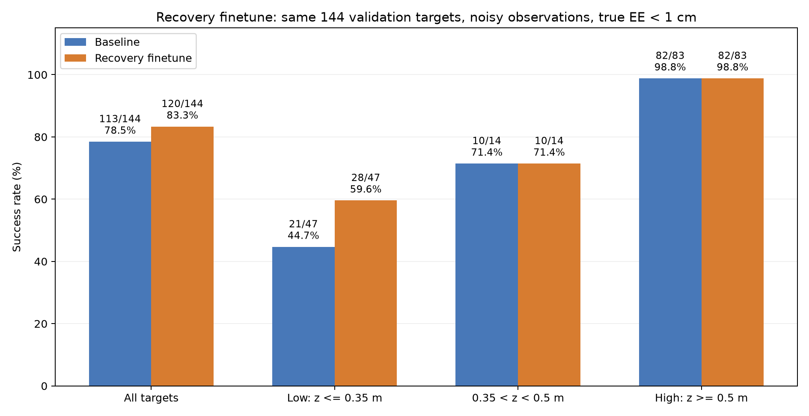

逐目标有**12个失败→成功、5个成功→失败**，不是只增加7个而完全没有退步。总失败数31→24，约减少22.6%；中高组成功数不变也不代表成功坐标完全相同。新增成功示例：`[0.989949,0.989949,0.2]`、`[1.8,0,0.2]`、`[-1.4,0,0.35]`。所有成对结果及12／5坐标见本次核验快照。

本次最重要的观察是：**原专家轨迹上的验证动作MSE略高，闭环1cm达标次数却提高，且收益集中在本来困难的低高度。** 恢复状态上的监督为策略补充了原正常轨迹较少覆盖的修正动作。这与结果一致，但仍需相同预算、恢复比例为0的继续训练闭环对照，才能分离恢复示范与额外训练本身的贡献；该对照尚未完成。

本成绩是同一开发验证集、每目标一组噪声种子的结果。没有在这里新增156目标最终测试成绩，也没有多种子统计，不能表述成任意位置的稳健泛化成功率。

## 54 严重失败案例：底盘未跨过停车阶段阈值

成功率提高的同时，整体平均最终误差从**22.51mm增至29.97mm**。主要异常点：`[-0.893461,0.542858,0.462578]`，seed10049。恢复版最终真实末端误差2.3439m，最小0.2879m。原基线在同一点也失败，最终0.1099m，因此它**不属于新增5个“原成功→新失败”目标**，而是失败严重程度明显扩大。

用户在GUI中看到先转向、后续持续“漂移”。读取`episode_124.npz`，与原基线对比如下：

| 项目 | 原基线 | 恢复微调 |
|---|---|---|
| `align→drive` | 2.740s | 2.740s |
| `drive→orient` | 5.140s | **20s内未发生** |
| `orient→done` | 5.841s | **未完成导航** |
| 带噪底盘观测到停车点的最近距离 | 6.216cm | **8.042cm** |
| 最终底盘到停车点的观测距离 | 约8.01cm | **约2.86m** |
| 机械臂原始力矩超过±30的步数 | 本表未作比较 | **0** |

停车点约为`[-0.325966,0.198054]`。规则中的底盘距离门槛是小于8cm；恢复版观测最近值只差约0.42mm。注意这是**带噪底盘观测距离和导航阶段门槛**，不是末端真实1cm成功标准，也不能把0.42mm解释成真实物理位置的精确差值。`drive`还可以在距离<15cm且已越过目标方向时退出，本次该条件也没有触发；导航超时25s长于本次20s评估，因此未由超时进入done。

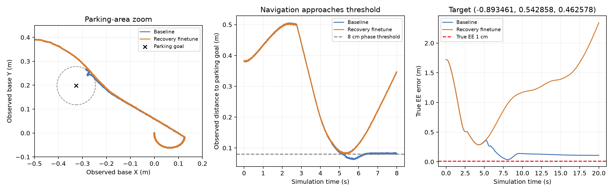

恢复版一直保留`base_active=1`及`drive`阶段，并持续收到非零轮速；不能只凭画面将其归为轮子停止后的惯性滑行。真实与观测末端误差几乎重合，也不支持将米级偏离简单归为毫米级测量误差。当前日志支持“导航阶段未切换、学习轮速继续驱动并偏离”的描述，不能证明接触、摩擦或机械臂反作用中的哪项是根本原因。

导航权重没有改变，但机械臂策略也参与整机物理闭环，细小的姿态／力矩变化可能影响底盘路径和规则触发。两条轨迹在停车点附近已有毫米级差异；仅凭现有对照还不能单独归因于机械臂反作用或某一次噪声。我们没有为让此点成功而放宽阈值、强制停车、改变配置或篡改成功标准。

现有恢复采集要求导航先done、末端在1～5cm附近停滞，不能覆盖该类导航阶段失败。这个案例说明机械臂纠偏改善之外，导航在停车点附近的闭环与阶段切换仍有薄弱点；未来可独立诊断底盘恢复，不把它混成“机械臂低高度完全没有学会”。

## 55 当前结论与保留的边界

**可以确认的进步：** 在相同144目标、相同噪声种子和真实1cm标准下，恢复示范混合微调后的第138轮模型达到120/144，较原113/144净增加7个，低高度组净增加7个。网络结构和输入维度没有增加，最终模型不依赖专家接管。这是明确的本验证协议下改善，值得保留为当前成功率更高的候选。

**仍保留的问题：** 有5个原成功目标退步；一个原本就失败的点出现严重导航偏离，平均最终距离变差。102条恢复片段是按特定触发条件收集的，不涵盖所有失败类型。新增数据和额外训练的独立贡献尚未通过匹配预算对照分离；没有多噪声种子和156点最终测试结论，不宣称统计显著性、普遍稳定或新的算法原创性。

原113/144模型保留为比较基线；第138轮恢复模型保留为当前带噪验证成功率更高的候选。后续优先检查导航近停车点失败机制，并在模型选择固定后用独立测试集检验，而不是仅追逐原轨迹MSE或继续增加网络复杂度。

原始来源、源文件哈希、完整成对结果和导航案例统计见[本阶段核验快照](阶段核验快照_20261104_恢复示范.json)及[结果核验索引](结果核验索引.md)。本次整理只读取既有实验文件、重算静态指标和绘制统计图，未启动新训练、仿真或采集；原Word、模型、配置和数据保留。


## 56 在线TD3残差强化学习：两版负结果

在恢复示范监督微调之后，尝试冻结120版机械臂与原导航，额外训练26→64→64→7的TD3力矩修正。critic只训练时使用，不将真实末端作为策略输入。完整设置、退化证据、对照边界和后续判断见[RL残差强化学习失败记录](RL残差强化学习_失败分析_20261104.md)，原始结果与哈希见[RL核验快照](RL残差核验快照_20261104.json)。

| 试验 | 完成情况 | 观察与结论 |
|---|---|---|
| V1：±2Nm、导航后全阶段修正 | 20,000交互步，38回合，400.23s | 训练前6回合零提案＋探索5/6保持成功，后续31个进入机械臂阶段回合0/31；单点无动作探索测试约14.2cm，修正RMS1.89Nm。出现退化，未做完整144点RL评估 |
| V2：±0.3Nm、观测5cm近区平滑门控、物理时间折扣、critic预热与验证选优 | 15,370步、52回合、819.14s早停 | 固定8点同种子验证7/8→6/8→3/8→4/8；最佳仍为第0步，已确认best actor等于初始零修正。7/8不能算RL提升或完整验证成功率 |

V1未做阶段验证，`best_model.pt`只是最后策略；V2允许初始零修正参与选模，连续3次未改善后早停。V2的保护机制保住基线输出，但没有让RL学出有效提升。现阶段暂停继续堆步数，不把本项目两版试验失败泛化为强化学习方法整体无效，也不认为从零全RL会自动更容易。

本轮RL固定父模型为恢复版`run_20261104_152933_829681`，没有覆盖原模型。补充核验：该父模型在后续带噪156目标独立测试已取得132/156＝84.62%，0进程错误、4进程约505s；这属于恢复示范监督微调，不能归给RL。源目录为`parallel_aux_b2_noise_truth_test_20261104_164047_200174`。

本次记录只追加RL失败和必要的父模型评估背景；前文历史试验和其他监督残差候选保留，不重新排名，不启动新训练或仿真。

## 57 发布后补记：关闭噪声与独立测试

恢复120版第138轮在无噪声144点取得119/144＝82.64%；相同模型带噪为120/144＝83.33%。仅一次噪声种子，不能据此宣称噪声提高成功率。其带噪156点独立测试为132/156＝84.62%，0进程错误，约505s、4进程。该成绩只属于恢复微调模型，不能归给后来残差、RL或Transformer。

## 58 冻结基础MLP：两次监督残差

R1冻结113版，从零训练有界7维力矩修正；原数据与恢复数据混合。最佳94轮，平衡验证MSE0.013360，带噪118/144＝81.94%。比冻结父模型多5个（+3.47个百分点），但比同数据整网恢复微调的120少2个。不能简单说“残差完全失败”；本次在保留父模型的前提下确有收益，但逊于整网更新。

R2改为冻结恢复120版，从零训练新的残差网络，最佳43轮，平衡验证MSE0.013019，带噪122/144＝84.72%。同目标同种子比120净多2个（+1.39个百分点），实际10个失败变成功、8个成功变失败。因此是单次验证小幅收益，没有多种子显著性，也未完成该122候选的156点测试。两次冻结父模型和各自残差不能混装。

## 59 CNN＋Transformer直接力矩模型

在两版TD3失败后，重新检验纯学习的时序架构。输入同一底盘yaw坐标26维，16帧按10ms间隔覆盖150ms；因果CNN26→64→128，2层4头Transformer、特征128、前馈256、dropout0.1，末端线性头输出7力矩，共305,991参数。无新增PD、IK或专家接管。导航固定。

模型从零训练，使用原698训练目标及已有102恢复片段；80%原数据、20%恢复。恢复片段前150帧只作上下文，不监督缺失接管前历史。训练使用GPU按索引构造窗口、支持bf16；验证与正式推理float32。默认固定每10ms验证一个端点，共148,315个，覆盖全部144个验证目标；该离线MSE与旧逐1ms全帧MSE不能直接当同一统计量比较。

正式运行`run_20261104_221010_025438`最佳86轮、末轮101，平衡验证MSE0.01387468。闭环评估计划144点，但前32个低高度点全失败，用户要求停止。终止时38点完成、2点成功、0已完成进程错误，其余106未完成；主summary的完整成功率为null。2/38＝5.26%仅描述已完成部分，既不写成2/144，也不外推为所有高度表现。CNN-only只是实现了对照入口，没有正式训练结果。

抽查71个保存的rollout帧，重建历史输入并回放预测，与存储力矩一致；没有发现这些抽查帧的历史窗口错位。这不是排除全部实现问题的证明，也没有定位退化的唯一原因。所有检查点、CSV、停止标记和源码保留。此后暂停新训练，转为学习组员成果。

## 60 组员发布版的阅读：高成功率不等于TCN单因素收益

2026-11-05读取用户提供的完整TCN包，并沿`run_model.py`核对真正默认入口。默认StructuredController不是目录里早期的直接力矩TCN。

每帧31维：关节角sin/cos14、关节角速度7、底盘yaw坐标目标3、阶段1、末端误差3、姿态对应重力方向3。20帧，10ms间隔。3层因果卷积，128通道，膨胀1/2/4；网络输出21个运动映射系数（7×3）和7个重力补偿。每个关节有3个学习系数，将末端XYZ误差加权成参考速度。参考速度积分成参考角，固定PD100/30计算最终力矩。

训练损失`L_velocity + 0.2L_gravity + 0.2L_teacher_forced_torque`。速度参考来自记录qd_des_arm；补偿由专家式重建且屏蔽饱和力矩；训练力矩项用记录专家参考角，部署用自积分参考，二者存在不同条件。

此方案算使用机器学习完成控制，是学习模型与固定PD组合的混合控制。它不满足我们此前“7力矩直接由网络产生”的严格自定边界，但不能据此断言违反课程要求。我们后来澄清：需要问TA的是是否允许学习运动参考后用固定PD跟踪。组员README本身明确披露PD，没有依据指责其隐瞒或作弊。

包内统计为同500个新连续目标，带噪3次1486/1500＝99.07%，无噪声一次493/500＝98.60%；逐条JSON计数已重算相符，但本机没有重跑完整2000回合，也没有拿到全部原始测试轨迹。这是不同目标集合、输入、监督和控制结构，不能与我们的144点直接算百分比提升，也不能把收益全部归给TCN。组员原模型与代码作为独立成果在[collaborator目录](../../collaborator/README.md)保存，不并入我们的实验排名。

## 61 截至归档的结论、贡献与未完成项

1. 可复核的带噪验证路线：原MLP106/144→无辅助继续训练113/144→专家恢复混合整网微调120/144→冻结120加监督残差122/144。每一步的目标与种子和逐目标变化见[成对比较JSON](../results/paired_comparisons.json)。
2. 有完整独立156点测试证据的恢复120版为132/156；不将后续122验证版或组员99%替代其测试成绩。
3. 负结果包括B2参考辅助、B3门控无净收益、B4速度辅助退化、两版TD3未学出有效提升、CNN＋Transformer已完成部分退化。GRU小幅收益只在原无噪声协议下成立。
4. 专家恢复数据与额外训练预算的独立贡献没有完成匹配对照；单训练种子、单验证噪声种子下+2个不宣称统计显著。导航停车阈值与整机耦合仍存在严重失败个案。
5. 将模型输出从直接力矩改成运动参考并加PD，是控制结构变化，不能只叫架构换成TCN。模型预测Kp/Kd是讨论过的未来想法，未实施、没有训练模型，不能记成已完成尝试。
6. 本次仅归档、核对文件与指标，不开展新训练。每一次训练都保留原检查点语义：best可能是父模型或零残差；last可能含续训状态；文件名本身不保证性能。

完整源代码、模型、归一化、训练历史、结果summary与CSV、102条恢复片段和组员原包全部建立索引；大体积原始基础数据与全测试rollout不放入本次Git分支。原Word未上传，已整理的完整过程及历史图表在本文和assets中。
